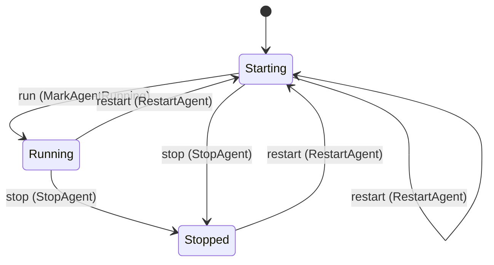
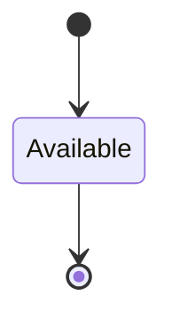

<!--
generated from conductor v1
contract digest slice-sha256/2:8e45add55cfb557268cf92eae4f535186c53eca53544b34b39d05cabb24bdaeb
do not edit: regenerate with `ess generate`
-->

# Agent

An agent kind fills any role at any placement (design docs/design/architecture-next.md § 7, decision 3). A kind is the program that fills a role slot and the way conductor starts, feeds, reads and stops it; `claude-code` is the only kind in v1, with today's session behaviour kept exactly. A kind's capabilities are `Interactive` (a PTY to attach to, a mailbox the runtime delivers into, a hand-over at a context threshold, a terminal log) or `RunToExit` (one unit of work in; an exit code and an events file out). An agent is a role slot filled, `(role, kind, placement, profile, limits)`, started by the instance runtime and named by its instance and its name; the instance API's `agents/{name}/attach`, `deliver` and `restart` routes (§ 5.1) are the kind's trait over HTTP. `conductor.session` stays the `claude-code` kind's behaviour: its scenarios and tests are the pin, and nothing here replaces them.

`conductor.agent` is one of conductor's bounded contexts. [Back to the index](../index.md).

## Types

### `AgentKindName`

`conductor.agent.AgentKindName` wraps `String` and is not interchangeable with one: the whole value of naming it separately is the crossings the model then refuses.

### `AgentName`

`conductor.agent.AgentName` wraps `String` and is not interchangeable with one: the whole value of naming it separately is the crossings the model then refuses.

### `AgentSlotSelection`

`conductor.agent.AgentSlotSelection` is a record of two fields:

- `instance` — `Optional<conductor.config.InstanceName>`, which may be absent
- `role` — `String`

### `AgentTerminalAttach`

`conductor.agent.AgentTerminalAttach` is a record of three fields:

- `instance` — `Optional<conductor.config.InstanceName>`, which may be absent
- `role` — `String`
- `watch` — `Optional<Boolean>`, which may be absent

### `AgentTextDelivery`

`conductor.agent.AgentTextDelivery` is a record of three fields:

- `instance` — `Optional<conductor.config.InstanceName>`, which may be absent
- `role` — `String`
- `text` — `String`

### `Capability`

`conductor.agent.Capability` is one of `Interactive` and `RunToExit`.

### `ExitClass`

`conductor.agent.ExitClass` is one of `Requested`, `UsageLimit` and `Exited`.

### `ShowRole`

`conductor.agent.ShowRole` is a record of one field:

- `role` — `Optional<String>`, which may be absent

Four of the types above are reached by nothing else in this system: `conductor.agent.AgentSlotSelection`, `conductor.agent.AgentTerminalAttach`, `conductor.agent.AgentTextDelivery` and `conductor.agent.ShowRole`. No entity, view, command, event, error or crossing names them, so it is either vocabulary something outside this specification uses or a leftover — and only a person can tell which.

## Entities

An entity is what this context is about: something with an identity that outlives any one request, a shape, and a lifecycle. The lifecycle is exhaustive — a move that is not drawn below is a move this specification does not permit, and that is the only way it says so. Every move is labelled with the command that takes it, because a move nothing can trigger is refused rather than drawn.

### `Agent`

`conductor.agent.Agent`.

An instance is identified by `name`, a `conductor.agent.AgentName`. The name is part of the model and not a convention: a view projects the identity under that name, so a projection inventing its own would disagree with the view.

It holds:

- `instance` — `conductor.config.InstanceName`
- `role` — `conductor.config.RoleName`
- `kind` — `conductor.agent.AgentKindName`
- `capabilities` — `List<conductor.agent.Capability>`
- `box` — `Optional<conductor.placement.BoxId>`, which may be absent
- `profile` — `Optional<String>`, which may be absent
- `limits` — `conductor.config.Limits`
- `token_owner` — `Optional<conductor.operator.OperatorName>`, which may be absent
- `started_by` — `conductor.operator.Actor`
- `started_at` — `Timestamp`
- `generation` — `Integer`
- `stopped_at` — `Optional<Timestamp>`, which may be absent
- `exit_class` — `Optional<conductor.agent.ExitClass>`, which may be absent
- `exit_code` — `Optional<Integer>`, which may be absent

It references at most one [`AgentKind`](#agentkind), as `agent_kind`, carried by `Agent.kind`. It references at most one [`conductor.instance.Instance`](conductor-instance.md#instance), as `instance`, carried by `Agent.instance`. It references at most one [`conductor.placement.Box`](conductor-placement.md#box), as `box`, carried by `Agent.box`.

Every instance satisfies `generation >= 1` — a predicate over this entity's own fields, checked against them rather than stored as a sentence, so an invariant reading something the entity does not have is refused instead of documented.

Its state is a `conductor.agent.Agent.State`, one of `Running`, `Starting` and `Stopped`. That enum is synthesised from the lifecycle rather than declared beside it, so the states a view's filter compares and the states drawn below cannot disagree.

An instance is created in `Starting`. No state is terminal: nothing in this lifecycle says an instance may stop moving.

Each move is taken by a declared command outcome, and a move nothing takes is refused as `missing_causation` rather than left as a state change nobody can trigger:

- `run` — taken by `conductor.agent.MarkAgentRunning` on its `running` outcome
- `stop` — taken by `conductor.agent.StopAgent` on its `stopped` outcome
- `restart` — taken by `conductor.agent.RestartAgent` on its `restarted` outcome

An instance is brought into existence by `conductor.agent.StartAgent` on its `started` outcome.

Illegal transitions are illegal by absence: no rule forbids them, there is simply no arrow, because a rule would be a second place for the same truth to live. A diagram cannot show an absence, so the pairs it does not connect are listed here, derived from the same transitions — anything named below is a move this specification does not permit.

- `Stopped` may not become `Running`

One view projects it: [`Agents`](#agents).

### `AgentKind`

`conductor.agent.AgentKind`.

An instance is identified by `name`, a `conductor.agent.AgentKindName`. The name is part of the model and not a convention: a view projects the identity under that name, so a projection inventing its own would disagree with the view.

It holds:

- `capabilities` — `List<conductor.agent.Capability>`
- `binary` — `String`
- `actor` — `conductor.operator.Actor`

It declares no relation to another entity, and no other entity names it.

No invariant is declared, so nothing here constrains an instance at rest.

Its state is a `conductor.agent.AgentKind.State`, one of `Available`. That enum is synthesised from the lifecycle rather than declared beside it, so the states a view's filter compares and the states drawn below cannot disagree.

An instance is created in `Available`. `Available` is terminal, so an instance may rest there forever. That is declared rather than inferred from having no way out: an entity that cannot leave a state is either finished or stuck, and only its author knows which.

It declares no moves, so nothing changes its state once it exists.

It has one state, so there is no move to permit or to forbid.

One view projects it: [`AgentKinds`](#agentkinds).

## Views

A view is what the outside world is promised it can observe. Each one says which instances it contains and how soon it reflects a command that has already returned, because "you can read this" without "how soon" is the promise every flaky suite is built on.

### `AgentKinds`

`conductor.agent.AgentKinds`, shown to a person as "Agent kinds" and called `agent-kinds` on the wire.

It reads [`AgentKind`](#agentkind).

It contains every instance of that entity: no filter narrows it, which is a decision somebody made and not a line somebody omitted.

It exposes:

- `name` — `conductor.agent.AgentKindName`
- `state` — `conductor.agent.AgentKind.State`
- `capabilities` — `List<conductor.agent.Capability>`
- `binary` — `String`
- `actor` — `conductor.operator.Actor`

It declares no order, so the rows come back in whatever order the implementation has, and two reads may disagree.

**Read-your-writes**: it is current the moment the command that changed it returns. A caller that has just created an invoice and cannot see it in here has been told a lie about what it did.

A generated scenario asserts it once, immediately after the command: a view promising this and not keeping the promise has to fail the suite rather than be retried until it passes.

### `Agents`

`conductor.agent.Agents`, shown to a person as "Agents" and called `agents` on the wire.

It reads [`Agent`](#agent).

It contains every instance of that entity: no filter narrows it, which is a decision somebody made and not a line somebody omitted.

It exposes:

- `name` — `conductor.agent.AgentName`
- `state` — `conductor.agent.Agent.State`
- `instance` — `conductor.config.InstanceName`
- `role` — `conductor.config.RoleName`
- `kind` — `conductor.agent.AgentKindName`
- `capabilities` — `List<conductor.agent.Capability>`
- `box` — `Optional<conductor.placement.BoxId>`, which may be absent
- `profile` — `Optional<String>`, which may be absent
- `limits` — `conductor.config.Limits`
- `token_owner` — `Optional<conductor.operator.OperatorName>`, which may be absent
- `started_by` — `conductor.operator.Actor`
- `started_at` — `Timestamp`
- `generation` — `Integer`
- `stopped_at` — `Optional<Timestamp>`, which may be absent
- `exit_class` — `Optional<conductor.agent.ExitClass>`, which may be absent
- `exit_code` — `Optional<Integer>`, which may be absent

It declares no order, so the rows come back in whatever order the implementation has, and two reads may disagree.

**Read-your-writes**: it is current the moment the command that changed it returns. A caller that has just created an invoice and cannot see it in here has been told a lie about what it did.

A generated scenario asserts it once, immediately after the command: a view promising this and not keeping the promise has to fail the suite rather than be retried until it passes.

## Commands

### `AttachAgent`

`conductor.agent.AttachAgent`, shown to a person as "Attach to an agent" and called `attach` on the wire.

It takes:

- `actor` — `conductor.operator.Actor`
- `name` — `conductor.agent.AgentName`
- `watch` — `Optional<Boolean>`, which may be absent

It has five outcomes.

**`not-interactive`** — The agent's kind has no PTY to attach to; nothing was opened. Taken when the existing subject's stored fields satisfy `not (exists c in capabilities: (c == Interactive))`. No entity in this specification changes. It reports `conductor.agent.CapabilityMissing`, carrying `name` and `capability`. It emits nothing. A test establishes and independently observes the subject enum fact before selecting this branch.

**`not-running`** — The agent is stopped; nothing was opened. Taken when the existing subject's stored fields satisfy `state == Stopped`. No entity in this specification changes. It reports `conductor.agent.AgentNotRunning`, carrying `name`. It emits nothing. A test establishes and independently observes the subject enum fact before selecting this branch.

**`unreachable`** — Nothing was opened; the caller names the agent. Decided outside the input: the agent's PTY does not answer. No predicate over the input reaches this branch, and saying `when: false` instead would have claimed it is unreachable, which is a different and false statement. No entity in this specification changes. It reports `conductor.agent.AgentNotReachable`, carrying `name`. It emits nothing. A test reaches it by injecting the declared fault, because no input can.

**`attached`** — The caller holds the agent's PTY stream, read-only with `watch`. The default branch, taken when no other outcome's condition matched. It preserves the existing subject, without an error or event. The instance is the one named by the input field `name`. It emits nothing. A test reaches it by constructing an input that satisfies no other outcome's condition.

**`no-such-agent`** — No agent of that name; nothing was opened. Taken when the identity the command names is one no record carries, before any other answer for it. No entity in this specification changes. It reports `conductor.agent.AgentNotFound`, carrying `name`. It emits nothing. A test reaches it by sending an identity no record carries, arranging nothing.

### `DeclareAgentKind`

`conductor.agent.DeclareAgentKind`, shown to a person as "Declare an agent kind" and called `declare-kind` on the wire.

It takes:

- `actor` — `conductor.operator.Actor`
- `name` — `conductor.agent.AgentKindName`
- `capabilities` — `List<conductor.agent.Capability>`
- `binary` — `String`

It has two outcomes.

**`declared`** — The kind is on record with its capabilities and its program. Taken when no record carries the identity the command names, and no input-guarded refusal applies; it creates that record. It creates a `conductor.agent.AgentKind`, which starts in `Available`. The new instance's identity is published as `name` on `conductor.agent.AgentKindDeclared`. It emits `conductor.agent.AgentKindDeclared`. It sets `capabilities` from `input.capabilities`, `binary` from `input.binary` and `actor` from `input.actor`. A test reaches it by sending an identity no record carries, arranging nothing.

**`redeclared`** — The kind was on record; it now holds what the binary says. The default branch, taken when no other outcome's condition matched. It changes a `conductor.agent.AgentKind` without moving it along its lifecycle. The instance is the one named by the input field `name`. It emits `conductor.agent.AgentKindDeclared`. It sets `capabilities` from `input.capabilities`, `binary` from `input.binary` and `actor` from `input.actor`. A test reaches it by constructing an input that satisfies no other outcome's condition.

### `DeliverToAgent`

`conductor.agent.DeliverToAgent`, shown to a person as "Deliver a text to an agent" and called `deliver` on the wire.

It takes:

- `actor` — `conductor.operator.Actor`
- `name` — `conductor.agent.AgentName`
- `first_line` — `String`
- `body_path` — `Optional<String>`, which may be absent

It has five outcomes.

**`not-interactive`** — The agent's kind is not interactive; nothing was delivered. Taken when the existing subject's stored fields satisfy `not (exists c in capabilities: (c == Interactive))`. No entity in this specification changes. It reports `conductor.agent.CapabilityMissing`, carrying `name` and `capability`. It emits nothing. A test establishes and independently observes the subject enum fact before selecting this branch.

**`not-running`** — The agent is stopped; nothing was delivered. Taken when the existing subject's stored fields satisfy `state == Stopped`. No entity in this specification changes. It reports `conductor.agent.AgentNotRunning`, carrying `name`. It emits nothing. A test establishes and independently observes the subject enum fact before selecting this branch.

**`unreachable`** — Nothing was typed; the caller names the agent and does not retry in a loop. Decided outside the input: the agent's PTY does not answer. No predicate over the input reaches this branch, and saying `when: false` instead would have claimed it is unreachable, which is a different and false statement. No entity in this specification changes. It reports `conductor.agent.AgentNotReachable`, carrying `name`. It emits nothing. A test reaches it by injecting the declared fault, because no input can.

**`delivered`** — The text is in front of the agent. The default branch, taken when no other outcome's condition matched. It preserves the existing subject, without an error or event. The instance is the one named by the input field `name`. It emits nothing. A test reaches it by constructing an input that satisfies no other outcome's condition.

**`no-such-agent`** — No agent of that name; nothing was delivered. Taken when the identity the command names is one no record carries, before any other answer for it. No entity in this specification changes. It reports `conductor.agent.AgentNotFound`, carrying `name`. It emits nothing. A test reaches it by sending an identity no record carries, arranging nothing.

### `MarkAgentRunning`

`conductor.agent.MarkAgentRunning`, shown to a person as "Mark an agent running" and called `mark-running` on the wire.

It takes:

- `actor` — `conductor.operator.Actor`
- `name` — `conductor.agent.AgentName`
- `running_at` — `Timestamp`

It has three outcomes.

**`running`** — The agent's program is up; the agent runs. The default branch, taken when no other outcome's condition matched. It moves a `conductor.agent.Agent` from `Starting` to `Running`, along the declared move `run`. The instance is the one named by the input field `name`. It emits `conductor.agent.AgentRunning`. A test reaches it by constructing an input that satisfies no other outcome's condition.

**`no-such-agent`** — No agent of that name; nothing changed. Taken when the identity the command names is one no record carries, before any other answer for it. No entity in this specification changes. It reports `conductor.agent.AgentNotFound`, carrying `name`. It emits nothing. A test reaches it by sending an identity no record carries, arranging nothing.

**`not-starting`** — The agent is not starting (running already, or stopped); nothing changed. Taken when the subject is resting in a state none of this command's moves start from — a `conductor.agent.Agent` in `Running` and `Stopped`, which is what is left of the lifecycle once this command's own moves are taken away. The document lists none of it. No entity in this specification changes. It reports `conductor.agent.AgentNotRunning`, carrying `name`. It emits nothing. A test reaches it by driving an instance into one of those states and then issuing the command, because no input selects this branch.

### `RecordAgentReport`

`conductor.agent.RecordAgentReport`, shown to a person as "Record an agent's report" and called `record-report` on the wire.

It takes:

- `actor` — `conductor.operator.Actor`
- `name` — `conductor.agent.AgentName`
- `line` — `String`
- `exit_code` — `Optional<Integer>`, which may be absent
- `events_path` — `Optional<String>`, which may be absent
- `reported_at` — `Timestamp`

It has two outcomes.

**`reported`** — The report is on record against the agent. The default branch, taken when no other outcome's condition matched. It changes a `conductor.agent.Agent` without moving it along its lifecycle. The instance is the one named by the input field `name`. It emits `conductor.agent.AgentReported`. A test reaches it by constructing an input that satisfies no other outcome's condition.

**`no-such-agent`** — No agent of that name; nothing was recorded. Taken when the identity the command names is one no record carries, before any other answer for it. No entity in this specification changes. It reports `conductor.agent.AgentNotFound`, carrying `name`. It emits nothing. A test reaches it by sending an identity no record carries, arranging nothing.

### `RestartAgent`

`conductor.agent.RestartAgent`, shown to a person as "Restart an agent" and called `restart` on the wire.

It takes:

- `actor` — `conductor.operator.Actor`
- `name` — `conductor.agent.AgentName`
- `token_owner` — `Optional<conductor.operator.OperatorName>`, which may be absent
- `started_at` — `Timestamp`

It has three outcomes.

**`launch-failed`** — The program did not come up again; the record is unchanged. Decided outside the input: the kind's start in the box failed, or its first prompt could not be delivered. No predicate over the input reaches this branch, and saying `when: false` instead would have claimed it is unreachable, which is a different and false statement. No entity in this specification changes. It reports `conductor.agent.AgentLaunchFailed`, carrying `name`. It emits nothing. A test reaches it by injecting the declared fault, because no input can.

**`restarted`** — The agent runs again as its next generation. The default branch, taken when no other outcome's condition matched. It moves a `conductor.agent.Agent` from `Running`, `Starting` and `Stopped` to `Starting`, along the declared move `restart`. The instance is the one named by the input field `name`. It emits `conductor.agent.AgentStarted`. It sets `token_owner` from `input.token_owner`, `started_at` from `input.started_at`, `generation` from `its previous value plus 1`, `stopped_at` cleared, `exit_class` cleared and `exit_code` cleared. A test reaches it by constructing an input that satisfies no other outcome's condition.

**`no-such-agent`** — No agent of that name; nothing was started. Taken when the identity the command names is one no record carries, before any other answer for it. No entity in this specification changes. It reports `conductor.agent.AgentNotFound`, carrying `name`. It emits nothing. A test reaches it by sending an identity no record carries, arranging nothing.

### `StartAgent`

`conductor.agent.StartAgent`, shown to a person as "Start an agent" and called `start` on the wire.

It takes:

- `actor` — `conductor.operator.Actor`
- `name` — `conductor.agent.AgentName`
- `instance` — `conductor.config.InstanceName`
- `role` — `conductor.config.RoleName`
- `kind` — `conductor.agent.AgentKindName`
- `capabilities` — `List<conductor.agent.Capability>`
- `box` — `Optional<conductor.placement.BoxId>`, which may be absent
- `profile` — `Optional<String>`, which may be absent
- `limits` — `conductor.config.Limits`
- `token_owner` — `Optional<conductor.operator.OperatorName>`, which may be absent
- `started_at` — `Timestamp`

It has four outcomes.

**`unknown-kind`** — The binary implements no such kind; nothing was started. Taken when no `conductor.agent.AgentKind` carries the identity `input.kind` names. No entity in this specification changes. It reports `conductor.agent.UnknownAgentKind`, carrying `kind`. It emits nothing. A test reaches it by arranging the row of the other entity the input names, or its absence, and sending the command for it.

**`launch-failed`** — The program did not come up; no agent is on record. Decided outside the input: the kind's start in the box failed, or its first prompt could not be delivered. No predicate over the input reaches this branch, and saying `when: false` instead would have claimed it is unreachable, which is a different and false statement. No entity in this specification changes. It reports `conductor.agent.AgentLaunchFailed`, carrying `name`. It emits nothing. A test reaches it by injecting the declared fault, because no input can.

**`started`** — The agent runs in its role, generation 1, naming who started it and whose token it runs on.
 The default branch, taken when no other outcome's condition matched. It creates a `conductor.agent.Agent`, which starts in `Starting`. The new instance's identity is published as `name` on `conductor.agent.AgentStarted`. It emits `conductor.agent.AgentStarted`. It sets `instance` from `input.instance`, `role` from `input.role`, `kind` from `input.kind`, `capabilities` from `input.capabilities`, `box` from `input.box`, `profile` from `input.profile`, `limits` from `input.limits`, `token_owner` from `input.token_owner`, `started_by` from `input.actor`, `started_at` from `input.started_at`, `generation` from `"1"`, `stopped_at` cleared, `exit_class` cleared and `exit_code` cleared. A test reaches it by constructing an input that satisfies no other outcome's condition.

**`exists`** — An agent of that name is on record; nothing was started, the record unchanged. Taken when a record already carries the identity the command's creating branch would create, and no input-guarded refusal applies. No entity in this specification changes. It reports `conductor.agent.AgentExists`, carrying `name`. It emits nothing. A test reaches it by sending the command twice with one identity: the first call creates the record, the second is answered by this branch.

### `StopAgent`

`conductor.agent.StopAgent`, shown to a person as "Stop an agent" and called `stop` on the wire.

It takes:

- `actor` — `conductor.operator.Actor`
- `name` — `conductor.agent.AgentName`
- `exit_class` — `conductor.agent.ExitClass`
- `exit_code` — `Optional<Integer>`, which may be absent
- `stopped_at` — `Timestamp`

It has three outcomes.

**`stopped`** — The agent is stopped, with why and, for an exit, its code. The default branch, taken when no other outcome's condition matched. It moves a `conductor.agent.Agent` from `Running` and `Starting` to `Stopped`, along the declared move `stop`. The instance is the one named by the input field `name`. It emits `conductor.agent.AgentStopped`. It sets `stopped_at` from `input.stopped_at`, `exit_class` from `input.exit_class` and `exit_code` from `input.exit_code`. A test reaches it by constructing an input that satisfies no other outcome's condition.

**`no-such-agent`** — No agent of that name; nothing was stopped. Taken when the identity the command names is one no record carries, before any other answer for it. No entity in this specification changes. It reports `conductor.agent.AgentNotFound`, carrying `name`. It emits nothing. A test reaches it by sending an identity no record carries, arranging nothing.

**`not-running`** — The agent is stopped already; nothing changed. Taken when the subject is resting in a state none of this command's moves start from — a `conductor.agent.Agent` in `Stopped`, which is what is left of the lifecycle once this command's own moves are taken away. The document lists none of it. No entity in this specification changes. It reports `conductor.agent.AgentNotRunning`, carrying `name`. It emits nothing. A test reaches it by driving an instance into one of those states and then issuing the command, because no input selects this branch.

## Events

### `AgentKindDeclared`

`conductor.agent.AgentKindDeclared`.

It carries:

- `actor` — `conductor.operator.Actor`
- `name` — `conductor.agent.AgentKindName`
- `capabilities` — `List<conductor.agent.Capability>`
- `binary` — `String`

Emitted by `conductor.agent.DeclareAgentKind` on its `declared` and `redeclared` outcomes.

Nothing in this system reacts to it.

### `AgentReported`

`conductor.agent.AgentReported`.

It carries:

- `actor` — `conductor.operator.Actor`
- `name` — `conductor.agent.AgentName`
- `line` — `String`
- `exit_code` — `Optional<Integer>`, which may be absent
- `events_path` — `Optional<String>`, which may be absent
- `reported_at` — `Timestamp`

Emitted by `conductor.agent.RecordAgentReport` on its `reported` outcome.

Nothing in this system reacts to it.

### `AgentRunning`

`conductor.agent.AgentRunning`.

It carries:

- `actor` — `conductor.operator.Actor`
- `name` — `conductor.agent.AgentName`
- `running_at` — `Timestamp`

Emitted by `conductor.agent.MarkAgentRunning` on its `running` outcome.

Nothing in this system reacts to it.

### `AgentStarted`

`conductor.agent.AgentStarted`.

It carries:

- `actor` — `conductor.operator.Actor`
- `name` — `conductor.agent.AgentName`
- `instance` — `conductor.config.InstanceName`
- `role` — `conductor.config.RoleName`
- `kind` — `conductor.agent.AgentKindName`
- `box` — `Optional<conductor.placement.BoxId>`, which may be absent
- `token_owner` — `Optional<conductor.operator.OperatorName>`, which may be absent
- `started_at` — `Timestamp`

Emitted by `conductor.agent.RestartAgent` on its `restarted` outcome.

Emitted by `conductor.agent.StartAgent` on its `started` outcome.

Nothing in this system reacts to it.

### `AgentStopped`

`conductor.agent.AgentStopped`.

It carries:

- `actor` — `conductor.operator.Actor`
- `name` — `conductor.agent.AgentName`
- `exit_class` — `conductor.agent.ExitClass`
- `exit_code` — `Optional<Integer>`, which may be absent
- `stopped_at` — `Timestamp`

Emitted by `conductor.agent.StopAgent` on its `stopped` outcome.

Nothing in this system reacts to it.

## Errors

### `AgentExists`

An agent of that name is on record already; a stopped one is started again with `RestartAgent`. Nothing was started.

It carries:

- `name` — `conductor.agent.AgentName`

Reported by `conductor.agent.StartAgent` on its `exists` outcome.

### `AgentLaunchFailed`

The kind's start failed (the program did not come up in the box, or its first prompt could not be delivered), so no agent is on record.

It carries:

- `name` — `conductor.agent.AgentName`

Reported by `conductor.agent.RestartAgent` on its `launch-failed` outcome.

Reported by `conductor.agent.StartAgent` on its `launch-failed` outcome.

### `AgentNotFound`

No agent of that name is on record; nothing was done.

It carries:

- `name` — `conductor.agent.AgentName`

Reported by `conductor.agent.AttachAgent` on its `no-such-agent` outcome.

Reported by `conductor.agent.DeliverToAgent` on its `no-such-agent` outcome.

Reported by `conductor.agent.MarkAgentRunning` on its `no-such-agent` outcome.

Reported by `conductor.agent.RecordAgentReport` on its `no-such-agent` outcome.

Reported by `conductor.agent.RestartAgent` on its `no-such-agent` outcome.

Reported by `conductor.agent.StopAgent` on its `no-such-agent` outcome.

### `AgentNotReachable`

The agent is on record as running, but its PTY does not answer (for the `claude-code` kind: no tmux server on its launcher socket, and, for a delivery, no live background session of its name whose attach client took the text), so nothing was typed or opened; the caller is told which agent, and does not retry in a loop.

It carries:

- `name` — `conductor.agent.AgentName`

Reported by `conductor.agent.AttachAgent` on its `unreachable` outcome.

Reported by `conductor.agent.DeliverToAgent` on its `unreachable` outcome.

### `AgentNotRunning`

The agent is stopped, so nothing reached it and nothing changed.

It carries:

- `name` — `conductor.agent.AgentName`

Reported by `conductor.agent.AttachAgent` on its `not-running` outcome.

Reported by `conductor.agent.DeliverToAgent` on its `not-running` outcome.

Reported by `conductor.agent.MarkAgentRunning` on its `not-starting` outcome.

Reported by `conductor.agent.StopAgent` on its `not-running` outcome.

### `CapabilityMissing`

The agent's kind lacks the capability the command needs, named here (`Interactive` for attach and deliver), so nothing was done.

It carries:

- `name` — `conductor.agent.AgentName`
- `capability` — `conductor.agent.Capability`

Reported by `conductor.agent.AttachAgent` on its `not-interactive` outcome.

Reported by `conductor.agent.DeliverToAgent` on its `not-interactive` outcome.

### `UnknownAgentKind`

The binary implements no kind of that name, so nothing was started.

It carries:

- `kind` — `conductor.agent.AgentKindName`

Reported by `conductor.agent.StartAgent` on its `unknown-kind` outcome.

## Actors

An actor is who may ask this context for something. Every grant below points at a command this specification declares — a grant is a resolved reference, so "may invoke" something nobody wrote is not a permission this model can express, and an authorisation that authorises nothing cannot ship quietly.

### `Controller`

`conductor.agent.Controller`, shown to a person as "Controller".

It may invoke [`AttachAgent`](#attachagent) and [`DeliverToAgent`](#delivertoagent).

It may read [`AgentKinds`](#agentkinds) and [`Agents`](#agents), which an actor whose grant does not name it may not read.

### `InstanceRuntime`

`conductor.agent.InstanceRuntime`, shown to a person as "Instance runtime".

It may invoke [`DeclareAgentKind`](#declareagentkind), [`DeliverToAgent`](#delivertoagent), [`MarkAgentRunning`](#markagentrunning), [`RecordAgentReport`](#recordagentreport), [`RestartAgent`](#restartagent), [`StartAgent`](#startagent) and [`StopAgent`](#stopagent).

It may read [`AgentKinds`](#agentkinds) and [`Agents`](#agents), which an actor whose grant does not name it may not read.

### `Operator`

`conductor.agent.Operator`, shown to a person as "Operator".

It may invoke [`AttachAgent`](#attachagent), [`DeliverToAgent`](#delivertoagent), [`RestartAgent`](#restartagent) and [`StopAgent`](#stopagent).

It may read [`AgentKinds`](#agentkinds) and [`Agents`](#agents), which an actor whose grant does not name it may not read.

---

Generated from conductor v1 · contract digest `slice-sha256/2:8e45add55cfb557268cf92eae4f535186c53eca53544b34b39d05cabb24bdaeb`. Do not edit this file; change the specification and regenerate it with `ess generate`.
