<!--
generated from conductor v1
contract digest slice-sha256/2:9878b375931c36b2e9b022667caef55368766c2bde3f0836a6f9846ef72e3ebb
do not edit: regenerate with `ess generate`
-->

# Config

The one file conductord reconciles from, `conductor.config/2`, read from `--config`, else the `conductor-config` setting, else ~/.b10x/conductor/conductor.yaml (story:config-file; docs/design/architecture-next.md § 9). It holds the `daemon` section (its port, TLS listener, reconcile cadence, the one store URL, the secrets source, the dashboard's served path and its operators), `globals` (the defaults every instance starts from) and `instances[]`. An instance is one organization conductor runs: its placement, where its repositories come from, where their checkouts are, where conductor keeps its records, state and cache, which kind and model each role runs on, its cadence, thresholds, reports, and who decides each decision class; every key an instance or a role writes overrides the global one. Precedence is role over instance over global (`Level`), and `EffectiveSettings` shows every key with its effective value and the level it came from. These types hold the effective config, after defaults; the file may leave out every key of an instance but its name, its sources and its checkouts. No field takes a secret: the file names one as `secret:<name>` (`conductor.secret.SecretName`). The config is desired state and is not kept in the store (§ 8); every change through `PutConfig` is validated, written, committed with its actor and reason, recorded as `ConfigChanged` and reconciled. A `conductor.config/1` file is read once by `conductor config migrate`.

`conductor.config` is one of conductor's bounded contexts. [Back to the index](../index.md).

## Types

### `ActivityChange`

`conductor.config.ActivityChange` is a record of three fields:

- `repository` — `conductor.direction.MarkedRepository`
- `activity` — `conductor.direction.Activity`
- `reason` — `String`

### `Authority`

`conductor.config.Authority` is a record of two fields:

- `class_c` — `conductor.decision.Decider`
- `class_o` — `conductor.decision.Decider`

### `Cadence`

`conductor.config.Cadence` is a record of four fields:

- `cycle` — `Duration`
- `daily` — `conductor.config.TimeOfDay`
- `watch` — `Duration`
- `ci` — `Duration`

### `Catalog`

`conductor.config.Catalog` is a record of three fields:

- `repository` — `String`
- `path` — `String`
- `names` — `conductor.config.CatalogNames`

### `CatalogNames`

`conductor.config.CatalogNames` is one of `Plain` and `Hex`.

### `ChangeConfig`

`conductor.config.ChangeConfig` is a record of six fields:

- `level` — `String`
- `instance` — `Optional<String>`, which may be absent
- `role` — `Optional<String>`, which may be absent
- `path` — `String`
- `value` — `Optional<String>`, which may be absent
- `reason` — `String`

### `Checkouts`

`conductor.config.Checkouts` is a record of two fields:

- `root` — `String`
- `trees` — `String`

### `CommandWord`

`conductor.config.CommandWord` wraps `String` and is not interchangeable with one: the whole value of naming it separately is the crossings the model then refuses. Its characters are drawn from `ABCDEFGHIJKLMNOPQRSTUVWXYZabcdefghijklmnopqrstuvwxyz0123456789._:/-`.

### `ConductorSession`

`conductor.config.ConductorSession` is a record of two fields:

- `served_by` — `Optional<conductor.config.InstanceName>`, which may be absent
- `session_name` — `Optional<conductor.config.SessionName>`, which may be absent

### `Config`

`conductor.config.Config` is a record of five fields:

- `version` — `String`
- `daemon` — `conductor.config.Daemon`
- `globals` — `conductor.config.Globals`
- `default` — `Optional<conductor.config.InstanceName>`, which may be absent
- `instances` — `List<conductor.config.Instance>`

Every value satisfies `version == "conductor.config/2"`, `(defined(daemon.kubernetes) or instances.count >= 1)`, `(not (defined(daemon.kubernetes)) or forall instance in instances: (instance.name.count <= 39))`, `distinct instance in instances by instance.name`, `distinct instance in instances by instance.session_prefix`, `distinct instance in instances by instance.state`, `distinct instance in instances by instance.records` and `(not (defined(default)) or exists instance in instances: (instance.name == default))`.

### `ConfigChange`

`conductor.config.ConfigChange` is a record of two fields:

- `path` — `String`
- `value` — `Optional<String>`, which may be absent

### `ConfigEffect`

`conductor.config.ConfigEffect` is one of `WatchTick`, `Cycle`, `LoopRestart` and `Fixed`.

### `ConfigField`

`conductor.config.ConfigField` is a record of four fields:

- `path` — `String`
- `value` — `String`
- `default` — `Optional<String>`, which may be absent
- `takes_effect` — `conductor.config.ConfigEffect`

### `ConfigInstance`

`conductor.config.ConfigInstance` is a record of four fields:

- `name` — `conductor.config.InstanceName`
- `session_prefix` — `Optional<conductor.config.SessionPrefix>`, which may be absent
- `forge` — `String`
- `current` — `Boolean`

### `ConfigPage`

`conductor.config.ConfigPage` is a record of seven fields:

- `file` — `String`
- `instance` — `conductor.config.InstanceName`
- `index` — `Integer`
- `fields` — `List<conductor.config.ConfigField>`
- `instances` — `List<conductor.config.ConfigInstance>`
- `repositories` — `List<conductor.direction.RepositoryActivityRow>`
- `errors` — `List<String>`

Every value satisfies `index >= 0`.

### `ConfigProblem`

`conductor.config.ConfigProblem` is a record of two fields:

- `path` — `String`
- `message` — `String`

### `ConfigWriteRefusal`

`conductor.config.ConfigWriteRefusal` is one of `NotThisPage`, `TokenMissing`, `Invalid`, `ReasonMissing`, `NothingStaged` and `NoConfigFile`.

### `ConfigWriteRefused`

`conductor.config.ConfigWriteRefused` is a record of three fields:

- `refusal` — `conductor.config.ConfigWriteRefusal`
- `detail` — `String`
- `problems` — `List<conductor.config.ConfigProblem>`

### `ConfigWritten`

`conductor.config.ConfigWritten` is a record of five fields:

- `diff` — `String`
- `restart` — `Boolean`
- `backup` — `Optional<String>`, which may be absent
- `decision_id` — `Optional<conductor.decision.DecisionId>`, which may be absent
- `problems` — `List<conductor.config.ConfigProblem>`

### `Controllers`

`conductor.config.Controllers` is a record of three fields:

- `max_working` — `Integer`
- `max_subagents` — `Integer`
- `max_open_reviews` — `Integer`

Every value satisfies `max_working >= 1`, `max_subagents >= 1` and `max_open_reviews >= 0`.

### `Daemon`

`conductor.config.Daemon` is a record of 15 fields:

- `port` — `Integer`
- `loopback` — `Boolean`
- `tls` — `Optional<conductor.config.TlsListener>`, which may be absent
- `cadence` — `conductor.config.DaemonCadence`
- `store` — `conductor.store.StoreUrl`
- `secrets` — `conductor.config.SecretsSource`
- `dashboard` — `String`
- `operators` — `List<conductor.config.DaemonOperator>`
- `upgrade_timeout` — `Duration`
- `timeout` — `Duration`
- `substrate_slots` — `Integer`
- `unattended` — `Boolean`
- `address` — `String`
- `kubernetes` — `Optional<conductor.config.Kubernetes>`, which may be absent
- `control_token` — `Optional<conductor.secret.SecretName>`, which may be absent

Every value satisfies `port >= 1`, `port <= 65535`, `substrate_slots >= 0` and `distinct operator in operators by operator.name`.

### `DaemonCadence`

`conductor.config.DaemonCadence` is a record of one field:

- `reconcile` — `Duration`

### `DaemonConfig`

`conductor.config.DaemonConfig` is a record of two fields:

- `version` — `String`
- `daemon` — `conductor.config.Daemon`

Every value satisfies `version == "conductor.config/2"`.

### `DaemonOperator`

`conductor.config.DaemonOperator` is a record of three fields:

- `name` — `conductor.operator.OperatorName`
- `role` — `conductor.config.OperatorRole`
- `grants` — `List<conductor.config.OperatorGrant>`

Every value satisfies `distinct grant in grants`.

### `DoctorReport`

`conductor.config.DoctorReport` is a record of four fields:

- `machine` — `conductor.config.Machine`
- `prerequisites` — `List<conductor.config.Prerequisite>`
- `logins` — `List<conductor.config.ForgeLogin>`
- `verdict` — `String`

### `Forge`

`conductor.config.Forge` is a record of one field:

- `route` — `conductor.config.ForgeRoute`

### `ForgeLogin`

`conductor.config.ForgeLogin` is a record of four fields:

- `program` — `String`
- `host` — `String`
- `state` — `conductor.config.ForgeLoginState`
- `account` — `Optional<String>`, which may be absent

### `ForgeLoginState`

`conductor.config.ForgeLoginState` is one of `LoggedIn` and `NotLoggedIn`.

### `ForgeRoute`

`conductor.config.ForgeRoute` is one of `Gates` and `Direct`.

### `ForgeSecret`

`conductor.config.ForgeSecret` is a record of three fields:

- `owner` — `String`
- `repository` — `Optional<String>`, which may be absent
- `name` — `String`

### `Gibibytes`

`conductor.config.Gibibytes` wraps `Integer` and is not interchangeable with one: the whole value of naming it separately is the crossings the model then refuses.

### `GitHubSource`

`conductor.config.GitHubSource` is a record of two fields:

- `owner` — `String`
- `include` — `Optional<List<String>>`, which may be absent

### `GitLabSource`

`conductor.config.GitLabSource` is a record of four fields:

- `group` — `String`
- `host` — `String`
- `exclude` — `List<String>`
- `include` — `Optional<List<String>>`, which may be absent

### `Globals`

`conductor.config.Globals` is a record of five fields:

- `roles` — `List<conductor.config.Role>`
- `cadence` — `conductor.config.Cadence`
- `thresholds` — `conductor.config.Thresholds`
- `limits` — `conductor.config.Limits`
- `tuning` — `conductor.improvement.TuningGrant`

Every value satisfies `distinct role in roles by role.role`.

### `Harness`

`conductor.config.Harness` is one of `Claude` and `Codex`.

### `InitRecords`

`conductor.config.InitRecords` is a record of one field:

- `instance` — `Optional<String>`, which may be absent

### `Instance`

`conductor.config.Instance` is a record of 27 fields:

- `name` — `conductor.config.InstanceName`
- `placement` — `conductor.config.PlacementName`
- `remote` — `Optional<conductor.placement.RemoteDaemon>`, which may be absent
- `session_prefix` — `Optional<conductor.config.SessionPrefix>`, which may be absent
- `sources` — `List<conductor.config.Source>`
- `checkouts` — `conductor.config.Checkouts`
- `records` — `String`
- `state` — `String`
- `cache` — `String`
- `roles` — `List<conductor.config.Role>`
- `limits` — `conductor.config.Limits`
- `controllers` — `conductor.config.Controllers`
- `repositories` — `List<conductor.config.RepositoryRule>`
- `cadence` — `conductor.config.Cadence`
- `thresholds` — `conductor.config.Thresholds`
- `retention` — `conductor.config.Retention`
- `reports` — `List<conductor.config.Report>`
- `authority` — `conductor.config.Authority`
- `usage` — `conductor.config.Usage`
- `operator` — `Optional<String>`, which may be absent
- `catalog` — `Optional<conductor.config.Catalog>`, which may be absent
- `secret_syncs` — `List<conductor.config.SecretSync>`
- `gates_policy` — `Optional<String>`, which may be absent
- `model_token` — `Optional<conductor.secret.SecretName>`, which may be absent
- `forge_token` — `Optional<conductor.secret.SecretName>`, which may be absent
- `forge` — `conductor.config.Forge`
- `conductor` — `conductor.config.ConductorSession`

### `InstanceName`

`conductor.config.InstanceName` wraps `String` and is not interchangeable with one: the whole value of naming it separately is the crossings the model then refuses.

### `InstanceRefusal`

`conductor.config.InstanceRefusal` is one of `AmbiguousInstance`, `StateDirNotInstance` and `ConfigUnloaded`.

### `InstanceRefused`

`conductor.config.InstanceRefused` is a record of two fields:

- `refusal` — `conductor.config.InstanceRefusal`
- `detail` — `String`

### `Kubernetes`

`conductor.config.Kubernetes` is a record of seven fields:

- `namespace` — `conductor.config.KubernetesName`
- `image` — `String`
- `owner` — `conductor.config.KubernetesName`
- `api_port` — `Integer`
- `volume` — `conductor.config.KubernetesVolume`
- `resources` — `conductor.config.KubernetesResources`
- `env` — `List<conductor.config.KubernetesEnv>`

Every value satisfies `api_port >= 1`, `api_port <= 65535`, `distinct variable in env by variable.name`, `forall variable in env: (not (variable.name starts_with "CONDUCTOR_"))` and `forall variable in env: (variable.name not in [HOME, PATH])`.

### `KubernetesEnv`

`conductor.config.KubernetesEnv` is a record of three fields:

- `name` — `String`
- `value` — `Optional<String>`, which may be absent
- `secret` — `Optional<conductor.secret.SecretName>`, which may be absent

Every value satisfies `(defined(value) or defined(secret))` and `(not (defined(value)) or not (defined(secret)))`.

### `KubernetesName`

`conductor.config.KubernetesName` wraps `String` and is not interchangeable with one: the whole value of naming it separately is the crossings the model then refuses. Its characters are drawn from `abcdefghijklmnopqrstuvwxyz0123456789-`.

### `KubernetesQuantities`

`conductor.config.KubernetesQuantities` is a record of two fields:

- `cpu` — `Optional<String>`, which may be absent
- `memory` — `Optional<String>`, which may be absent

### `KubernetesResources`

`conductor.config.KubernetesResources` is a record of two fields:

- `requests` — `conductor.config.KubernetesQuantities`
- `limits` — `conductor.config.KubernetesQuantities`

### `KubernetesVolume`

`conductor.config.KubernetesVolume` is a record of two fields:

- `size` — `conductor.config.Gibibytes`
- `storage_class` — `Optional<String>`, which may be absent

Every value satisfies `size >= 1`.

### `Level`

`conductor.config.Level` is one of `Default`, `Global`, `Instance` and `Role`.

### `Limits`

`conductor.config.Limits` is a record of three fields:

- `memory_max` — `Optional<conductor.config.Gibibytes>`, which may be absent
- `cpu_weight` — `Optional<Integer>`, which may be absent
- `tasks_max` — `Optional<Integer>`, which may be absent

Every value satisfies `(not (defined(cpu_weight)) or cpu_weight >= 1)`, `(not (defined(cpu_weight)) or cpu_weight <= 10000)` and `(not (defined(tasks_max)) or tasks_max >= 1)`.

### `LocalSource`

`conductor.config.LocalSource` is a record of two fields:

- `path` — `String`
- `exclude` — `List<String>`

### `Machine`

`conductor.config.Machine` is a record of five fields:

- `host` — `String`
- `system` — `String`
- `release` — `String`
- `architecture` — `String`
- `conductor` — `String`

### `MigrateConfig`

`conductor.config.MigrateConfig` is a record of one field:

- `check` — `Optional<Boolean>`, which may be absent

### `Network`

`conductor.config.Network` is one of `Open`.

### `OperatorGrant`

`conductor.config.OperatorGrant` is one of `AnswerDecisions`, `ChangeSettings`, `StartInstances`, `StopInstances`, `UpgradeInstances`, `Purge` and `Join`.

### `OperatorRole`

`conductor.config.OperatorRole` wraps `String` and is not interchangeable with one: the whole value of naming it separately is the crossings the model then refuses.

### `PlacementName`

`conductor.config.PlacementName` wraps `String` and is not interchangeable with one: the whole value of naming it separately is the crossings the model then refuses.

### `Prerequisite`

`conductor.config.Prerequisite` is a record of five fields:

- `program` — `String`
- `state` — `conductor.config.PrerequisiteState`
- `version_line` — `Optional<String>`, which may be absent
- `version` — `Optional<String>`, which may be absent
- `pin` — `Optional<String>`, which may be absent

### `PrerequisiteState`

`conductor.config.PrerequisiteState` is one of `Present`, `Missing`, `OlderThanPin`, `VersionUnread` and `NotNeeded`.

### `RepoCache`

`conductor.config.RepoCache` is one of `On` and `Off`.

### `Report`

`conductor.config.Report` is a record of three fields:

- `channel` — `String`
- `as` — `String`
- `when` — `List<String>`

### `RepositoryCheck`

`conductor.config.RepositoryCheck` is a record of four fields:

- `check` — `String`
- `ready` — `Boolean`
- `detail` — `String`
- `fix` — `Optional<String>`, which may be absent

### `RepositoryRule`

`conductor.config.RepositoryRule` is a record of three fields:

- `match` — `String`
- `activity` — `Optional<conductor.direction.Activity>`, which may be absent
- `no_releases` — `Optional<String>`, which may be absent

### `Retention`

`conductor.config.Retention` is a record of one field:

- `snapshots` — `Integer`

Every value satisfies `snapshots >= 1`.

### `RevisionId`

`conductor.config.RevisionId` wraps `Uuid` and is not interchangeable with one: the whole value of naming it separately is the crossings the model then refuses.

### `Role`

`conductor.config.Role` is a record of 15 fields:

- `role` — `String`
- `kind` — `conductor.agent.AgentKindName`
- `harness` — `conductor.config.Harness`
- `model` — `conductor.config.CommandWord`
- `agent` — `Optional<conductor.config.CommandWord>`, which may be absent
- `settings` — `Optional<conductor.config.CommandWord>`, which may be absent
- `profile` — `Optional<conductor.config.CommandWord>`, which may be absent
- `session_name` — `Optional<conductor.config.SessionName>`, which may be absent
- `read_only_tools` — `List<String>`
- `limits` — `conductor.config.Limits`
- `writable` — `List<conductor.config.Writable>`
- `network` — `conductor.config.Network`
- `forge_token_env` — `List<String>`
- `grant` — `conductor.tool.RoleGrant`
- `token_owner` — `Optional<conductor.operator.OperatorName>`, which may be absent

### `RoleName`

`conductor.config.RoleName` wraps `String` and is not interchangeable with one: the whole value of naming it separately is the crossings the model then refuses.

### `SecretSource`

`conductor.config.SecretSource` is a record of three fields:

- `repository` — `String`
- `branch` — `String`
- `path` — `String`

### `SecretSync`

`conductor.config.SecretSync` is a record of five fields:

- `name` — `String`
- `source` — `conductor.config.SecretSource`
- `secrets` — `List<conductor.config.ForgeSecret>`
- `command` — `String`
- `dry_run` — `Optional<String>`, which may be absent

### `SecretsSource`

`conductor.config.SecretsSource` is a record of four fields:

- `source` — `conductor.secret.Source`
- `namespace` — `Optional<String>`, which may be absent
- `url` — `Optional<String>`, which may be absent
- `dir` — `Optional<String>`, which may be absent

### `SessionName`

`conductor.config.SessionName` wraps `String` and is not interchangeable with one: the whole value of naming it separately is the crossings the model then refuses.

### `SessionPrefix`

`conductor.config.SessionPrefix` wraps `String` and is not interchangeable with one: the whole value of naming it separately is the crossings the model then refuses. Its characters are drawn from `ABCDEFGHIJKLMNOPQRSTUVWXYZabcdefghijklmnopqrstuvwxyz0123456789-`.

### `SettingKey`

`conductor.config.SettingKey` wraps `String` and is not interchangeable with one: the whole value of naming it separately is the crossings the model then refuses.

### `SetupReport`

`conductor.config.SetupReport` is a record of four fields:

- `doctor` — `conductor.config.DoctorReport`
- `repository` — `String`
- `checks` — `List<conductor.config.RepositoryCheck>`
- `verdict` — `String`

### `SetupRepository`

`conductor.config.SetupRepository` is a record of two fields:

- `repository` — `Optional<String>`, which may be absent
- `apply` — `Optional<Boolean>`, which may be absent

### `ShowConfig`

`conductor.config.ShowConfig` is a record of three fields:

- `format` — `Optional<String>`, which may be absent
- `instance` — `Optional<String>`, which may be absent
- `effective` — `Optional<Boolean>`, which may be absent

### `Source`

`conductor.config.Source` is one of three shapes, told apart by a `kind` field — tagged, so a decoder never has to guess which branch it is reading:

- `GitHub` — `conductor.config.GitHubSource`
- `GitLab` — `conductor.config.GitLabSource`
- `Local` — `conductor.config.LocalSource`

### `SuggestedPrefix`

`conductor.config.SuggestedPrefix` is a record of two fields:

- `instance` — `conductor.config.InstanceName`
- `session_prefix` — `conductor.config.SessionPrefix`

### `Thresholds`

`conductor.config.Thresholds` is a record of 21 fields:

- `context_handover` — `conductor.config.Tokens`
- `disk_path` — `String`
- `disk_low` — `conductor.config.Gibibytes`
- `disk_clear` — `conductor.config.Gibibytes`
- `disk_admit` — `conductor.config.Gibibytes`
- `build_slot` — `conductor.config.Gibibytes`
- `build_size` — `conductor.config.Gibibytes`
- `gate_stop` — `conductor.config.Gibibytes`
- `gate_resume` — `conductor.config.Gibibytes`
- `watchdog_every` — `Duration`
- `silent_session` — `Duration`
- `cpu_reserve` — `Integer`
- `build_slots` — `Integer`
- `repo_cache` — `conductor.config.RepoCache`
- `repo_cache_size` — `conductor.config.Gibibytes`
- `lean_debuginfo` — `Boolean`
- `short_lane_slots` — `Integer`
- `short_lane_max` — `Duration`
- `stalled_session` — `Duration`
- `build_queued` — `Duration`
- `tree_stale` — `Duration`

Every value satisfies `gate_resume > gate_stop`, `cpu_reserve >= 0`, `build_slots >= 0` and `short_lane_slots >= 0`.

### `TimeOfDay`

`conductor.config.TimeOfDay` wraps `String` and is not interchangeable with one: the whole value of naming it separately is the crossings the model then refuses.

### `TlsListener`

`conductor.config.TlsListener` is a record of four fields:

- `listen` — `String`
- `cert` — `Optional<String>`, which may be absent
- `key` — `Optional<String>`, which may be absent
- `identity` — `Optional<String>`, which may be absent

### `Tokens`

`conductor.config.Tokens` wraps `Integer` and is not interchangeable with one: the whole value of naming it separately is the crossings the model then refuses.

### `TrustWorkspaces`

`conductor.config.TrustWorkspaces` is a record of one field:

- `instance` — `Optional<String>`, which may be absent

### `UpgradeBinary`

`conductor.config.UpgradeBinary` is a record of two fields:

- `check` — `Optional<Boolean>`, which may be absent
- `release` — `Optional<String>`, which may be absent

### `UpgradeOutcome`

`conductor.config.UpgradeOutcome` is one of `UpgradeAvailable`, `NoneAvailable`, `Upgraded` and `AlreadyCurrent`.

### `UpgradeRefusal`

`conductor.config.UpgradeRefusal` is one of `ReleaseUnread`, `NoArchiveForTarget`, `ChecksumMismatch`, `NewBinaryDoesNotRun` and `BinaryNotWritable`.

### `UpgradeRefused`

`conductor.config.UpgradeRefused` is a record of four fields:

- `release` — `String`
- `target` — `String`
- `refusal` — `conductor.config.UpgradeRefusal`
- `detail` — `String`

### `UpgradeReport`

`conductor.config.UpgradeReport` is a record of four fields:

- `installed` — `String`
- `release` — `String`
- `outcome` — `conductor.config.UpgradeOutcome`
- `binary` — `String`

### `Usage`

`conductor.config.Usage` is a record of three fields:

- `probe` — `Optional<String>`, which may be absent
- `watcher` — `Optional<String>`, which may be absent
- `rotate` — `Optional<String>`, which may be absent

### `ValidateConfig`

`conductor.config.ValidateConfig` is a record of one field:

- `instance` — `Optional<String>`, which may be absent

### `WorkspaceMember`

`conductor.config.WorkspaceMember` is a record of two fields:

- `name` — `String`
- `source` — `String`

### `Writable`

`conductor.config.Writable` wraps `String` and is not interchangeable with one: the whole value of naming it separately is the crossings the model then refuses.

### `WriteConfig`

`conductor.config.WriteConfig` is a record of four fields:

- `changes` — `List<conductor.config.ConfigChange>`
- `activity` — `List<conductor.config.ActivityChange>`
- `reason` — `Optional<String>`, which may be absent
- `check` — `Optional<Boolean>`, which may be absent

### `WriteWorkspace`

`conductor.config.WriteWorkspace` is a record of two fields:

- `instance` — `Optional<String>`, which may be absent
- `check` — `Optional<Boolean>`, which may be absent

21 of the types above are reached by nothing else in this system: `conductor.config.ChangeConfig`, `conductor.config.Config`, `conductor.config.ConfigPage`, `conductor.config.ConfigWriteRefused`, `conductor.config.ConfigWritten`, `conductor.config.DaemonConfig`, `conductor.config.InitRecords`, `conductor.config.InstanceRefused`, `conductor.config.MigrateConfig`, `conductor.config.SetupReport`, `conductor.config.SetupRepository`, `conductor.config.ShowConfig`, `conductor.config.SuggestedPrefix`, `conductor.config.TrustWorkspaces`, `conductor.config.UpgradeBinary`, `conductor.config.UpgradeRefused`, `conductor.config.UpgradeReport`, `conductor.config.ValidateConfig`, `conductor.config.WorkspaceMember`, `conductor.config.WriteConfig` and `conductor.config.WriteWorkspace`. No entity, view, command, event, error or crossing names them, so it is either vocabulary something outside this specification uses or a leftover — and only a person can tell which.

## Entities

An entity is what this context is about: something with an identity that outlives any one request, a shape, and a lifecycle. The lifecycle is exhaustive — a move that is not drawn below is a move this specification does not permit, and that is the only way it says so. Every move is labelled with the command that takes it, because a move nothing can trigger is refused rather than drawn.

### `ConfigRevision`

`conductor.config.ConfigRevision`.

An instance is identified by `revision_id`, a `conductor.config.RevisionId`. The name is part of the model and not a convention: a view projects the identity under that name, so a projection inventing its own would disagree with the view.

It holds:

- `actor` — `conductor.operator.Actor`
- `level` — `conductor.config.Level`
- `instance` — `Optional<conductor.config.InstanceName>`, which may be absent
- `role` — `Optional<conductor.config.RoleName>`, which may be absent
- `path` — `String`
- `value` — `Optional<String>`, which may be absent
- `reason` — `String`
- `commit` — `String`
- `changed_at` — `Timestamp`

It declares no relation to another entity, and no other entity names it.

No invariant is declared, so nothing here constrains an instance at rest.

Its state is a `conductor.config.ConfigRevision.State`, one of `Committed`. That enum is synthesised from the lifecycle rather than declared beside it, so the states a view's filter compares and the states drawn below cannot disagree.

An instance is created in `Committed`. `Committed` is terminal, so an instance may rest there forever. That is declared rather than inferred from having no way out: an entity that cannot leave a state is either finished or stuck, and only its author knows which.

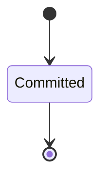

It declares no moves, so nothing changes its state once it exists.

It has one state, so there is no move to permit or to forbid.

One view projects it: [`ConfigRevisions`](#configrevisions).

### `EffectiveSetting`

`conductor.config.EffectiveSetting`.

An instance is identified by `setting_key`, a `conductor.config.SettingKey`. The name is part of the model and not a convention: a view projects the identity under that name, so a projection inventing its own would disagree with the view.

It holds:

- `instance` — `conductor.config.InstanceName`
- `role` — `Optional<conductor.config.RoleName>`, which may be absent
- `path` — `String`
- `value` — `String`
- `level` — `conductor.config.Level`

It declares no relation to another entity, and no other entity names it.

No invariant is declared, so nothing here constrains an instance at rest.

Its state is a `conductor.config.EffectiveSetting.State`, one of `Effective`. That enum is synthesised from the lifecycle rather than declared beside it, so the states a view's filter compares and the states drawn below cannot disagree.

An instance is created in `Effective`. `Effective` is terminal, so an instance may rest there forever. That is declared rather than inferred from having no way out: an entity that cannot leave a state is either finished or stuck, and only its author knows which.

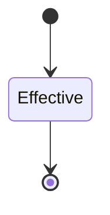

It declares no moves, so nothing changes its state once it exists.

It has one state, so there is no move to permit or to forbid.

One view projects it: [`EffectiveSettings`](#effectivesettings).

## Views

A view is what the outside world is promised it can observe. Each one says which instances it contains and how soon it reflects a command that has already returned, because "you can read this" without "how soon" is the promise every flaky suite is built on.

### `ConfigRevisions`

`conductor.config.ConfigRevisions`, shown to a person as "Config changes" and called `config-revisions` on the wire.

It reads [`ConfigRevision`](#configrevision).

It contains every instance of that entity: no filter narrows it, which is a decision somebody made and not a line somebody omitted.

It exposes:

- `revision_id` — `conductor.config.RevisionId`
- `state` — `conductor.config.ConfigRevision.State`
- `actor` — `conductor.operator.Actor`
- `level` — `conductor.config.Level`
- `instance` — `Optional<conductor.config.InstanceName>`, which may be absent
- `role` — `Optional<conductor.config.RoleName>`, which may be absent
- `path` — `String`
- `value` — `Optional<String>`, which may be absent
- `reason` — `String`
- `commit` — `String`
- `changed_at` — `Timestamp`

It declares no order, so the rows come back in whatever order the implementation has, and two reads may disagree.

**Read-your-writes**: it is current the moment the command that changed it returns. A caller that has just created an invoice and cannot see it in here has been told a lie about what it did.

A generated scenario asserts it once, immediately after the command: a view promising this and not keeping the promise has to fail the suite rather than be retried until it passes.

### `EffectiveSettings`

`conductor.config.EffectiveSettings`, shown to a person as "Effective settings" and called `effective-settings` on the wire.

It reads [`EffectiveSetting`](#effectivesetting).

It contains the instances where `instance == param.instance` holds, and only those — so an instance a caller cannot find in here has been filtered out rather than lost.

It exposes:

- `setting_key` — `conductor.config.SettingKey`
- `state` — `conductor.config.EffectiveSetting.State`
- `instance` — `conductor.config.InstanceName`
- `role` — `Optional<conductor.config.RoleName>`, which may be absent
- `path` — `String`
- `value` — `String`
- `level` — `conductor.config.Level`

It declares no order, so the rows come back in whatever order the implementation has, and two reads may disagree.

**Eventual**: it catches up some time after the command returns, so a caller that reads it immediately may legitimately not see its own write yet. Nothing here says how long that takes, so nothing here lets a caller wait a fixed time and call it correct.

A generated scenario therefore retries the assertion until the projection catches up, rather than asserting once and racing it. The repair everyone reaches for instead is a sleep, which turns the suite into a test of the machine it runs on.

## Commands

### `AddInstance`

`conductor.config.AddInstance`, shown to a person as "Add an instance" and called `add-instance` on the wire.

It takes:

- `actor` — `conductor.operator.Actor`
- `name` — `conductor.config.InstanceName`
- `mapping` — `String`
- `reason` — `String`
- `changed_at` — `Timestamp`

It has four outcomes.

**`actor-not-human`** — Only a person or the control plane adds an instance; an agent or the daemon is refused by name and nothing was written. Taken when `(actor.kind != Human and actor.kind != ControlPlane)` holds of the input. No entity in this specification changes. It reports `conductor.operator.ActorNotHuman`, carrying `actor`. It emits nothing. A test reaches it by constructing an input that satisfies that condition.

**`exists`** — The config holds an instance of this name; nothing was written. Decided outside the input: the config already names an instance of this name. No predicate over the input reaches this branch, and saying `when: false` instead would have claimed it is unreachable, which is a different and false statement. No entity in this specification changes. It reports `conductor.config.InstanceExists`, carrying `name`. It emits nothing. A test reaches it by injecting the declared fault, because no input can.

**`invalid`** — The config with the instance added does not validate, the problem named by its YAML path; nothing was written. Decided outside the input: the config with the instance added does not validate. No predicate over the input reaches this branch, and saying `when: false` instead would have claimed it is unreachable, which is a different and false statement. No entity in this specification changes. It reports `conductor.config.ConfigInvalid`, carrying `path`. It emits nothing. A test reaches it by injecting the declared fault, because no input can.

**`changed`** — The instance is written into the config file and committed with the actor and the reason; the daemon starts its runtime.
 The default branch, taken when no other outcome's condition matched. It creates a `conductor.config.ConfigRevision`, which starts in `Committed`. The new instance's identity is published as `revision_id` on `conductor.config.InstanceAdded`. It emits `conductor.config.InstanceAdded`. It sets `actor` from `input.actor`, `level` from `"Instance"`, `instance` from `input.name`, `role` cleared, `path` from `"."`, `value` from `input.mapping`, `reason` from `input.reason`, `commit` from `implementation-generated` and `changed_at` from `input.changed_at`. A test reaches it by constructing an input that satisfies no other outcome's condition.

### `PutConfig`

`conductor.config.PutConfig`, shown to a person as "Change the config" and called `put-config` on the wire.

It takes:

- `actor` — `conductor.operator.Actor`
- `level` — `conductor.config.Level`
- `instance` — `Optional<conductor.config.InstanceName>`, which may be absent
- `role` — `Optional<conductor.config.RoleName>`, which may be absent
- `path` — `String`
- `value` — `Optional<String>`, which may be absent
- `reason` — `String`
- `changed_at` — `Timestamp`

It has four outcomes.

**`level-scope-mismatch`** — The level and the instance or role named do not fit; nothing was written. Taken when `(level == Default or (level == Global and defined(instance)) or (level == Global and defined(role)) or (level == Instance and not (defined(instance))) or (level == Instance and defined(role)) or (level == Role and not (defined(instance))) or (level == Role and not (defined(role))))` holds of the input. No entity in this specification changes. It reports `conductor.config.LevelScopeMismatch`, carrying `level`. It emits nothing. A test reaches it by constructing an input that satisfies that condition.

**`actor-not-human`** — An agent's change of a key the tuning grant does not name, or to a value outside its range, is refused; nothing was written.
 Eligible when actor.kind != Human; externally decided: the change lies outside the tuning grant. No entity in this specification changes. It reports `conductor.operator.ActorNotHuman`, carrying `actor`. It emits nothing. A test reaches it by injecting the declared fault, because no input can.

**`invalid`** — The changed config does not validate; nothing was written. Decided outside the input: the config with the change does not validate. No predicate over the input reaches this branch, and saying `when: false` instead would have claimed it is unreachable, which is a different and false statement. No entity in this specification changes. It reports `conductor.config.ConfigInvalid`, carrying `path`. It emits nothing. A test reaches it by injecting the declared fault, because no input can.

**`changed`** — The key is written at its level and committed with the actor and the reason; the daemon reconciles the instances the change touches.
 The default branch, taken when no other outcome's condition matched. It creates a `conductor.config.ConfigRevision`, which starts in `Committed`. The new instance's identity is published as `revision_id` on `conductor.config.ConfigChanged`. It emits `conductor.config.ConfigChanged`. It sets `actor` from `input.actor`, `level` from `input.level`, `instance` from `input.instance`, `role` from `input.role`, `path` from `input.path`, `value` from `input.value`, `reason` from `input.reason`, `commit` from `implementation-generated` and `changed_at` from `input.changed_at`. A test reaches it by constructing an input that satisfies no other outcome's condition.

### `PutInstance`

`conductor.config.PutInstance`, shown to a person as "Replace an instance" and called `put-instance` on the wire.

It takes:

- `actor` — `conductor.operator.Actor`
- `name` — `conductor.config.InstanceName`
- `mapping` — `String`
- `reason` — `String`
- `changed_at` — `Timestamp`

It has four outcomes.

**`actor-not-human`** — Only a person or the control plane replaces an instance; an agent or the daemon is refused by name and nothing was written. Taken when `(actor.kind != Human and actor.kind != ControlPlane)` holds of the input. No entity in this specification changes. It reports `conductor.operator.ActorNotHuman`, carrying `actor`. It emits nothing. A test reaches it by constructing an input that satisfies that condition.

**`unknown`** — The config names no instance of this name; nothing was written. Decided outside the input: the config names no instance of this name. No predicate over the input reaches this branch, and saying `when: false` instead would have claimed it is unreachable, which is a different and false statement. No entity in this specification changes. It reports `conductor.instance.UnknownInstance`, carrying `name`. It emits nothing. A test reaches it by injecting the declared fault, because no input can.

**`invalid`** — The config with the instance replaced does not validate, the problem named by its YAML path; nothing was written. Decided outside the input: the config with the instance replaced does not validate. No predicate over the input reaches this branch, and saying `when: false` instead would have claimed it is unreachable, which is a different and false statement. No entity in this specification changes. It reports `conductor.config.ConfigInvalid`, carrying `path`. It emits nothing. A test reaches it by injecting the declared fault, because no input can.

**`changed`** — The instance's mapping is replaced in the config file and committed with the actor and the reason; the daemon reconciles it.
 The default branch, taken when no other outcome's condition matched. It creates a `conductor.config.ConfigRevision`, which starts in `Committed`. The new instance's identity is published as `revision_id` on `conductor.config.InstanceReplaced`. It emits `conductor.config.InstanceReplaced`. It sets `actor` from `input.actor`, `level` from `"Instance"`, `instance` from `input.name`, `role` cleared, `path` from `"."`, `value` from `input.mapping`, `reason` from `input.reason`, `commit` from `implementation-generated` and `changed_at` from `input.changed_at`. A test reaches it by constructing an input that satisfies no other outcome's condition.

### `RemoveInstance`

`conductor.config.RemoveInstance`, shown to a person as "Remove an instance" and called `remove-instance` on the wire.

It takes:

- `actor` — `conductor.operator.Actor`
- `name` — `conductor.config.InstanceName`
- `reason` — `String`
- `changed_at` — `Timestamp`

It has four outcomes.

**`actor-not-human`** — Only a person or the control plane removes an instance; an agent or the daemon is refused by name and nothing was written. Taken when `(actor.kind != Human and actor.kind != ControlPlane)` holds of the input. No entity in this specification changes. It reports `conductor.operator.ActorNotHuman`, carrying `actor`. It emits nothing. A test reaches it by constructing an input that satisfies that condition.

**`unknown`** — The config names no instance of this name; nothing was written. Decided outside the input: the config names no instance of this name. No predicate over the input reaches this branch, and saying `when: false` instead would have claimed it is unreachable, which is a different and false statement. No entity in this specification changes. It reports `conductor.instance.UnknownInstance`, carrying `name`. It emits nothing. A test reaches it by injecting the declared fault, because no input can.

**`invalid`** — The config without the instance does not validate, the problem named by its YAML path; nothing was written. Decided outside the input: the config without the instance does not validate. No predicate over the input reaches this branch, and saying `when: false` instead would have claimed it is unreachable, which is a different and false statement. No entity in this specification changes. It reports `conductor.config.ConfigInvalid`, carrying `path`. It emits nothing. A test reaches it by injecting the declared fault, because no input can.

**`changed`** — The instance is removed from the config file and the removal committed with the actor and the reason; the daemon stops its runtime and keeps its data.
 The default branch, taken when no other outcome's condition matched. It creates a `conductor.config.ConfigRevision`, which starts in `Committed`. The new instance's identity is published as `revision_id` on `conductor.config.InstanceRemoved`. It emits `conductor.config.InstanceRemoved`. It sets `actor` from `input.actor`, `level` from `"Instance"`, `instance` from `input.name`, `role` cleared, `path` from `"."`, `value` cleared, `reason` from `input.reason`, `commit` from `implementation-generated` and `changed_at` from `input.changed_at`. A test reaches it by constructing an input that satisfies no other outcome's condition.

## Events

### `ConfigChanged`

`conductor.config.ConfigChanged`.

It carries:

- `revision_id` — `conductor.config.RevisionId`
- `actor` — `conductor.operator.Actor`
- `level` — `conductor.config.Level`
- `instance_name` — `Optional<conductor.config.InstanceName>`, which may be absent
- `role` — `Optional<conductor.config.RoleName>`, which may be absent
- `path` — `String`
- `value` — `Optional<String>`, which may be absent
- `reason` — `String`

Emitted by `conductor.config.PutConfig` on its `changed` outcome.

Nothing in this system reacts to it.

### `InstanceAdded`

`conductor.config.InstanceAdded`.

It carries:

- `revision_id` — `conductor.config.RevisionId`
- `actor` — `conductor.operator.Actor`
- `name` — `conductor.config.InstanceName`
- `mapping` — `String`
- `reason` — `String`

Emitted by `conductor.config.AddInstance` on its `changed` outcome.

Nothing in this system reacts to it.

### `InstanceRemoved`

`conductor.config.InstanceRemoved`.

It carries:

- `revision_id` — `conductor.config.RevisionId`
- `actor` — `conductor.operator.Actor`
- `name` — `conductor.config.InstanceName`
- `reason` — `String`

Emitted by `conductor.config.RemoveInstance` on its `changed` outcome.

Nothing in this system reacts to it.

### `InstanceReplaced`

`conductor.config.InstanceReplaced`.

It carries:

- `revision_id` — `conductor.config.RevisionId`
- `actor` — `conductor.operator.Actor`
- `name` — `conductor.config.InstanceName`
- `mapping` — `String`
- `reason` — `String`

Emitted by `conductor.config.PutInstance` on its `changed` outcome.

Nothing in this system reacts to it.

## Errors

### `ConfigInvalid`

The config with this change does not validate; nothing was written, committed or reconciled, and the problem is named by its YAML path.

It carries:

- `path` — `String`

Reported by `conductor.config.AddInstance` on its `invalid` outcome.

Reported by `conductor.config.PutConfig` on its `invalid` outcome.

Reported by `conductor.config.PutInstance` on its `invalid` outcome.

Reported by `conductor.config.RemoveInstance` on its `invalid` outcome.

### `InstanceExists`

The config already names an instance of this name; nothing was written.

It carries:

- `name` — `conductor.config.InstanceName`

Reported by `conductor.config.AddInstance` on its `exists` outcome.

### `LevelScopeMismatch`

A `Global` change names no instance and no role, an `Instance` change names an instance and no role, a `Role` change names both, and no change is written at `Default`; this one does not fit, and nothing was written.

It carries:

- `level` — `conductor.config.Level`

Reported by `conductor.config.PutConfig` on its `level-scope-mismatch` outcome.

### `StateDirNotInstance`

`--state-dir` names a directory that is not the state of the instance the config file names, and the command writes that instance's records; nothing was written.

It carries:

- `state_dir` — `String`
- `instance` — `conductor.config.InstanceName`
- `state` — `String`

No outcome in this system reports it: it is declared and unreachable.

## Actors

An actor is who may ask this context for something. Every grant below points at a command this specification declares — a grant is a resolved reference, so "may invoke" something nobody wrote is not a permission this model can express, and an authorisation that authorises nothing cannot ship quietly.

### `ControlPlane`

`conductor.config.ControlPlane`, shown to a person as "Control plane".

It may invoke [`AddInstance`](#addinstance), [`PutInstance`](#putinstance) and [`RemoveInstance`](#removeinstance).

### `Operator`

`conductor.config.Operator`, shown to a person as "Operator".

It may invoke [`AddInstance`](#addinstance), [`PutConfig`](#putconfig), [`PutInstance`](#putinstance) and [`RemoveInstance`](#removeinstance).

### `Tuner`

`conductor.config.Tuner`, shown to a person as "Tuner".

It may invoke [`PutConfig`](#putconfig).

---

Generated from conductor v1 · contract digest `slice-sha256/2:9878b375931c36b2e9b022667caef55368766c2bde3f0836a6f9846ef72e3ebb`. Do not edit this file; change the specification and regenerate it with `ess generate`.

<!--
generated from conductor v1
contract digest slice-sha256/2:fb89f4ad7df3ee11c20c3e258f53d81667208c7d630ced38120f17f0bb6df914
do not edit: regenerate with `ess generate`
-->

# Instance

The instances conductord reconciles (design docs/design/architecture-next.md § 4): desired state from the config (name, placement, roles, settings), actual state from what runs (state, binary version, last seen, box), and one `Reconciliation` record per action the daemon takes (start, stop, restart, upgrade, nothing). Replaces the registry types of `conductor.host`.

`conductor.instance` is one of conductor's bounded contexts. [Back to the index](../index.md).

## Types

### `ReconcileAction`

`conductor.instance.ReconcileAction` is one of `Start`, `Stop`, `Restart`, `Upgrade`, `Nothing` and `Purge`.

### `ReconcileReason`

`conductor.instance.ReconcileReason` is one of `ConfigChange`, `LostRuntime`, `Cadence`, `OperatorCommand` and `RunBound`.

### `ReconcileResult`

`conductor.instance.ReconcileResult` is one of `Succeeded`, `Refused` and `RolledBack`.

### `ReconciliationId`

`conductor.instance.ReconciliationId` wraps `Uuid` and is not interchangeable with one: the whole value of naming it separately is the crossings the model then refuses.

### `ServeDaemon`

`conductor.instance.ServeDaemon` is a record of three fields:

- `install` — `Optional<Boolean>`, which may be absent
- `uninstall` — `Optional<Boolean>`, which may be absent
- `daemon_config` — `Optional<String>`, which may be absent

### `StartHostRole`

`conductor.instance.StartHostRole` is a record of one field:

- `role` — `Optional<conductor.config.RoleName>`, which may be absent

### `UpgradeInstances`

`conductor.instance.UpgradeInstances` is a record of three fields:

- `instance` — `Optional<conductor.config.InstanceName>`, which may be absent
- `tag` — `String`
- `all` — `Optional<Boolean>`, which may be absent

Three of the types above are reached by nothing else in this system: `conductor.instance.ServeDaemon`, `conductor.instance.StartHostRole` and `conductor.instance.UpgradeInstances`. No entity, view, command, event, error or crossing names them, so it is either vocabulary something outside this specification uses or a leftover — and only a person can tell which.

## Entities

An entity is what this context is about: something with an identity that outlives any one request, a shape, and a lifecycle. The lifecycle is exhaustive — a move that is not drawn below is a move this specification does not permit, and that is the only way it says so. Every move is labelled with the command that takes it, because a move nothing can trigger is refused rather than drawn.

### `Instance`

`conductor.instance.Instance`.

An instance is identified by `name`, a `conductor.config.InstanceName`. The name is part of the model and not a convention: a view projects the identity under that name, so a projection inventing its own would disagree with the view.

It holds:

- `placement` — `conductor.placement.PlacementName`
- `roles` — `List<conductor.config.RoleName>`
- `binary_version` — `Optional<String>`, which may be absent
- `last_seen` — `Optional<Timestamp>`, which may be absent
- `box_id` — `Optional<conductor.placement.BoxId>`, which may be absent
- `sources` — `List<conductor.config.Source>`
- `detail` — `Optional<String>`, which may be absent
- `changed_by` — `conductor.operator.Actor`

It references at most one [`conductor.placement.Placement`](conductor-placement.md#placement), as `placement`, carried by `Instance.placement`. It references at most one [`conductor.placement.Box`](conductor-placement.md#box), as `box`, carried by `Instance.box_id`.

No invariant is declared, so nothing here constrains an instance at rest.

Its state is a `conductor.instance.Instance.State`, one of `Purged`, `Running`, `Starting`, `Stopped`, `Unreachable` and `Upgrading`. That enum is synthesised from the lifecycle rather than declared beside it, so the states a view's filter compares and the states drawn below cannot disagree.

An instance is created in `Starting`. `Purged` is terminal, so an instance may rest there forever. That is declared rather than inferred from having no way out: an entity that cannot leave a state is either finished or stuck, and only its author knows which.

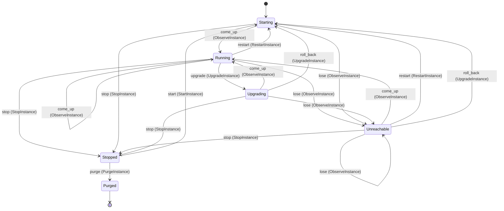

Each move is taken by a declared command outcome, and a move nothing takes is refused as `missing_causation` rather than left as a state change nobody can trigger:

- `start` — taken by `conductor.instance.StartInstance` on its `started` outcome
- `come_up` — taken by `conductor.instance.ObserveInstance` on its `answering` outcome
- `lose` — taken by `conductor.instance.ObserveInstance` on its `not-answering` outcome
- `stop` — taken by `conductor.instance.StopInstance` on its `stopped` outcome
- `restart` — taken by `conductor.instance.RestartInstance` on its `restarted` outcome
- `upgrade` — taken by `conductor.instance.UpgradeInstance` on its `upgrading` outcome
- `roll_back` — taken by `conductor.instance.UpgradeInstance` on its `rolled-back` outcome
- `purge` — taken by `conductor.instance.PurgeInstance` on its `purged` outcome

An instance is brought into existence by `conductor.instance.StartInstance` on its `created` outcome.

Illegal transitions are illegal by absence: no rule forbids them, there is simply no arrow, because a rule would be a second place for the same truth to live. A diagram cannot show an absence, so the pairs it does not connect are listed here, derived from the same transitions — anything named below is a move this specification does not permit.

- `Purged` may not become `Running`
- `Purged` may not become `Starting`
- `Purged` may not become `Stopped`
- `Purged` may not become `Unreachable`
- `Purged` may not become `Upgrading`
- `Running` may not become `Purged`
- `Starting` may not become `Purged`
- `Starting` may not become `Upgrading`
- `Stopped` may not become `Running`
- `Stopped` may not become `Unreachable`
- `Stopped` may not become `Upgrading`
- `Unreachable` may not become `Purged`
- `Unreachable` may not become `Upgrading`
- `Upgrading` may not become `Purged`

Two views project it: [`InstanceByName`](#instancebyname) and [`Instances`](#instances).

### `Reconciliation`

`conductor.instance.Reconciliation`.

An instance is identified by `reconciliation_id`, a `conductor.instance.ReconciliationId`. The name is part of the model and not a convention: a view projects the identity under that name, so a projection inventing its own would disagree with the view.

It holds:

- `instance` — `conductor.config.InstanceName`
- `action` — `conductor.instance.ReconcileAction`
- `reason` — `conductor.instance.ReconcileReason`
- `result` — `conductor.instance.ReconcileResult`
- `detail` — `Optional<String>`, which may be absent
- `actor` — `conductor.operator.Actor`
- `at` — `Timestamp`

It references at most one [`Instance`](#instance), as `subject`, carried by `Reconciliation.instance`.

No invariant is declared, so nothing here constrains an instance at rest.

Its state is a `conductor.instance.Reconciliation.State`, one of `Recorded`. That enum is synthesised from the lifecycle rather than declared beside it, so the states a view's filter compares and the states drawn below cannot disagree.

An instance is created in `Recorded`. `Recorded` is terminal, so an instance may rest there forever. That is declared rather than inferred from having no way out: an entity that cannot leave a state is either finished or stuck, and only its author knows which.

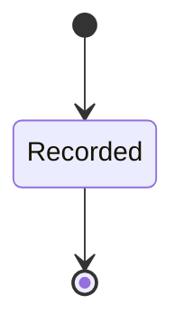

It declares no moves, so nothing changes its state once it exists.

It has one state, so there is no move to permit or to forbid.

One view projects it: [`Reconciliations`](#reconciliations).

## Views

A view is what the outside world is promised it can observe. Each one says which instances it contains and how soon it reflects a command that has already returned, because "you can read this" without "how soon" is the promise every flaky suite is built on.

### `InstanceByName`

`conductor.instance.InstanceByName`, shown to a person as "One instance" and called `instance` on the wire.

It reads [`Instance`](#instance).

It contains the instances where `name == param.name` holds, and only those — so an instance a caller cannot find in here has been filtered out rather than lost.

It exposes:

- `name` — `conductor.config.InstanceName`
- `state` — `conductor.instance.Instance.State`
- `placement` — `conductor.placement.PlacementName`
- `roles` — `List<conductor.config.RoleName>`
- `binary_version` — `Optional<String>`, which may be absent
- `last_seen` — `Optional<Timestamp>`, which may be absent
- `box_id` — `Optional<conductor.placement.BoxId>`, which may be absent
- `sources` — `List<conductor.config.Source>`
- `detail` — `Optional<String>`, which may be absent
- `changed_by` — `conductor.operator.Actor`

It declares no order, so the rows come back in whatever order the implementation has, and two reads may disagree.

**Read-your-writes**: it is current the moment the command that changed it returns. A caller that has just created an invoice and cannot see it in here has been told a lie about what it did.

A generated scenario asserts it once, immediately after the command: a view promising this and not keeping the promise has to fail the suite rather than be retried until it passes.

### `Instances`

`conductor.instance.Instances`, shown to a person as "Instances" and called `instances` on the wire.

It reads [`Instance`](#instance).

It contains every instance of that entity: no filter narrows it, which is a decision somebody made and not a line somebody omitted.

It exposes:

- `name` — `conductor.config.InstanceName`
- `state` — `conductor.instance.Instance.State`
- `placement` — `conductor.placement.PlacementName`
- `roles` — `List<conductor.config.RoleName>`
- `binary_version` — `Optional<String>`, which may be absent
- `last_seen` — `Optional<Timestamp>`, which may be absent
- `box_id` — `Optional<conductor.placement.BoxId>`, which may be absent
- `sources` — `List<conductor.config.Source>`
- `detail` — `Optional<String>`, which may be absent
- `changed_by` — `conductor.operator.Actor`

It declares no order, so the rows come back in whatever order the implementation has, and two reads may disagree.

**Read-your-writes**: it is current the moment the command that changed it returns. A caller that has just created an invoice and cannot see it in here has been told a lie about what it did.

A generated scenario asserts it once, immediately after the command: a view promising this and not keeping the promise has to fail the suite rather than be retried until it passes.

### `Reconciliations`

`conductor.instance.Reconciliations`, shown to a person as "Reconciliations" and called `reconciliations` on the wire.

It reads [`Reconciliation`](#reconciliation).

It contains every instance of that entity: no filter narrows it, which is a decision somebody made and not a line somebody omitted.

It exposes:

- `reconciliation_id` — `conductor.instance.ReconciliationId`
- `state` — `conductor.instance.Reconciliation.State`
- `instance` — `conductor.config.InstanceName`
- `action` — `conductor.instance.ReconcileAction`
- `reason` — `conductor.instance.ReconcileReason`
- `result` — `conductor.instance.ReconcileResult`
- `detail` — `Optional<String>`, which may be absent
- `actor` — `conductor.operator.Actor`
- `at` — `Timestamp`

It declares no order, so the rows come back in whatever order the implementation has, and two reads may disagree.

**Read-your-writes**: it is current the moment the command that changed it returns. A caller that has just created an invoice and cannot see it in here has been told a lie about what it did.

A generated scenario asserts it once, immediately after the command: a view promising this and not keeping the promise has to fail the suite rather than be retried until it passes.

## Commands

### `ObserveInstance`

`conductor.instance.ObserveInstance`, shown to a person as "Observe an instance" and called `observe` on the wire.

It takes:

- `actor` — `conductor.operator.Actor`
- `name` — `conductor.config.InstanceName`
- `answering` — `Boolean`
- `binary_version` — `Optional<String>`, which may be absent
- `detail` — `Optional<String>`, which may be absent
- `at` — `Timestamp`

It has four outcomes.

**`unknown`** — No record of the instance is kept; nothing was observed. Taken when the identity the command names is one no record carries, before any other answer for it. No entity in this specification changes. It reports `conductor.instance.UnknownInstance`, carrying `name`. It emits nothing. A test reaches it by sending an identity no record carries, arranging nothing.

**`answering`** — The runtime answers; the instance runs, with the version it reported and the time it answered. Taken when `answering == true` holds of the input. It moves a `conductor.instance.Instance` from `Running`, `Starting`, `Unreachable` and `Upgrading` to `Running`, along the declared move `come_up`. The instance is the one named by the input field `name`. It emits `conductor.instance.InstanceAnswered`. It sets `binary_version` from `input.binary_version`, `last_seen` from `input.at`, `detail` cleared and `changed_by` from `input.actor`. A test reaches it by constructing an input that satisfies that condition.

**`not-answering`** — The runtime does not answer; the instance is a row with state Unreachable and the time it last answered. The default branch, taken when no other outcome's condition matched. It moves a `conductor.instance.Instance` from `Running`, `Starting`, `Unreachable` and `Upgrading` to `Unreachable`, along the declared move `lose`. The instance is the one named by the input field `name`. It emits `conductor.instance.InstanceUnreachable`. It sets `detail` from `input.detail` and `changed_by` from `input.actor`. A test reaches it by constructing an input that satisfies no other outcome's condition.

**`not-running`** — A stopped or purged instance has no runtime to observe; nothing changed. Taken when the subject is resting in a state none of this command's moves start from — a `conductor.instance.Instance` in `Purged` and `Stopped`, which is what is left of the lifecycle once this command's own moves are taken away. The document lists none of it. No entity in this specification changes. It reports `conductor.instance.InstanceStateConflict`, carrying `name`. It emits nothing. A test reaches it by driving an instance into one of those states and then issuing the command, because no input selects this branch.

### `PurgeInstance`

`conductor.instance.PurgeInstance`, shown to a person as "Purge an instance" and called `purge` on the wire.

It takes:

- `actor` — `conductor.operator.Actor`
- `name` — `conductor.config.InstanceName`
- `at` — `Timestamp`

It has four outcomes.

**`actor-not-human`** — A purge is a class H decision; an agent actor is refused by name and nothing is deleted. Taken when `actor.kind != Human` holds of the input. No entity in this specification changes. It reports `conductor.operator.ActorNotHuman`, carrying `actor`. It emits nothing. A test reaches it by constructing an input that satisfies that condition.

**`unknown`** — No record of the instance is kept; nothing was purged. Taken when the identity the command names is one no record carries, before any other answer for it. No entity in this specification changes. It reports `conductor.instance.UnknownInstance`, carrying `name`. It emits nothing. A test reaches it by sending an identity no record carries, arranging nothing.

**`purged`** — The operator said yes; the instance's data is deleted and the instance is Purged. The default branch, taken when no other outcome's condition matched. It moves a `conductor.instance.Instance` from `Stopped` to `Purged`, along the declared move `purge`. The instance is the one named by the input field `name`. It emits `conductor.instance.InstancePurged`. It sets `changed_by` from `input.actor`. A test reaches it by constructing an input that satisfies no other outcome's condition.

**`not-stopped`** — Only a stopped instance is purged; nothing was deleted. Taken when the subject is resting in a state none of this command's moves start from — a `conductor.instance.Instance` in `Purged`, `Running`, `Starting`, `Unreachable` and `Upgrading`, which is what is left of the lifecycle once this command's own moves are taken away. The document lists none of it. No entity in this specification changes. It reports `conductor.instance.InstanceStateConflict`, carrying `name`. It emits nothing. A test reaches it by driving an instance into one of those states and then issuing the command, because no input selects this branch.

### `Reconcile`

`conductor.instance.Reconcile`, shown to a person as "Record a reconciliation" and called `reconcile` on the wire.

It takes:

- `actor` — `conductor.operator.Actor`
- `instance` — `conductor.config.InstanceName`
- `action` — `conductor.instance.ReconcileAction`
- `reason` — `conductor.instance.ReconcileReason`
- `result` — `conductor.instance.ReconcileResult`
- `detail` — `Optional<String>`, which may be absent
- `at` — `Timestamp`

It has one outcome.

**`recorded`** — The action is on record in the daemon's store with its reason and result. The default branch, taken when no other outcome's condition matched. It creates a `conductor.instance.Reconciliation`, which starts in `Recorded`. The new instance's identity is published as `reconciliation_id` on `conductor.instance.InstanceReconciled`. It emits `conductor.instance.InstanceReconciled`. It sets `instance` from `input.instance`, `action` from `input.action`, `reason` from `input.reason`, `result` from `input.result`, `detail` from `input.detail`, `actor` from `input.actor` and `at` from `input.at`. A test reaches it by constructing an input that satisfies no other outcome's condition.

### `RestartInstance`

`conductor.instance.RestartInstance`, shown to a person as "Restart an instance" and called `restart` on the wire.

It takes:

- `actor` — `conductor.operator.Actor`
- `name` — `conductor.config.InstanceName`
- `placement` — `conductor.placement.PlacementName`
- `roles` — `List<conductor.config.RoleName>`
- `sources` — `List<conductor.config.Source>`
- `box_id` — `conductor.placement.BoxId`
- `at` — `Timestamp`

It has four outcomes.

**`unknown`** — No record of the instance is kept; nothing was restarted. Taken when the identity the command names is one no record carries, before any other answer for it. No entity in this specification changes. It reports `conductor.instance.UnknownInstance`, carrying `name`. It emits nothing. A test reaches it by sending an identity no record carries, arranging nothing.

**`placement-refused`** — The instance does not come back and nothing falls back; the daemon records why. Decided outside the input: substrate refused the box the placement asks for. No predicate over the input reaches this branch, and saying `when: false` instead would have claimed it is unreachable, which is a different and false statement. No entity in this specification changes. It reports `conductor.instance.PlacementRefused`, carrying `name` and `placement`. It emits nothing. A test reaches it by injecting the declared fault, because no input can.

**`restarted`** — The runtime is stopped and started again in a box at the placement the config names. The default branch, taken when no other outcome's condition matched. It moves a `conductor.instance.Instance` from `Running` and `Unreachable` to `Starting`, along the declared move `restart`. The instance is the one named by the input field `name`. It emits `conductor.instance.InstanceRestarted`. It sets `placement` from `input.placement`, `roles` from `input.roles`, `box_id` from `input.box_id`, `sources` from `input.sources` and `changed_by` from `input.actor`. A test reaches it by constructing an input that satisfies no other outcome's condition.

**`not-running`** — Only a running or unreachable instance is restarted; nothing changed. Taken when the subject is resting in a state none of this command's moves start from — a `conductor.instance.Instance` in `Purged`, `Starting`, `Stopped` and `Upgrading`, which is what is left of the lifecycle once this command's own moves are taken away. The document lists none of it. No entity in this specification changes. It reports `conductor.instance.InstanceStateConflict`, carrying `name`. It emits nothing. A test reaches it by driving an instance into one of those states and then issuing the command, because no input selects this branch.

### `StartInstance`

`conductor.instance.StartInstance`, shown to a person as "Start an instance" and called `start` on the wire.

It takes:

- `actor` — `conductor.operator.Actor`
- `name` — `conductor.config.InstanceName`
- `placement` — `conductor.placement.PlacementName`
- `roles` — `List<conductor.config.RoleName>`
- `sources` — `List<conductor.config.Source>`
- `box_id` — `conductor.placement.BoxId`
- `at` — `Timestamp`

It has six outcomes.

**`created`** — The config names the instance and nothing ran it; its box is open, its runtime starting. Taken when no record carries the identity the command names, and no input-guarded refusal applies; it creates that record. It creates a `conductor.instance.Instance`, which starts in `Starting`. The new instance's identity is published as `name` on `conductor.instance.InstanceStarted`. It emits `conductor.instance.InstanceStarted`. It sets `placement` from `input.placement`, `roles` from `input.roles`, `binary_version` cleared, `last_seen` cleared, `box_id` from `input.box_id`, `sources` from `input.sources`, `detail` cleared and `changed_by` from `input.actor`. A test reaches it by sending an identity no record carries, arranging nothing.

**`started`** — The stopped instance's box is open again and its runtime starting. Taken when the existing subject is in Stopped. It moves a `conductor.instance.Instance` from `Stopped` to `Starting`, along the declared move `start`. The instance is the one named by the input field `name`. It emits `conductor.instance.InstanceStarted`. It sets `placement` from `input.placement`, `roles` from `input.roles`, `box_id` from `input.box_id`, `sources` from `input.sources` and `changed_by` from `input.actor`. A test establishes the declared subject state and constructs input selecting this branch in that state.

**`already-started`** — The instance already runs or is coming up; nothing changed. Taken when the existing subject is in Running or Starting or Upgrading. It preserves the existing subject, without an error or event. The instance is the one named by the input field `name`. It emits nothing. A test establishes the declared subject state and constructs input selecting this branch in that state.

**`not-in-config`** — Nothing was started; an instance runs only where the config names it. Decided outside the input: the config names no instance of this name. No predicate over the input reaches this branch, and saying `when: false` instead would have claimed it is unreachable, which is a different and false statement. No entity in this specification changes. It reports `conductor.instance.UnknownInstance`, carrying `name`. It emits nothing. A test reaches it by injecting the declared fault, because no input can.

**`placement-refused`** — The instance does not start and nothing falls back; the daemon records why. Decided outside the input: substrate refused the box the placement asks for. No predicate over the input reaches this branch, and saying `when: false` instead would have claimed it is unreachable, which is a different and false statement. No entity in this specification changes. It reports `conductor.instance.PlacementRefused`, carrying `name` and `placement`. It emits nothing. A test reaches it by injecting the declared fault, because no input can.

**`not-startable`** — An unreachable instance is restarted, not started, and a purged one is not started; nothing changed. The default branch, taken when no other outcome's condition matched. No entity in this specification changes. It reports `conductor.instance.InstanceStateConflict`, carrying `name`. It emits nothing. A test reaches it by constructing an input that satisfies no other outcome's condition.

### `StopInstance`

`conductor.instance.StopInstance`, shown to a person as "Stop an instance" and called `stop` on the wire.

It takes:

- `actor` — `conductor.operator.Actor`
- `name` — `conductor.config.InstanceName`
- `at` — `Timestamp`

It has four outcomes.

**`unknown`** — No record of the instance is kept; nothing was stopped. Taken when the identity the command names is one no record carries, before any other answer for it. No entity in this specification changes. It reports `conductor.instance.UnknownInstance`, carrying `name`. It emits nothing. A test reaches it by sending an identity no record carries, arranging nothing.

**`stopped`** — The runtime is stopped and its box closed; the instance's records are kept. Taken when the existing subject is in Running or Starting or Unreachable or Upgrading. It moves a `conductor.instance.Instance` from `Running`, `Starting`, `Unreachable` and `Upgrading` to `Stopped`, along the declared move `stop`. The instance is the one named by the input field `name`. It emits `conductor.instance.InstanceStopped`. It sets `box_id` cleared and `changed_by` from `input.actor`. A test establishes the declared subject state and constructs input selecting this branch in that state.

**`already-stopped`** — The instance is stopped already; nothing changed. Taken when the existing subject is in Stopped. It preserves the existing subject, without an error or event. The instance is the one named by the input field `name`. It emits nothing. A test establishes the declared subject state and constructs input selecting this branch in that state.

**`purged`** — A purged instance has nothing to stop; nothing changed. The default branch, taken when no other outcome's condition matched. No entity in this specification changes. It reports `conductor.instance.InstanceStateConflict`, carrying `name`. It emits nothing. A test reaches it by constructing an input that satisfies no other outcome's condition.

### `UpgradeInstance`

`conductor.instance.UpgradeInstance`, shown to a person as "Upgrade an instance" and called `upgrade` on the wire.

It takes:

- `actor` — `conductor.operator.Actor`
- `name` — `conductor.config.InstanceName`
- `binary_version` — `String`
- `at` — `Timestamp`

It has four outcomes.

**`unknown`** — No record of the instance is kept; nothing was upgraded. Taken when the identity the command names is one no record carries, before any other answer for it. No entity in this specification changes. It reports `conductor.instance.UnknownInstance`, carrying `name`. It emits nothing. A test reaches it by sending an identity no record carries, arranging nothing.

**`upgrading`** — The new binary is installed and the runtime restarted on it; the instance runs again once it answers. Taken when the existing subject is in Running. It moves a `conductor.instance.Instance` from `Running` to `Upgrading`, along the declared move `upgrade`. The instance is the one named by the input field `name`. It emits `conductor.instance.InstanceUpgrading`. It sets `changed_by` from `input.actor`. A test establishes the declared subject state and constructs input selecting this branch in that state.

**`rolled-back`** — The upgraded runtime did not come up; the previous binary is back and its runtime starting. Taken when the existing subject is in Unreachable or Upgrading. It moves a `conductor.instance.Instance` from `Unreachable` and `Upgrading` to `Starting`, along the declared move `roll_back`. The instance is the one named by the input field `name`. It emits `conductor.instance.InstanceRolledBack`. It sets `changed_by` from `input.actor`. A test establishes the declared subject state and constructs input selecting this branch in that state.

**`not-running`** — Only a running instance is upgraded; nothing changed. The default branch, taken when no other outcome's condition matched. No entity in this specification changes. It reports `conductor.instance.InstanceStateConflict`, carrying `name`. It emits nothing. A test reaches it by constructing an input that satisfies no other outcome's condition.

## Events

### `InstanceAnswered`

`conductor.instance.InstanceAnswered`.

It carries:

- `actor` — `conductor.operator.Actor`
- `name` — `conductor.config.InstanceName`
- `binary_version` — `Optional<String>`, which may be absent
- `at` — `Timestamp`

Emitted by `conductor.instance.ObserveInstance` on its `answering` outcome.

Nothing in this system reacts to it.

### `InstancePurged`

`conductor.instance.InstancePurged`.

It carries:

- `actor` — `conductor.operator.Actor`
- `name` — `conductor.config.InstanceName`
- `at` — `Timestamp`

Emitted by `conductor.instance.PurgeInstance` on its `purged` outcome.

Nothing in this system reacts to it.

### `InstanceReconciled`

`conductor.instance.InstanceReconciled`.

It carries:

- `reconciliation_id` — `conductor.instance.ReconciliationId`
- `actor` — `conductor.operator.Actor`
- `instance` — `conductor.config.InstanceName`
- `action` — `conductor.instance.ReconcileAction`
- `reason` — `conductor.instance.ReconcileReason`
- `result` — `conductor.instance.ReconcileResult`
- `at` — `Timestamp`

Emitted by `conductor.instance.Reconcile` on its `recorded` outcome.

Nothing in this system reacts to it.

### `InstanceRestarted`

`conductor.instance.InstanceRestarted`.

It carries:

- `actor` — `conductor.operator.Actor`
- `name` — `conductor.config.InstanceName`
- `placement` — `conductor.placement.PlacementName`
- `box_id` — `conductor.placement.BoxId`
- `at` — `Timestamp`

Emitted by `conductor.instance.RestartInstance` on its `restarted` outcome.

Nothing in this system reacts to it.

### `InstanceRolledBack`

`conductor.instance.InstanceRolledBack`.

It carries:

- `actor` — `conductor.operator.Actor`
- `name` — `conductor.config.InstanceName`
- `binary_version` — `String`
- `at` — `Timestamp`

Emitted by `conductor.instance.UpgradeInstance` on its `rolled-back` outcome.

Nothing in this system reacts to it.

### `InstanceStarted`

`conductor.instance.InstanceStarted`.

It carries:

- `actor` — `conductor.operator.Actor`
- `name` — `conductor.config.InstanceName`
- `placement` — `conductor.placement.PlacementName`
- `box_id` — `conductor.placement.BoxId`
- `at` — `Timestamp`

Emitted by `conductor.instance.StartInstance` on its `created` and `started` outcomes.

Nothing in this system reacts to it.

### `InstanceStopped`

`conductor.instance.InstanceStopped`.

It carries:

- `actor` — `conductor.operator.Actor`
- `name` — `conductor.config.InstanceName`
- `at` — `Timestamp`

Emitted by `conductor.instance.StopInstance` on its `stopped` outcome.

Nothing in this system reacts to it.

### `InstanceUnreachable`

`conductor.instance.InstanceUnreachable`.

It carries:

- `actor` — `conductor.operator.Actor`
- `name` — `conductor.config.InstanceName`
- `at` — `Timestamp`

Emitted by `conductor.instance.ObserveInstance` on its `not-answering` outcome.

Nothing in this system reacts to it.

### `InstanceUpgrading`

`conductor.instance.InstanceUpgrading`.

It carries:

- `actor` — `conductor.operator.Actor`
- `name` — `conductor.config.InstanceName`
- `binary_version` — `String`
- `at` — `Timestamp`

Emitted by `conductor.instance.UpgradeInstance` on its `upgrading` outcome.

Nothing in this system reacts to it.

## Errors

### `InstanceStateConflict`

The instance is not in a state this command acts from, so nothing moved.

It carries:

- `name` — `conductor.config.InstanceName`

Reported by `conductor.instance.ObserveInstance` on its `not-running` outcome.

Reported by `conductor.instance.PurgeInstance` on its `not-stopped` outcome.

Reported by `conductor.instance.RestartInstance` on its `not-running` outcome.

Reported by `conductor.instance.StartInstance` on its `not-startable` outcome.

Reported by `conductor.instance.StopInstance` on its `purged` outcome.

Reported by `conductor.instance.UpgradeInstance` on its `not-running` outcome.

### `PlacementRefused`

The placement could not give what the profile asks for; substrate's reason is named, the instance does not start, and nothing falls back (§ 6).

It carries:

- `name` — `conductor.config.InstanceName`
- `placement` — `conductor.placement.PlacementName`

Reported by `conductor.instance.RestartInstance` on its `placement-refused` outcome.

Reported by `conductor.instance.StartInstance` on its `placement-refused` outcome.

### `SupervisorNotRunning`

No supervisor runs to take the question, so it was not delivered; nothing changed.

It carries:

- `instance` — `Optional<conductor.config.InstanceName>`, which may be absent

No outcome in this system reports it: it is declared and unreachable.

### `UnknownInstance`

The config names no instance of this name, or no record of it is kept; nothing changed.

It carries:

- `name` — `conductor.config.InstanceName`

Reported by `conductor.config.PutInstance` on its `unknown` outcome.

Reported by `conductor.config.RemoveInstance` on its `unknown` outcome.

Reported by `conductor.instance.ObserveInstance` on its `unknown` outcome.

Reported by `conductor.instance.PurgeInstance` on its `unknown` outcome.

Reported by `conductor.instance.RestartInstance` on its `unknown` outcome.

Reported by `conductor.instance.StartInstance` on its `not-in-config` outcome.

Reported by `conductor.instance.StopInstance` on its `unknown` outcome.

Reported by `conductor.instance.UpgradeInstance` on its `unknown` outcome.

## Actors

An actor is who may ask this context for something. Every grant below points at a command this specification declares — a grant is a resolved reference, so "may invoke" something nobody wrote is not a permission this model can express, and an authorisation that authorises nothing cannot ship quietly.

### `Conductord`

`conductor.instance.Conductord`, shown to a person as "conductord".

It may invoke [`ObserveInstance`](#observeinstance), [`Reconcile`](#reconcile), [`RestartInstance`](#restartinstance), [`StartInstance`](#startinstance), [`StopInstance`](#stopinstance) and [`UpgradeInstance`](#upgradeinstance).

### `ControlPlane`

`conductor.instance.ControlPlane`, shown to a person as "Control plane".

It may invoke [`RestartInstance`](#restartinstance).

### `Operator`

`conductor.instance.Operator`, shown to a person as "Operator".

It may invoke [`PurgeInstance`](#purgeinstance), [`RestartInstance`](#restartinstance), [`StartInstance`](#startinstance), [`StopInstance`](#stopinstance) and [`UpgradeInstance`](#upgradeinstance).

---

Generated from conductor v1 · contract digest `slice-sha256/2:fb89f4ad7df3ee11c20c3e258f53d81667208c7d630ced38120f17f0bb6df914`. Do not edit this file; change the specification and regenerate it with `ess generate`.

<!--
generated from conductor v1
contract digest slice-sha256/2:5ad383b829b82318132ca8058831e63ee1400b54c28b277716e46cfe57ebdcfb
do not edit: regenerate with `ess generate`
-->

# Operator

Who acts on conductor, told apart by kind (design docs/design/architecture-next.md § 3 "Actors", § 5.3, decisions 9, 11, 12 and 14). An `Actor` is a kind and the fields of that kind: `Human`, an operator (an Identity principal with grants); `Agent`, a program the runtime started in a role of an instance; `Daemon`, conductord or an instance runtime acting on its own account. Every command in every domain carries its `actor`; every event and every record derived from one carries the same; a grant belongs to a human actor only, and a command that needs one refuses every other kind by name, as a predicate over `actor.kind`. The instance cluster has several operators; an operator joins an instance and leaves it; the records projection writes an actor as `human:<name>`, `agent:<instance>/<role>/<name>` or `daemon`.

`conductor.operator` is one of conductor's bounded contexts. [Back to the index](../index.md).

## Types

### `Actor`

`conductor.operator.Actor` is a record of three fields:

- `kind` — `conductor.operator.ActorKind`
- `operator` — `Optional<conductor.operator.OperatorName>`, which may be absent
- `agent` — `Optional<conductor.operator.AgentActor>`, which may be absent

### `ActorKind`

`conductor.operator.ActorKind` is one of `ControlPlane`, `Human`, `Agent` and `Daemon`.

### `AgentActor`

`conductor.operator.AgentActor` is a record of four fields:

- `instance` — `conductor.config.InstanceName`
- `role` — `conductor.config.RoleName`
- `name` — `conductor.agent.AgentName`
- `kind` — `conductor.agent.AgentKindName`

### `Grant`

`conductor.operator.Grant` is one of `AnswerDecisions`, `ChangeSettings`, `StartInstances`, `StopInstances`, `UpgradeInstances`, `Purge` and `Join`.

### `OperatorKey`

`conductor.operator.OperatorKey` is a record of two fields:

- `operator` — `conductor.operator.OperatorName`
- `instance` — `conductor.config.InstanceName`

### `OperatorName`

`conductor.operator.OperatorName` wraps `String` and is not interchangeable with one: the whole value of naming it separately is the crossings the model then refuses.

## Entities

An entity is what this context is about: something with an identity that outlives any one request, a shape, and a lifecycle. The lifecycle is exhaustive — a move that is not drawn below is a move this specification does not permit, and that is the only way it says so. Every move is labelled with the command that takes it, because a move nothing can trigger is refused rather than drawn.

### `Operator`

`conductor.operator.Operator`.

An instance is identified by `key`, a `conductor.operator.OperatorKey`. The name is part of the model and not a convention: a view projects the identity under that name, so a projection inventing its own would disagree with the view.

It holds:

- `grants` — `List<conductor.operator.Grant>`
- `joined_at` — `Timestamp`
- `joined_by` — `conductor.operator.Actor`
- `left_at` — `Optional<Timestamp>`, which may be absent
- `left_by` — `Optional<conductor.operator.Actor>`, which may be absent

It declares no relation to another entity, and no other entity names it.

No invariant is declared, so nothing here constrains an instance at rest.

Its state is a `conductor.operator.Operator.State`, one of `Active` and `Left`. That enum is synthesised from the lifecycle rather than declared beside it, so the states a view's filter compares and the states drawn below cannot disagree.

An instance is created in `Active`. No state is terminal: nothing in this lifecycle says an instance may stop moving.

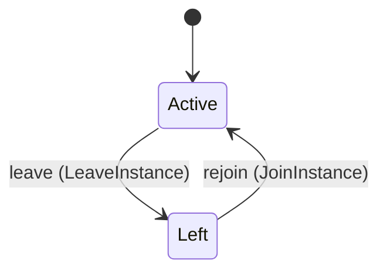

Each move is taken by a declared command outcome, and a move nothing takes is refused as `missing_causation` rather than left as a state change nobody can trigger:

- `leave` — taken by `conductor.operator.LeaveInstance` on its `left` outcome
- `rejoin` — taken by `conductor.operator.JoinInstance` on its `rejoined` outcome

An instance is brought into existence by `conductor.operator.JoinInstance` on its `joined` outcome.

Every ordered pair of these states is connected by some move, so this lifecycle forbids nothing.

One view projects it: [`Operators`](#operators).

## Views

A view is what the outside world is promised it can observe. Each one says which instances it contains and how soon it reflects a command that has already returned, because "you can read this" without "how soon" is the promise every flaky suite is built on.

### `Operators`

`conductor.operator.Operators`, shown to a person as "Operators" and called `operators` on the wire.

It reads [`Operator`](#operator).

It contains every instance of that entity: no filter narrows it, which is a decision somebody made and not a line somebody omitted.

It exposes:

- `key` — `conductor.operator.OperatorKey`
- `state` — `conductor.operator.Operator.State`
- `grants` — `List<conductor.operator.Grant>`
- `joined_at` — `Timestamp`
- `joined_by` — `conductor.operator.Actor`
- `left_at` — `Optional<Timestamp>`, which may be absent
- `left_by` — `Optional<conductor.operator.Actor>`, which may be absent

It declares no order, so the rows come back in whatever order the implementation has, and two reads may disagree.

**Read-your-writes**: it is current the moment the command that changed it returns. A caller that has just created an invoice and cannot see it in here has been told a lie about what it did.

A generated scenario asserts it once, immediately after the command: a view promising this and not keeping the promise has to fail the suite rather than be retried until it passes.

## Commands

### `JoinInstance`

`conductor.operator.JoinInstance`, shown to a person as "Join an instance" and called `join-instance` on the wire.

It takes:

- `actor` — `conductor.operator.Actor`
- `key` — `conductor.operator.OperatorKey`
- `grants` — `List<conductor.operator.Grant>`
- `joined_at` — `Timestamp`

It has four outcomes.

**`actor-not-human`** — An agent cannot join an instance; nothing was written. Taken when `actor.kind != Human` holds of the input. No entity in this specification changes. It reports `conductor.operator.ActorNotHuman`, carrying `actor`. It emits nothing. A test reaches it by constructing an input that satisfies that condition.

**`joined`** — The engineer is an active operator of the instance, with the grants given. Taken when no record carries the identity the command names, and no input-guarded refusal applies; it creates that record. It creates a `conductor.operator.Operator`, which starts in `Active`. The new instance's identity is published as `key` on `conductor.operator.OperatorJoined`. It emits `conductor.operator.OperatorJoined`. It sets `grants` from `input.grants`, `joined_at` from `input.joined_at`, `joined_by` from `input.actor`, `left_at` cleared and `left_by` cleared. A test reaches it by sending an identity no record carries, arranging nothing.

**`rejoined`** — An operator who had left joins again and is active, with the grants given now. The default branch, taken when no other outcome's condition matched. It moves a `conductor.operator.Operator` from `Left` to `Active`, along the declared move `rejoin`. The instance is the one named by the input field `key`. It emits `conductor.operator.OperatorJoined`. It sets `grants` from `input.grants`, `joined_at` from `input.joined_at`, `joined_by` from `input.actor`, `left_at` cleared and `left_by` cleared. A test reaches it by constructing an input that satisfies no other outcome's condition.

**`already-joined`** — The operator is active on the instance already; the record is unchanged. Taken when the subject is resting in a state none of this command's moves start from — a `conductor.operator.Operator` in `Active`, which is what is left of the lifecycle once this command's own moves are taken away. The document lists none of it. No entity in this specification changes. It reports `conductor.operator.AlreadyJoined`, carrying `key`. It emits nothing. A test reaches it by driving an instance into one of those states and then issuing the command, because no input selects this branch.

### `LeaveInstance`

`conductor.operator.LeaveInstance`, shown to a person as "Leave an instance" and called `leave-instance` on the wire.

It takes:

- `actor` — `conductor.operator.Actor`
- `key` — `conductor.operator.OperatorKey`
- `left_at` — `Timestamp`

It has four outcomes.

**`actor-not-human`** — An agent cannot make an operator leave; nothing was written. Taken when `actor.kind != Human` holds of the input. No entity in this specification changes. It reports `conductor.operator.ActorNotHuman`, carrying `actor`. It emits nothing. A test reaches it by constructing an input that satisfies that condition.

**`left`** — The operator has left the instance; the record stays, `Left`, with who and when. The default branch, taken when no other outcome's condition matched. It moves a `conductor.operator.Operator` from `Active` to `Left`, along the declared move `leave`. The instance is the one named by the input field `key`. It emits `conductor.operator.OperatorLeft`. It sets `left_at` from `input.left_at` and `left_by` from `input.actor`. A test reaches it by constructing an input that satisfies no other outcome's condition.

**`not-joined`** — The operator had left the instance already; the record is unchanged. Taken when the subject is resting in a state none of this command's moves start from — a `conductor.operator.Operator` in `Left`, which is what is left of the lifecycle once this command's own moves are taken away. The document lists none of it. No entity in this specification changes. It reports `conductor.operator.NotJoined`, carrying `key`. It emits nothing. A test reaches it by driving an instance into one of those states and then issuing the command, because no input selects this branch.

**`unknown-operator`** — The engineer never joined the instance; nothing was written. Taken when the identity the command names is one no record carries, before any other answer for it. No entity in this specification changes. It reports `conductor.operator.NotJoined`, carrying `key`. It emits nothing. A test reaches it by sending an identity no record carries, arranging nothing.

## Events

### `OperatorJoined`

`conductor.operator.OperatorJoined`.

It carries:

- `key` — `conductor.operator.OperatorKey`
- `grants` — `List<conductor.operator.Grant>`
- `joined_at` — `Timestamp`
- `actor` — `conductor.operator.Actor`

Emitted by `conductor.operator.JoinInstance` on its `joined` and `rejoined` outcomes.

Nothing in this system reacts to it.

### `OperatorLeft`

`conductor.operator.OperatorLeft`.

It carries:

- `key` — `conductor.operator.OperatorKey`
- `left_at` — `Timestamp`
- `actor` — `conductor.operator.Actor`

Emitted by `conductor.operator.LeaveInstance` on its `left` outcome.

Nothing in this system reacts to it.

## Errors

### `ActorNotHuman`

The command needs a grant, a grant belongs to a human actor only, and the actor that issued it is an agent or the daemon. Nothing was written.

It carries:

- `actor` — `conductor.operator.Actor`

Reported by `conductor.config.AddInstance` on its `actor-not-human` outcome.

Reported by `conductor.config.PutConfig` on its `actor-not-human` outcome.

Reported by `conductor.config.PutInstance` on its `actor-not-human` outcome.

Reported by `conductor.config.RemoveInstance` on its `actor-not-human` outcome.

Reported by `conductor.decision.AnswerEscalatedRequest` on its `agent-actor` outcome.

Reported by `conductor.decision.AnswerRequest` on its `agent-actor` outcome.

Reported by `conductor.decision.RecordOperatorDecision` on its `agent-actor` outcome.

Reported by `conductor.decision.RecordOperatorDecisionForRequest` on its `agent-actor` outcome.

Reported by `conductor.decision.ReverseOperatorDecision` on its `agent-actor` outcome.

Reported by `conductor.direction.ConfirmGoal` on its `agent-actor` outcome.

Reported by `conductor.direction.DropGoal` on its `agent-actor` outcome.

Reported by `conductor.improvement.SetMetricTarget` on its `actor-not-human` outcome.

Reported by `conductor.instance.PurgeInstance` on its `actor-not-human` outcome.

Reported by `conductor.operator.JoinInstance` on its `actor-not-human` outcome.

Reported by `conductor.operator.LeaveInstance` on its `actor-not-human` outcome.

Reported by `conductor.secret.PutSecret` on its `not-human` outcome.

Reported by `conductor.store.MigrateStore` on its `not-human` outcome.

Reported by `conductor.token.ContributeToken` on its `actor-not-human` outcome.

Reported by `conductor.token.WithdrawToken` on its `actor-not-human` outcome.

### `AlreadyJoined`

The operator is an active operator of the instance already; nothing changed.

It carries:

- `key` — `conductor.operator.OperatorKey`

Reported by `conductor.operator.JoinInstance` on its `already-joined` outcome.

### `GrantMissing`

The operator is a person, and holds no grant for the write asked. Nothing was written.

It carries:

- `operator` — `conductor.operator.OperatorName`
- `grant` — `conductor.operator.Grant`

No outcome in this system reports it: it is declared and unreachable.

### `NotJoined`

The operator is not an active operator of the instance, so there is nothing to leave.

It carries:

- `key` — `conductor.operator.OperatorKey`

Reported by `conductor.operator.LeaveInstance` on its `not-joined` and `unknown-operator` outcomes.

## Actors

An actor is who may ask this context for something. Every grant below points at a command this specification declares — a grant is a resolved reference, so "may invoke" something nobody wrote is not a permission this model can express, and an authorisation that authorises nothing cannot ship quietly.

### `Conductord`

`conductor.operator.Conductord`, shown to a person as "conductord".

It may invoke nothing: it observes. "Who is in this picture" is part of what a specification describes, so an actor with no grant is a statement rather than an unfinished line.

It may read [`Operators`](#operators), which an actor whose grant does not name it may not read.

### `Engineer`

`conductor.operator.Engineer`, shown to a person as "Engineer".

It may invoke [`JoinInstance`](#joininstance) and [`LeaveInstance`](#leaveinstance).

It may read [`Operators`](#operators), which an actor whose grant does not name it may not read.

---

Generated from conductor v1 · contract digest `slice-sha256/2:5ad383b829b82318132ca8058831e63ee1400b54c28b277716e46cfe57ebdcfb`. Do not edit this file; change the specification and regenerate it with `ess generate`.

<!--
generated from conductor v1
contract digest slice-sha256/2:2014a4a5b6434f5880a9ad5a28738f15456318dc9e3bf0f1fa712ad948422822
do not edit: regenerate with `ess generate`
-->

# Placement

Where an instance runs: a Substrate box, opened by a substrate daemon on this host or by a remote one named by URL with a bearer, through one of the adapters `systemd`, `linux` (bubblewrap), `oci` or `pod` (design docs/design/architecture-next.md § 6, decision 3). A placement carries the box's profile: read-only roots, the writable workspace, limits, egress and the secret slots. Conductor implements no sandbox: conductord asks substrate to open the box with the profile, and a refusal is recorded as a box refusal with substrate's own reason, by name, and nothing falls back (ADR 0109, quoted in § 6). Replaces `confinement.provider`, `confinement.mode` and the systemd provider's places (§ 3).

`conductor.placement` is one of conductor's bounded contexts. [Back to the index](../index.md).

## Types

### `Adapter`

`conductor.placement.Adapter` is one of `Systemd`, `Linux`, `Oci` and `Pod`.

### `BoxId`

`conductor.placement.BoxId` wraps `Uuid` and is not interchangeable with one: the whole value of naming it separately is the crossings the model then refuses.

### `BoxLimits`

`conductor.placement.BoxLimits` is a record of two fields:

- `limits` — `conductor.config.Limits`
- `storage_max` — `Optional<conductor.config.Gibibytes>`, which may be absent

### `BoxProfile`

`conductor.placement.BoxProfile` is a record of five fields:

- `read_only_roots` — `List<String>`
- `workspace` — `String`
- `limits` — `conductor.placement.BoxLimits`
- `egress` — `conductor.placement.Egress`
- `secret_slots` — `List<conductor.secret.SecretName>`

### `Daemon`

`conductor.placement.Daemon` is one of two shapes, told apart by a `kind` field — tagged, so a decoder never has to guess which branch it is reading:

- `Local` — `conductor.placement.LocalDaemon`
- `Remote` — `conductor.placement.RemoteDaemon`

### `Egress`

`conductor.placement.Egress` is a record of two fields:

- `forge_hosts` — `List<String>`
- `model_host` — `String`

### `LocalDaemon`

`conductor.placement.LocalDaemon` is a record of one field:

- `socket` — `String`

### `PlacementName`

`conductor.placement.PlacementName` wraps `String` and is not interchangeable with one: the whole value of naming it separately is the crossings the model then refuses.

### `RefusalReason`

`conductor.placement.RefusalReason` wraps `String` and is not interchangeable with one: the whole value of naming it separately is the crossings the model then refuses.

### `RemoteDaemon`

`conductor.placement.RemoteDaemon` is a record of four fields:

- `url` — `String`
- `bearer` — `conductor.secret.SecretName`
- `trust_roots` — `String`
- `server_identity` — `String`

## Entities

An entity is what this context is about: something with an identity that outlives any one request, a shape, and a lifecycle. The lifecycle is exhaustive — a move that is not drawn below is a move this specification does not permit, and that is the only way it says so. Every move is labelled with the command that takes it, because a move nothing can trigger is refused rather than drawn.

### `Box`

`conductor.placement.Box`.

An instance is identified by `box_id`, a `conductor.placement.BoxId`. The name is part of the model and not a convention: a view projects the identity under that name, so a projection inventing its own would disagree with the view.

It holds:

- `placement` — `conductor.placement.PlacementName`
- `instance` — `conductor.config.InstanceName`
- `actor` — `conductor.operator.Actor`
- `opened_at` — `Timestamp`
- `closed_at` — `Optional<Timestamp>`, which may be absent
- `closed_by` — `Optional<conductor.operator.Actor>`, which may be absent

It references at most one [`Placement`](#placement), as `placement`, carried by `Box.placement`. It references at most one [`conductor.instance.Instance`](conductor-instance.md#instance), as `instance`, carried by `Box.instance`.

No invariant is declared, so nothing here constrains an instance at rest.

Its state is a `conductor.placement.Box.State`, one of `Closed` and `Opened`. That enum is synthesised from the lifecycle rather than declared beside it, so the states a view's filter compares and the states drawn below cannot disagree.

An instance is created in `Opened`. `Closed` is terminal, so an instance may rest there forever. That is declared rather than inferred from having no way out: an entity that cannot leave a state is either finished or stuck, and only its author knows which.

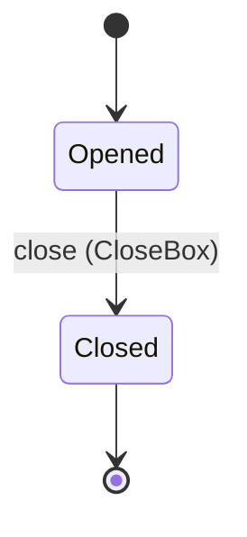

Each move is taken by a declared command outcome, and a move nothing takes is refused as `missing_causation` rather than left as a state change nobody can trigger:

- `close` — taken by `conductor.placement.CloseBox` on its `closed` outcome

An instance is brought into existence by `conductor.placement.OpenBox` on its `opened` outcome.

Illegal transitions are illegal by absence: no rule forbids them, there is simply no arrow, because a rule would be a second place for the same truth to live. A diagram cannot show an absence, so the pairs it does not connect are listed here, derived from the same transitions — anything named below is a move this specification does not permit.

- `Closed` may not become `Opened`

One view projects it: [`Boxes`](#boxes).

### `BoxRefusal`

`conductor.placement.BoxRefusal`.

An instance is identified by `box_id`, a `conductor.placement.BoxId`. The name is part of the model and not a convention: a view projects the identity under that name, so a projection inventing its own would disagree with the view.

It holds:

- `placement` — `conductor.placement.PlacementName`
- `instance` — `conductor.config.InstanceName`
- `actor` — `conductor.operator.Actor`
- `reason` — `conductor.placement.RefusalReason`
- `refused_at` — `Timestamp`

It references at most one [`Placement`](#placement), as `placement`, carried by `BoxRefusal.placement`.

No invariant is declared, so nothing here constrains an instance at rest.

Its state is a `conductor.placement.BoxRefusal.State`, one of `Refused`. That enum is synthesised from the lifecycle rather than declared beside it, so the states a view's filter compares and the states drawn below cannot disagree.

An instance is created in `Refused`. `Refused` is terminal, so an instance may rest there forever. That is declared rather than inferred from having no way out: an entity that cannot leave a state is either finished or stuck, and only its author knows which.

It declares no moves, so nothing changes its state once it exists.

It has one state, so there is no move to permit or to forbid.

One view projects it: [`BoxRefusals`](#boxrefusals).

### `Placement`

`conductor.placement.Placement`.

An instance is identified by `name`, a `conductor.placement.PlacementName`. The name is part of the model and not a convention: a view projects the identity under that name, so a projection inventing its own would disagree with the view.

It holds:

- `daemon` — `conductor.placement.Daemon`
- `adapter` — `conductor.placement.Adapter`
- `profile` — `conductor.placement.BoxProfile`

It declares no relation to another entity, and no other entity names it.

No invariant is declared, so nothing here constrains an instance at rest.

Its state is a `conductor.placement.Placement.State`, one of `Configured`. That enum is synthesised from the lifecycle rather than declared beside it, so the states a view's filter compares and the states drawn below cannot disagree.

An instance is created in `Configured`. `Configured` is terminal, so an instance may rest there forever. That is declared rather than inferred from having no way out: an entity that cannot leave a state is either finished or stuck, and only its author knows which.

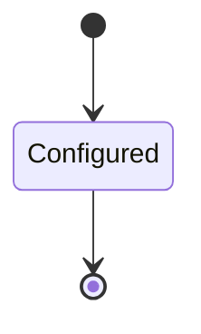

It declares no moves, so nothing changes its state once it exists.

It has one state, so there is no move to permit or to forbid.

One view projects it: [`Placements`](#placements).

## Views

A view is what the outside world is promised it can observe. Each one says which instances it contains and how soon it reflects a command that has already returned, because "you can read this" without "how soon" is the promise every flaky suite is built on.

### `BoxRefusals`

`conductor.placement.BoxRefusals`, shown to a person as "Box refusals" and called `box-refusals` on the wire.

It reads [`BoxRefusal`](#boxrefusal).

It contains every instance of that entity: no filter narrows it, which is a decision somebody made and not a line somebody omitted.

It exposes:

- `box_id` — `conductor.placement.BoxId`
- `state` — `conductor.placement.BoxRefusal.State`
- `placement` — `conductor.placement.PlacementName`
- `instance` — `conductor.config.InstanceName`
- `actor` — `conductor.operator.Actor`
- `reason` — `conductor.placement.RefusalReason`
- `refused_at` — `Timestamp`

It declares no order, so the rows come back in whatever order the implementation has, and two reads may disagree.

**Read-your-writes**: it is current the moment the command that changed it returns. A caller that has just created an invoice and cannot see it in here has been told a lie about what it did.

A generated scenario asserts it once, immediately after the command: a view promising this and not keeping the promise has to fail the suite rather than be retried until it passes.

### `Boxes`

`conductor.placement.Boxes`, shown to a person as "Boxes" and called `boxes` on the wire.

It reads [`Box`](#box).

It contains every instance of that entity: no filter narrows it, which is a decision somebody made and not a line somebody omitted.

It exposes:

- `box_id` — `conductor.placement.BoxId`
- `state` — `conductor.placement.Box.State`
- `placement` — `conductor.placement.PlacementName`
- `instance` — `conductor.config.InstanceName`
- `actor` — `conductor.operator.Actor`
- `opened_at` — `Timestamp`
- `closed_at` — `Optional<Timestamp>`, which may be absent
- `closed_by` — `Optional<conductor.operator.Actor>`, which may be absent

It declares no order, so the rows come back in whatever order the implementation has, and two reads may disagree.

**Read-your-writes**: it is current the moment the command that changed it returns. A caller that has just created an invoice and cannot see it in here has been told a lie about what it did.

A generated scenario asserts it once, immediately after the command: a view promising this and not keeping the promise has to fail the suite rather than be retried until it passes.

### `Placements`

`conductor.placement.Placements`, shown to a person as "Placements" and called `placements` on the wire.

It reads [`Placement`](#placement).

It contains every instance of that entity: no filter narrows it, which is a decision somebody made and not a line somebody omitted.

It exposes:

- `name` — `conductor.placement.PlacementName`
- `state` — `conductor.placement.Placement.State`
- `daemon` — `conductor.placement.Daemon`
- `adapter` — `conductor.placement.Adapter`
- `profile` — `conductor.placement.BoxProfile`

It declares no order, so the rows come back in whatever order the implementation has, and two reads may disagree.

**Read-your-writes**: it is current the moment the command that changed it returns. A caller that has just created an invoice and cannot see it in here has been told a lie about what it did.

A generated scenario asserts it once, immediately after the command: a view promising this and not keeping the promise has to fail the suite rather than be retried until it passes.

## Commands

### `CloseBox`

`conductor.placement.CloseBox`, shown to a person as "Close a box" and called `close-box` on the wire.

It takes:

- `actor` — `conductor.operator.Actor`
- `box_id` — `conductor.placement.BoxId`
- `at` — `Timestamp`

It has three outcomes.

**`closed`** — The box is closed. The default branch, taken when no other outcome's condition matched. It moves a `conductor.placement.Box` from `Opened` to `Closed`, along the declared move `close`. The instance is the one named by the input field `box_id`. It emits `conductor.placement.BoxClosed`. It sets `closed_at` from `input.at` and `closed_by` from `input.actor`. A test reaches it by constructing an input that satisfies no other outcome's condition.

**`no-such-box`** — No box has this id; nothing was closed. Taken when the identity the command names is one no record carries, before any other answer for it. No entity in this specification changes. It reports `conductor.placement.BoxNotFound`, carrying `box_id`. It emits nothing. A test reaches it by sending an identity no record carries, arranging nothing.

**`wrong-state`** — The box is already Closed, so nothing was closed. Taken when the subject is resting in a state none of this command's moves start from — a `conductor.placement.Box` in `Closed`, which is what is left of the lifecycle once this command's own moves are taken away. The document lists none of it. No entity in this specification changes. It reports `conductor.placement.BoxStateConflict`, carrying `box_id`. It emits nothing. A test reaches it by driving an instance into one of those states and then issuing the command, because no input selects this branch.

### `OpenBox`

`conductor.placement.OpenBox`, shown to a person as "Open a box" and called `open-box` on the wire.

It takes:

- `actor` — `conductor.operator.Actor`
- `placement` — `conductor.placement.PlacementName`
- `instance` — `conductor.config.InstanceName`
- `at` — `Timestamp`

It has three outcomes.

**`refused`** — Substrate refused the box; the refusal is on record with substrate's reason, the instance does not start and nothing falls back. Decided outside the input: substrate cannot give what the placement's profile asks for and refuses by name (`exec.sandbox-unavailable`). No predicate over the input reaches this branch, and saying `when: false` instead would have claimed it is unreachable, which is a different and false statement. It creates a `conductor.placement.BoxRefusal`, which starts in `Refused`. The new instance's identity is published as `box_id` on `conductor.placement.BoxRefused`. It emits `conductor.placement.BoxRefused`. It sets `placement` from `input.placement`, `instance` from `input.instance`, `actor` from `input.actor`, `reason` from `implementation-generated` and `refused_at` from `input.at`. A test reaches it by injecting the declared fault, because no input can.

**`adapter-refused`** — The host policy refused the adapter; the refusal is on record with the name substrate gave it, passed through, and nothing falls back. Decided outside the input: substrate's host policy refuses the placement's adapter, and substrate names the refusal. No predicate over the input reaches this branch, and saying `when: false` instead would have claimed it is unreachable, which is a different and false statement. It creates a `conductor.placement.BoxRefusal`, which starts in `Refused`. The new instance's identity is published as `box_id` on `conductor.placement.BoxRefused`. It emits `conductor.placement.BoxRefused`. It sets `placement` from `input.placement`, `instance` from `input.instance`, `actor` from `input.actor`, `reason` from `implementation-generated` and `refused_at` from `input.at`. A test reaches it by injecting the declared fault, because no input can.

**`opened`** — The box is open at the placement with the placement's profile. The default branch, taken when no other outcome's condition matched. It creates a `conductor.placement.Box`, which starts in `Opened`. The new instance's identity is published as `box_id` on `conductor.placement.BoxOpened`. It emits `conductor.placement.BoxOpened`. It sets `placement` from `input.placement`, `instance` from `input.instance`, `actor` from `input.actor` and `opened_at` from `input.at`. A test reaches it by constructing an input that satisfies no other outcome's condition.

## Events

### `BoxClosed`

`conductor.placement.BoxClosed`.

It carries:

- `box_id` — `conductor.placement.BoxId`
- `actor` — `conductor.operator.Actor`
- `closed_at` — `Timestamp`

Emitted by `conductor.placement.CloseBox` on its `closed` outcome.

Nothing in this system reacts to it.

### `BoxOpened`

`conductor.placement.BoxOpened`.

It carries:

- `box_id` — `conductor.placement.BoxId`
- `actor` — `conductor.operator.Actor`
- `placement` — `conductor.placement.PlacementName`
- `instance` — `conductor.config.InstanceName`
- `opened_at` — `Timestamp`

Emitted by `conductor.placement.OpenBox` on its `opened` outcome.

Nothing in this system reacts to it.

### `BoxRefused`

`conductor.placement.BoxRefused`.

It carries:

- `box_id` — `conductor.placement.BoxId`
- `actor` — `conductor.operator.Actor`
- `placement` — `conductor.placement.PlacementName`
- `instance` — `conductor.config.InstanceName`
- `reason` — `conductor.placement.RefusalReason`
- `refused_at` — `Timestamp`

Emitted by `conductor.placement.OpenBox` on its `refused` and `adapter-refused` outcomes.

Nothing in this system reacts to it.

## Errors

### `BoxNotFound`

No box has this id, so nothing was closed.

It carries:

- `box_id` — `conductor.placement.BoxId`

Reported by `conductor.placement.CloseBox` on its `no-such-box` outcome.

### `BoxStateConflict`

The box is already closed, so nothing was closed.

It carries:

- `box_id` — `conductor.placement.BoxId`

Reported by `conductor.placement.CloseBox` on its `wrong-state` outcome.

## Actors

An actor is who may ask this context for something. Every grant below points at a command this specification declares — a grant is a resolved reference, so "may invoke" something nobody wrote is not a permission this model can express, and an authorisation that authorises nothing cannot ship quietly.

### `Conductord`

`conductor.placement.Conductord`, shown to a person as "conductord".

It may invoke [`CloseBox`](#closebox) and [`OpenBox`](#openbox).

---

Generated from conductor v1 · contract digest `slice-sha256/2:2014a4a5b6434f5880a9ad5a28738f15456318dc9e3bf0f1fa712ad948422822`. Do not edit this file; change the specification and regenerate it with `ess generate`.

<!--
generated from conductor v1
contract digest slice-sha256/2:c654091b2df68b9f8baec969e7532681a9638a54b634f8fa5c3f7867b3d4fd1d
do not edit: regenerate with `ess generate`
-->

# Secret

The config names secrets and never holds them (design docs/design/architecture-next.md § 9, decision 6): a `secret:<name>` is resolved by the daemon through the `secrets` crates, the OS keychain on a workstation and the Secrets service where conductord is deployed, and handed to a box as a sealed slot at box open (§ 6). The API lists names and sources, never values. The specification holds no secret value anywhere: no type, field, input, event, error or view below carries one.

`conductor.secret` is one of conductor's bounded contexts. [Back to the index](../index.md).

## Types

### `InstanceSecretKey`

`conductor.secret.InstanceSecretKey` wraps `String` and is not interchangeable with one: the whole value of naming it separately is the crossings the model then refuses.

### `Namespace`

`conductor.secret.Namespace` wraps `String` and is not interchangeable with one: the whole value of naming it separately is the crossings the model then refuses.

### `SecretName`

`conductor.secret.SecretName` wraps `String` and is not interchangeable with one: the whole value of naming it separately is the crossings the model then refuses.

### `Slot`

`conductor.secret.Slot` is a record of four fields:

- `secret` — `conductor.secret.SecretName`
- `box` — `conductor.placement.BoxId`
- `slot_name` — `conductor.secret.SlotName`
- `sealed_at` — `Timestamp`

### `SlotName`

`conductor.secret.SlotName` wraps `String` and is not interchangeable with one: the whole value of naming it separately is the crossings the model then refuses.

### `Source`

`conductor.secret.Source` is one of `Keychain`, `Remote` and `Files`.

### `WriteSecret`

`conductor.secret.WriteSecret` is a record of two fields:

- `name` — `Optional<conductor.secret.SecretName>`, which may be absent
- `replace` — `Optional<Boolean>`, which may be absent

One of the types above is reached by nothing else in this system: `conductor.secret.WriteSecret`. No entity, view, command, event, error or crossing names it, so it is either vocabulary something outside this specification uses or a leftover — and only a person can tell which.

## Entities

An entity is what this context is about: something with an identity that outlives any one request, a shape, and a lifecycle. The lifecycle is exhaustive — a move that is not drawn below is a move this specification does not permit, and that is the only way it says so. Every move is labelled with the command that takes it, because a move nothing can trigger is refused rather than drawn.

### `InstanceSecret`

`conductor.secret.InstanceSecret`.

An instance is identified by `secret_key`, a `conductor.secret.InstanceSecretKey`. The name is part of the model and not a convention: a view projects the identity under that name, so a projection inventing its own would disagree with the view.

It holds:

- `instance` — `conductor.config.InstanceName`
- `key` — `String`
- `secret` — `conductor.secret.SecretName`
- `set` — `Boolean`
- `modified_at` — `Optional<Timestamp>`, which may be absent

It declares no relation to another entity, and no other entity names it.

No invariant is declared, so nothing here constrains an instance at rest.

Its state is a `conductor.secret.InstanceSecret.State`, one of `Derived`. That enum is synthesised from the lifecycle rather than declared beside it, so the states a view's filter compares and the states drawn below cannot disagree.

An instance is created in `Derived`. `Derived` is terminal, so an instance may rest there forever. That is declared rather than inferred from having no way out: an entity that cannot leave a state is either finished or stuck, and only its author knows which.

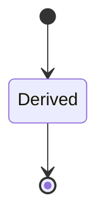

It declares no moves, so nothing changes its state once it exists.

It has one state, so there is no move to permit or to forbid.

One view projects it: [`InstanceSecrets`](#instancesecrets).

### `Secret`

`conductor.secret.Secret`.

An instance is identified by `name`, a `conductor.secret.SecretName`. The name is part of the model and not a convention: a view projects the identity under that name, so a projection inventing its own would disagree with the view.

It holds:

- `source` — `conductor.secret.Source`
- `namespace` — `Optional<conductor.secret.Namespace>`, which may be absent
- `instances` — `List<conductor.config.InstanceName>`
- `created_by` — `conductor.operator.Actor`
- `created_at` — `Timestamp`
- `last_resolved_at` — `Optional<Timestamp>`, which may be absent

It references any number of [`conductor.instance.Instance`](conductor-instance.md#instance), as `instances`, carried by `Secret.instances`.

No invariant is declared, so nothing here constrains an instance at rest.

Its state is a `conductor.secret.Secret.State`, one of `Stored`. That enum is synthesised from the lifecycle rather than declared beside it, so the states a view's filter compares and the states drawn below cannot disagree.

An instance is created in `Stored`. `Stored` is terminal, so an instance may rest there forever. That is declared rather than inferred from having no way out: an entity that cannot leave a state is either finished or stuck, and only its author knows which.

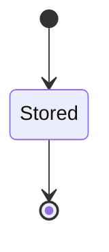

It declares no moves, so nothing changes its state once it exists.

It has one state, so there is no move to permit or to forbid.

One view projects it: [`Secrets`](#secrets).

## Views

A view is what the outside world is promised it can observe. Each one says which instances it contains and how soon it reflects a command that has already returned, because "you can read this" without "how soon" is the promise every flaky suite is built on.

### `InstanceSecrets`

`conductor.secret.InstanceSecrets`, shown to a person as "Instance secrets" and called `instance-secrets` on the wire.

It reads [`InstanceSecret`](#instancesecret).

It contains the instances where `instance == param.instance` holds, and only those — so an instance a caller cannot find in here has been filtered out rather than lost.

It exposes:

- `instance` — `conductor.config.InstanceName`
- `key` — `String`
- `secret` — `conductor.secret.SecretName`
- `set` — `Boolean`
- `modified_at` — `Optional<Timestamp>`, which may be absent

It declares no order, so the rows come back in whatever order the implementation has, and two reads may disagree.

**Read-your-writes**: it is current the moment the command that changed it returns. A caller that has just created an invoice and cannot see it in here has been told a lie about what it did.

A generated scenario asserts it once, immediately after the command: a view promising this and not keeping the promise has to fail the suite rather than be retried until it passes.

### `Secrets`

`conductor.secret.Secrets`, shown to a person as "Secrets" and called `secrets` on the wire.

It reads [`Secret`](#secret).

It contains every instance of that entity: no filter narrows it, which is a decision somebody made and not a line somebody omitted.

It exposes:

- `name` — `conductor.secret.SecretName`
- `state` — `conductor.secret.Secret.State`
- `source` — `conductor.secret.Source`
- `created_by` — `conductor.operator.Actor`
- `created_at` — `Timestamp`

It declares no order, so the rows come back in whatever order the implementation has, and two reads may disagree.

**Read-your-writes**: it is current the moment the command that changed it returns. A caller that has just created an invoice and cannot see it in here has been told a lie about what it did.

A generated scenario asserts it once, immediately after the command: a view promising this and not keeping the promise has to fail the suite rather than be retried until it passes.

## Commands

### `PutSecret`

`conductor.secret.PutSecret`, shown to a person as "Put a secret into the keychain" and called `put-secret` on the wire.

It takes:

- `actor` — `conductor.operator.Actor`
- `name` — `conductor.secret.SecretName`
- `put_at` — `Timestamp`
- `replace` — `Boolean`

It has six outcomes.

**`not-human`** — An agent actor holds no credential and puts none; nothing was written. Taken when `actor.kind != Human` holds of the input. No entity in this specification changes. It reports `conductor.operator.ActorNotHuman`, carrying `actor`. It emits nothing. A test reaches it by constructing an input that satisfies that condition.

**`read-only`** — Nothing was written to the directory and nothing recorded. Decided outside the input: the daemon's secrets source is a directory of mounted files, which conductor never writes. No predicate over the input reaches this branch, and saying `when: false` instead would have claimed it is unreachable, which is a different and false statement. No entity in this specification changes. It reports `conductor.secret.SourceReadOnly`, carrying `source`. It emits nothing. A test reaches it by injecting the declared fault, because no input can.

**`unreachable`** — Nothing was written to the keychain and nothing recorded. Decided outside the input: the OS keychain does not answer. No predicate over the input reaches this branch, and saying `when: false` instead would have claimed it is unreachable, which is a different and false statement. No entity in this specification changes. It reports `conductor.secret.SourceUnreachable`, carrying `source`. It emits nothing. A test reaches it by injecting the declared fault, because no input can.

**`stored`** — The value is in the keychain under the name, and the secret is on record with its source and who put it. Taken when no record carries the identity the command names, and no input-guarded refusal applies; it creates that record. It creates a `conductor.secret.Secret`, which starts in `Stored`. The new instance's identity is published as `name` on `conductor.secret.SecretPut`. It emits `conductor.secret.SecretPut`. It sets `source` from `"Keychain"`, `created_by` from `input.actor`, `created_at` from `input.put_at` and `last_resolved_at` cleared. A test reaches it by sending an identity no record carries, arranging nothing.

**`exists`** — The name is on record and the put did not ask to replace it; nothing was written. Decided outside the input: the secrets source already holds a value under the name and replace is false. No predicate over the input reaches this branch, and saying `when: false` instead would have claimed it is unreachable, which is a different and false statement. No entity in this specification changes. It reports `conductor.secret.SecretExists`, carrying `name`. It emits nothing. A test reaches it by injecting the declared fault, because no input can.

**`replaced`** — The value under the name is written again; the record is unchanged. The default branch, taken when no other outcome's condition matched. It changes a `conductor.secret.Secret` without moving it along its lifecycle. The instance is the one named by the input field `name`. It emits `conductor.secret.SecretPut`. A test reaches it by constructing an input that satisfies no other outcome's condition.

### `ResolveSecrets`

`conductor.secret.ResolveSecrets`, shown to a person as "Resolve an instance's secrets at box open" and called `resolve-secrets` on the wire.

It takes:

- `actor` — `conductor.operator.Actor`
- `instance` — `conductor.config.InstanceName`
- `box` — `conductor.placement.BoxId`
- `slots` — `List<conductor.secret.Slot>`
- `resolved_at` — `Timestamp`

It has three outcomes.

**`unreachable`** — Nothing was resolved and no slot sealed; the box is not opened, and the daemon records why. Decided outside the input: the daemon's secrets source (the OS keychain or the Secrets service) does not answer. No predicate over the input reaches this branch, and saying `when: false` instead would have claimed it is unreachable, which is a different and false statement. No entity in this specification changes. It reports `conductor.secret.SourceUnreachable`, carrying `source`. It emits nothing. A test reaches it by injecting the declared fault, because no input can.

**`missing`** — No slot was sealed; the refusal names every missing secret, and the box is not opened. Decided outside the input: the secrets source holds no value under one or more of the names the slots carry. No predicate over the input reaches this branch, and saying `when: false` instead would have claimed it is unreachable, which is a different and false statement. No entity in this specification changes. It reports `conductor.secret.SecretMissing`, carrying `instance`, `box` and `names`. It emits nothing. A test reaches it by injecting the declared fault, because no input can.

**`resolved`** — Every named secret is sealed into the box as a slot; the record names the slots and never a value. The default branch, taken when no other outcome's condition matched. No entity in this specification changes. It emits `conductor.secret.SecretsResolved`. A test reaches it by constructing an input that satisfies no other outcome's condition.

## Events

### `SecretPut`

`conductor.secret.SecretPut`.

It carries:

- `actor` — `conductor.operator.Actor`
- `name` — `conductor.secret.SecretName`
- `source` — `conductor.secret.Source`
- `put_at` — `Timestamp`

Emitted by `conductor.secret.PutSecret` on its `stored` and `replaced` outcomes.

Nothing in this system reacts to it.

### `SecretsResolved`

`conductor.secret.SecretsResolved`.

It carries:

- `actor` — `conductor.operator.Actor`
- `instance` — `conductor.config.InstanceName`
- `box` — `conductor.placement.BoxId`
- `slots` — `List<conductor.secret.Slot>`
- `resolved_at` — `Timestamp`

Emitted by `conductor.secret.ResolveSecrets` on its `resolved` outcome.

Nothing in this system reacts to it.

## Errors

### `SecretExists`

The secrets source already holds a value under the name and the put did not ask to replace it, so nothing was written; `conductor secret put --replace` writes it again.

It carries:

- `name` — `conductor.secret.SecretName`

Reported by `conductor.secret.PutSecret` on its `exists` outcome.

### `SecretMissing`

The secrets source holds no value under one or more of the names the instance's effective config writes as `secret:<name>`, so no slot was sealed and the box is not opened; the refusal names every missing name.

It carries:

- `instance` — `conductor.config.InstanceName`
- `box` — `conductor.placement.BoxId`
- `names` — `List<conductor.secret.SecretName>`

Reported by `conductor.secret.ResolveSecrets` on its `missing` outcome.

### `SourceReadOnly`

The secrets source is a directory of mounted files, which conductor reads and never writes, so nothing was written; the value goes into the directory's file of that name, written by whoever mounts the directory.

It carries:

- `source` — `conductor.secret.Source`

Reported by `conductor.secret.PutSecret` on its `read-only` outcome.

### `SourceUnreachable`

The secrets source (the OS keychain, or the Secrets service) did not answer, so nothing was read or written; the refusal names which source.

It carries:

- `source` — `conductor.secret.Source`

Reported by `conductor.secret.PutSecret` on its `unreachable` outcome.

Reported by `conductor.secret.ResolveSecrets` on its `unreachable` outcome.

### `SourceUnusable`

The secrets source `daemon.secrets` names cannot be used: `remote` writes no `url`, `files` writes no `dir`, or the namespace is not one segment of lower-case letters, digits, `.`, `_` and `-`; the daemon does not start.

It carries:

- `source` — `conductor.secret.Source`

No outcome in this system reports it: it is declared and unreachable.

## Actors

An actor is who may ask this context for something. Every grant below points at a command this specification declares — a grant is a resolved reference, so "may invoke" something nobody wrote is not a permission this model can express, and an authorisation that authorises nothing cannot ship quietly.

### `Conductord`

`conductor.secret.Conductord`, shown to a person as "conductord".

It may invoke [`ResolveSecrets`](#resolvesecrets).

### `Operator`

`conductor.secret.Operator`, shown to a person as "Operator".

It may invoke [`PutSecret`](#putsecret).

---

Generated from conductor v1 · contract digest `slice-sha256/2:c654091b2df68b9f8baec969e7532681a9638a54b634f8fa5c3f7867b3d4fd1d`. Do not edit this file; change the specification and regenerate it with `ess generate`.

<!--
generated from conductor v1
contract digest slice-sha256/2:6201fcc4fb07d482b8d327852bfcb6cfaccf646f3881d567b5bdc64f2d09db9c
do not edit: regenerate with `ess generate`
-->

# Store

One shared database per deployment (design docs/design/architecture-next.md § 8, decision 13), opened through Eventlog's port: `sqlite` for a deployment that is one host, `postgres` for everything else. `daemon.store` names the one URL; the daemon hands it to every instance runtime it starts; every event names its instance; every UI and every operator reads the same records. No copy per instance, no sync, no restore. Today's eventlog tree is read once by the migration (`conductor store migrate`) and not opened again.
No command opens the store: § 2 and § 8 say the daemon opens it at start and hands its URL to every runtime, and neither lists that opening among the records the store keeps (decisions, dispatches, readings, findings, charters, hand-offs, snapshots, config changes, reconciliations). The `Store` row is the deployment's, not a command's.

`conductor.store` is one of conductor's bounded contexts. [Back to the index](../index.md).

## Types

### `Backend`

`conductor.store.Backend` is one of `Sqlite` and `Postgres`.

### `BinaryVersion`

`conductor.store.BinaryVersion` wraps `String` and is not interchangeable with one: the whole value of naming it separately is the crossings the model then refuses.

### `StoreUrl`

`conductor.store.StoreUrl` wraps `String` and is not interchangeable with one: the whole value of naming it separately is the crossings the model then refuses.

## Entities

An entity is what this context is about: something with an identity that outlives any one request, a shape, and a lifecycle. The lifecycle is exhaustive — a move that is not drawn below is a move this specification does not permit, and that is the only way it says so. Every move is labelled with the command that takes it, because a move nothing can trigger is refused rather than drawn.

### `Build`

`conductor.store.Build`.

An instance is identified by `version`, a `conductor.store.BinaryVersion`. The name is part of the model and not a convention: a view projects the identity under that name, so a projection inventing its own would disagree with the view.

It holds:

- `config` — `String`

It declares no relation to another entity, and no other entity names it.

No invariant is declared, so nothing here constrains an instance at rest.

Its state is a `conductor.store.Build.State`, one of `Built`. That enum is synthesised from the lifecycle rather than declared beside it, so the states a view's filter compares and the states drawn below cannot disagree.

An instance is created in `Built`. `Built` is terminal, so an instance may rest there forever. That is declared rather than inferred from having no way out: an entity that cannot leave a state is either finished or stuck, and only its author knows which.

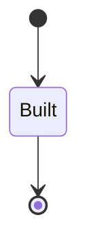

It declares no moves, so nothing changes its state once it exists.

It has one state, so there is no move to permit or to forbid.

One view projects it: [`Version`](#version).

### `Migration`

`conductor.store.Migration`.

An instance is identified by `instance`, a `conductor.config.InstanceName`. The name is part of the model and not a convention: a view projects the identity under that name, so a projection inventing its own would disagree with the view.

It holds:

- `source` — `String`
- `store` — `conductor.store.StoreUrl`
- `events_copied` — `Integer`
- `migrated_at` — `Timestamp`
- `actor` — `conductor.operator.Actor`

It references at most one [`Store`](#store), as `store`, carried by `Migration.store`.

Every instance satisfies `events_copied >= 0` — a predicate over this entity's own fields, checked against them rather than stored as a sentence, so an invariant reading something the entity does not have is refused instead of documented.

Its state is a `conductor.store.Migration.State`, one of `Migrated`. That enum is synthesised from the lifecycle rather than declared beside it, so the states a view's filter compares and the states drawn below cannot disagree.

An instance is created in `Migrated`. `Migrated` is terminal, so an instance may rest there forever. That is declared rather than inferred from having no way out: an entity that cannot leave a state is either finished or stuck, and only its author knows which.

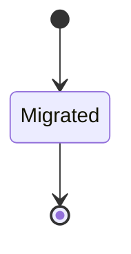

It declares no moves, so nothing changes its state once it exists.

It has one state, so there is no move to permit or to forbid.

One view projects it: [`Migrations`](#migrations).

### `Store`

`conductor.store.Store`.

An instance is identified by `url`, a `conductor.store.StoreUrl`. The name is part of the model and not a convention: a view projects the identity under that name, so a projection inventing its own would disagree with the view.

It holds:

- `backend` — `conductor.store.Backend`
- `opened_at` — `Timestamp`
- `reachable` — `Boolean`
- `reason` — `Optional<String>`, which may be absent
- `last_event_id` — `Integer`
- `instance_last_event_ids` — `Map<String, Integer>`

It declares no relation to another entity, and no other entity names it.

Every instance satisfies `last_event_id >= 0` — a predicate over this entity's own fields, checked against them rather than stored as a sentence, so an invariant reading something the entity does not have is refused instead of documented.

Its state is a `conductor.store.Store.State`, one of `Opened`. That enum is synthesised from the lifecycle rather than declared beside it, so the states a view's filter compares and the states drawn below cannot disagree.

An instance is created in `Opened`. `Opened` is terminal, so an instance may rest there forever. That is declared rather than inferred from having no way out: an entity that cannot leave a state is either finished or stuck, and only its author knows which.

It declares no moves, so nothing changes its state once it exists.

It has one state, so there is no move to permit or to forbid.

Two views project it: [`Readiness`](#readiness) and [`StoreStatus`](#storestatus).

## Views

A view is what the outside world is promised it can observe. Each one says which instances it contains and how soon it reflects a command that has already returned, because "you can read this" without "how soon" is the promise every flaky suite is built on.

### `Migrations`

`conductor.store.Migrations`, shown to a person as "Store migrations" and called `migrations` on the wire.

It reads [`Migration`](#migration).

It contains every instance of that entity: no filter narrows it, which is a decision somebody made and not a line somebody omitted.

It exposes:

- `instance` — `conductor.config.InstanceName`
- `state` — `conductor.store.Migration.State`
- `source` — `String`
- `store` — `conductor.store.StoreUrl`
- `events_copied` — `Integer`
- `migrated_at` — `Timestamp`
- `actor` — `conductor.operator.Actor`

It declares no order, so the rows come back in whatever order the implementation has, and two reads may disagree.

**Read-your-writes**: it is current the moment the command that changed it returns. A caller that has just created an invoice and cannot see it in here has been told a lie about what it did.

A generated scenario asserts it once, immediately after the command: a view promising this and not keeping the promise has to fail the suite rather than be retried until it passes.

### `Readiness`

`conductor.store.Readiness`, shown to a person as "Readiness" and called `readiness` on the wire.

It reads [`Store`](#store).

It contains every instance of that entity: no filter narrows it, which is a decision somebody made and not a line somebody omitted.

It exposes:

- `reachable` — `Boolean`
- `reason` — `Optional<String>`, which may be absent

It declares no order, so the rows come back in whatever order the implementation has, and two reads may disagree.

**Read-your-writes**: it is current the moment the command that changed it returns. A caller that has just created an invoice and cannot see it in here has been told a lie about what it did.

A generated scenario asserts it once, immediately after the command: a view promising this and not keeping the promise has to fail the suite rather than be retried until it passes.

### `StoreStatus`

`conductor.store.StoreStatus`, shown to a person as "Store status" and called `store-status` on the wire.

It reads [`Store`](#store).

It contains every instance of that entity: no filter narrows it, which is a decision somebody made and not a line somebody omitted.

It exposes:

- `url` — `conductor.store.StoreUrl`
- `state` — `conductor.store.Store.State`
- `backend` — `conductor.store.Backend`
- `reachable` — `Boolean`
- `last_event_id` — `Integer`
- `instance_last_event_ids` — `Map<String, Integer>`

It declares no order, so the rows come back in whatever order the implementation has, and two reads may disagree.

**Read-your-writes**: it is current the moment the command that changed it returns. A caller that has just created an invoice and cannot see it in here has been told a lie about what it did.

A generated scenario asserts it once, immediately after the command: a view promising this and not keeping the promise has to fail the suite rather than be retried until it passes.

### `Version`

`conductor.store.Version`, shown to a person as "Version" and called `version` on the wire.

It reads [`Build`](#build).

It contains every instance of that entity: no filter narrows it, which is a decision somebody made and not a line somebody omitted.

It exposes:

- `version` — `conductor.store.BinaryVersion`
- `config` — `String`

It declares no order, so the rows come back in whatever order the implementation has, and two reads may disagree.

**Read-your-writes**: it is current the moment the command that changed it returns. A caller that has just created an invoice and cannot see it in here has been told a lie about what it did.

A generated scenario asserts it once, immediately after the command: a view promising this and not keeping the promise has to fail the suite rather than be retried until it passes.

## Commands

### `MigrateStore`

`conductor.store.MigrateStore`, shown to a person as "Migrate an eventlog tree into the store" and called `migrate-store` on the wire.

It takes:

- `actor` — `conductor.operator.Actor`
- `instance` — `conductor.config.InstanceName`
- `source` — `String`
- `store` — `conductor.store.StoreUrl`
- `events_copied` — `Integer`
- `migrated_at` — `Timestamp`

It has five outcomes.

**`not-human`** — An agent ran the operator's one-time step; it is refused and nothing was copied. Taken when `actor.kind != Human` holds of the input. No entity in this specification changes. It reports `conductor.operator.ActorNotHuman`, carrying `actor`. It emits nothing. A test reaches it by constructing an input that satisfies that condition.

**`negative-count`** — A count of events is never negative; nothing was recorded. Taken when `events_copied < 0` holds of the input. No entity in this specification changes. It reports `conductor.store.InvalidEventCount`, carrying `events_copied`. It emits nothing. A test reaches it by constructing an input that satisfies that condition.

**`already-migrated`** — The instance's tree is in the store already; it is not read again. Taken when, of the `conductor.store.Migration` rows whose stored fields satisfy `instance == input.instance` before the outcome, at least one row is selected. No entity in this specification changes. It reports `conductor.store.AlreadyMigrated`, carrying `instance`. It emits nothing. A test reaches it by arranging the row of the other entity the input names, or its absence, and sending the command for it.

**`source-missing`** — There is no tree to read; nothing was copied. Decided outside the input: no eventlog tree is at the source path. No predicate over the input reaches this branch, and saying `when: false` instead would have claimed it is unreachable, which is a different and false statement. No entity in this specification changes. It reports `conductor.store.SourceMissing`, carrying `instance` and `source`. It emits nothing. A test reaches it by injecting the declared fault, because no input can.

**`migrated`** — The instance's tree is in the store, the count copied is on record, and the tree is not opened again. The default branch, taken when no other outcome's condition matched. It creates a `conductor.store.Migration`, which starts in `Migrated`. The new instance's identity is published as `instance` on `conductor.store.StoreMigrated`. It emits `conductor.store.StoreMigrated`. It sets `source` from `input.source`, `store` from `input.store`, `events_copied` from `input.events_copied`, `migrated_at` from `input.migrated_at` and `actor` from `input.actor`. A test reaches it by constructing an input that satisfies no other outcome's condition.

## Events

### `StoreMigrated`

`conductor.store.StoreMigrated`.

It carries:

- `actor` — `conductor.operator.Actor`
- `instance` — `conductor.config.InstanceName`
- `source` — `String`
- `store` — `conductor.store.StoreUrl`
- `events_copied` — `Integer`
- `migrated_at` — `Timestamp`

Emitted by `conductor.store.MigrateStore` on its `migrated` outcome.

Nothing in this system reacts to it.

## Errors

### `AlreadyMigrated`

The instance's tree was read into the store before; it is read once and not opened again, so nothing was copied.

It carries:

- `instance` — `conductor.config.InstanceName`

Reported by `conductor.store.MigrateStore` on its `already-migrated` outcome.

### `InvalidEventCount`

A count of events copied is never negative, so no migration was recorded.

It carries:

- `events_copied` — `Integer`

Reported by `conductor.store.MigrateStore` on its `negative-count` outcome.

### `SourceMissing`

No eventlog tree is at the source path, so nothing was copied.

It carries:

- `instance` — `conductor.config.InstanceName`
- `source` — `String`

Reported by `conductor.store.MigrateStore` on its `source-missing` outcome.

## Actors

An actor is who may ask this context for something. Every grant below points at a command this specification declares — a grant is a resolved reference, so "may invoke" something nobody wrote is not a permission this model can express, and an authorisation that authorises nothing cannot ship quietly.

### `Operator`

`conductor.store.Operator`, shown to a person as "Operator".

It may invoke [`MigrateStore`](#migratestore).

---

Generated from conductor v1 · contract digest `slice-sha256/2:6201fcc4fb07d482b8d327852bfcb6cfaccf646f3881d567b5bdc64f2d09db9c`. Do not edit this file; change the specification and regenerate it with `ess generate`.

<!--
generated from conductor v1
contract digest slice-sha256/2:88908e755fdbe669c3bc24250db8c082a988de48849e62ccd2bd518277fa0b47
do not edit: regenerate with `ess generate`
-->

# Token

The token pool of an instance (design docs/design/architecture-next.md § 5.3, decisions 10 and 11): an engineer who joins an instance contributes their Claude token; the pool is a set of secrets, each with its owner, its seat and its state (`ok`, or `limited until <time>`); values never leave the secrets source except as a sealed slot. The `claude-code` kind leases one token per agent start, resumes an agent on another token after a usage-limit stop, and names the token's owner on every agent record. A controller started for Remote Control on a named owner's token appears in that owner's Claude app.

`conductor.token` is one of conductor's bounded contexts. [Back to the index](../index.md).

## Types

### `JoinDaemon`

`conductor.token.JoinDaemon` is a record of two fields:

- `instance` — `Optional<conductor.config.InstanceName>`, which may be absent
- `seat` — `Optional<conductor.token.Seat>`, which may be absent

### `LeaveDaemon`

`conductor.token.LeaveDaemon` is a record of one field:

- `instance` — `Optional<conductor.config.InstanceName>`, which may be absent

### `RevealToken`

`conductor.token.RevealToken` is a record of two fields:

- `token` — `Optional<String>`, which may be absent
- `model_token` — `Optional<conductor.config.InstanceName>`, which may be absent

### `Seat`

`conductor.token.Seat` wraps `String` and is not interchangeable with one: the whole value of naming it separately is the crossings the model then refuses.

### `TokenId`

`conductor.token.TokenId` wraps `Uuid` and is not interchangeable with one: the whole value of naming it separately is the crossings the model then refuses.

### `TokenState`

`conductor.token.TokenState` is one of `Ok` and `Limited`.

Three of the types above are reached by nothing else in this system: `conductor.token.JoinDaemon`, `conductor.token.LeaveDaemon` and `conductor.token.RevealToken`. No entity, view, command, event, error or crossing names them, so it is either vocabulary something outside this specification uses or a leftover — and only a person can tell which.

## Entities

An entity is what this context is about: something with an identity that outlives any one request, a shape, and a lifecycle. The lifecycle is exhaustive — a move that is not drawn below is a move this specification does not permit, and that is the only way it says so. Every move is labelled with the command that takes it, because a move nothing can trigger is refused rather than drawn.

### `PoolToken`

`conductor.token.PoolToken`.

An instance is identified by `token_id`, a `conductor.token.TokenId`. The name is part of the model and not a convention: a view projects the identity under that name, so a projection inventing its own would disagree with the view.

It holds:

- `instance` — `conductor.config.InstanceName`
- `owner` — `conductor.operator.OperatorName`
- `seat` — `conductor.token.Seat`
- `secret` — `conductor.secret.SecretName`
- `token_state` — `conductor.token.TokenState`
- `limited_until` — `Optional<Timestamp>`, which may be absent
- `agent` — `Optional<conductor.agent.AgentName>`, which may be absent
- `contributed_at` — `Timestamp`
- `actor` — `conductor.operator.Actor`

It references at most one [`conductor.secret.Secret`](conductor-secret.md#secret), as `secret`, carried by `PoolToken.secret`. It references at most one [`conductor.agent.Agent`](conductor-agent.md#agent), as `agent`, carried by `PoolToken.agent`. Its `instance` is what [`TokenPool`](#tokenpool) owns it by, as `tokens`.

No invariant is declared, so nothing here constrains an instance at rest.

Its state is a `conductor.token.PoolToken.State`, one of `Available`, `Leased`, `Limited` and `Withdrawn`. That enum is synthesised from the lifecycle rather than declared beside it, so the states a view's filter compares and the states drawn below cannot disagree.

An instance is created in `Available`. `Withdrawn` is terminal, so an instance may rest there forever. That is declared rather than inferred from having no way out: an entity that cannot leave a state is either finished or stuck, and only its author knows which.

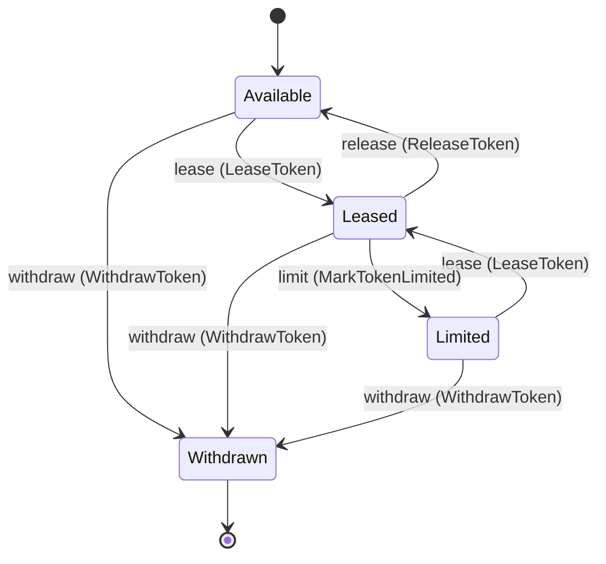

Each move is taken by a declared command outcome, and a move nothing takes is refused as `missing_causation` rather than left as a state change nobody can trigger:

- `lease` — taken by `conductor.token.LeaseToken` on its `leased` outcome
- `release` — taken by `conductor.token.ReleaseToken` on its `released` outcome
- `limit` — taken by `conductor.token.MarkTokenLimited` on its `limited` outcome
- `withdraw` — taken by `conductor.token.WithdrawToken` on its `withdrawn` outcome

An instance is brought into existence by `conductor.token.ContributeToken` on its `contributed` outcome.

Illegal transitions are illegal by absence: no rule forbids them, there is simply no arrow, because a rule would be a second place for the same truth to live. A diagram cannot show an absence, so the pairs it does not connect are listed here, derived from the same transitions — anything named below is a move this specification does not permit.

- `Available` may not become `Limited`
- `Limited` may not become `Available`
- `Withdrawn` may not become `Available`
- `Withdrawn` may not become `Leased`
- `Withdrawn` may not become `Limited`

One view projects it: [`Tokens`](#tokens).

### `TokenPool`

`conductor.token.TokenPool`.

An instance is identified by `instance`, a `conductor.config.InstanceName`. The name is part of the model and not a convention: a view projects the identity under that name, so a projection inventing its own would disagree with the view.

It holds nothing beyond its identity and its state.

It owns any number of [`PoolToken`](#pooltoken), as `tokens`, carried by `PoolToken.instance`. It references at most one [`conductor.instance.Instance`](conductor-instance.md#instance), as `instance`, carried by `TokenPool.instance`.

No invariant is declared, so nothing here constrains an instance at rest.

Its state is a `conductor.token.TokenPool.State`, one of `Open`. That enum is synthesised from the lifecycle rather than declared beside it, so the states a view's filter compares and the states drawn below cannot disagree.

An instance is created in `Open`. `Open` is terminal, so an instance may rest there forever. That is declared rather than inferred from having no way out: an entity that cannot leave a state is either finished or stuck, and only its author knows which.

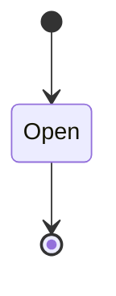

It declares no moves, so nothing changes its state once it exists.

It has one state, so there is no move to permit or to forbid.

No view projects it, so nothing outside this context is promised a way to observe one.

## Views

A view is what the outside world is promised it can observe. Each one says which instances it contains and how soon it reflects a command that has already returned, because "you can read this" without "how soon" is the promise every flaky suite is built on.

### `Tokens`

`conductor.token.Tokens`, shown to a person as "Tokens of the pool" and called `tokens` on the wire.

It reads [`PoolToken`](#pooltoken).

It contains the instances where `instance == param.instance` holds, and only those — so an instance a caller cannot find in here has been filtered out rather than lost.

It exposes:

- `token_id` — `conductor.token.TokenId`
- `state` — `conductor.token.PoolToken.State`
- `instance` — `conductor.config.InstanceName`
- `owner` — `conductor.operator.OperatorName`
- `seat` — `conductor.token.Seat`
- `token_state` — `conductor.token.TokenState`
- `limited_until` — `Optional<Timestamp>`, which may be absent
- `agent` — `Optional<conductor.agent.AgentName>`, which may be absent
- `contributed_at` — `Timestamp`
- `actor` — `conductor.operator.Actor`

It declares no order, so the rows come back in whatever order the implementation has, and two reads may disagree.

**Read-your-writes**: it is current the moment the command that changed it returns. A caller that has just created an invoice and cannot see it in here has been told a lie about what it did.

A generated scenario asserts it once, immediately after the command: a view promising this and not keeping the promise has to fail the suite rather than be retried until it passes.

## Commands

### `ContributeToken`

`conductor.token.ContributeToken`, shown to a person as "Contribute a token to the pool" and called `contribute-token` on the wire.

It takes:

- `actor` — `conductor.operator.Actor`
- `instance` — `conductor.config.InstanceName`
- `owner` — `conductor.operator.OperatorName`
- `seat` — `conductor.token.Seat`
- `secret` — `conductor.secret.SecretName`
- `contributed_at` — `Timestamp`

It has two outcomes.

**`actor-not-human`** — An agent tried to contribute a token; only a person contributes one, and nothing was written. Taken when `actor.kind != Human` holds of the input. No entity in this specification changes. It reports `conductor.operator.ActorNotHuman`, carrying `actor`. It emits nothing. A test reaches it by constructing an input that satisfies that condition.

**`contributed`** — The token is in the pool, Available and Ok, with its owner and seat. The default branch, taken when no other outcome's condition matched. It creates a `conductor.token.PoolToken`, which starts in `Available`. The new instance's identity is published as `token_id` on `conductor.token.TokenContributed`. It emits `conductor.token.TokenContributed`. It sets `instance` from `input.instance`, `owner` from `input.owner`, `seat` from `input.seat`, `secret` from `input.secret`, `token_state` from `"Ok"`, `limited_until` cleared, `agent` cleared, `contributed_at` from `input.contributed_at` and `actor` from `input.actor`. A test reaches it by constructing an input that satisfies no other outcome's condition.

### `LeaseToken`

`conductor.token.LeaseToken`, shown to a person as "Lease a token for an agent start" and called `lease-token` on the wire.

It takes:

- `actor` — `conductor.operator.Actor`
- `instance` — `conductor.config.InstanceName`
- `token_id` — `conductor.token.TokenId`
- `agent` — `conductor.agent.AgentName`
- `preferred_owner` — `Optional<conductor.operator.OperatorName>`, which may be absent
- `leased_at` — `Timestamp`

It has three outcomes.

**`none-available`** — The pool holds no Available token, so the agent does not start on one; nothing changed. Decided outside the input: the runtime's pick found no Available token in the instance's pool. No predicate over the input reaches this branch, and saying `when: false` instead would have claimed it is unreachable, which is a different and false statement. It is decided before the addressed row is read, among the input-guarded refusals: before existence and the held state. No entity in this specification changes. It reports `conductor.token.NoTokenAvailable`, carrying `instance`. It emits nothing. A test reaches it by injecting the declared fault, because no input can.

**`leased`** — The agent runs on the token; the event names the token's owner and seat, so the agent's record names them. The default branch, taken when no other outcome's condition matched. It moves a `conductor.token.PoolToken` from `Available` and `Limited` to `Leased`, along the declared move `lease`. The instance is the one named by the input field `token_id`. It emits `conductor.token.TokenLeased`. It sets `token_state` from `"Ok"`, `limited_until` cleared, `agent` from `input.agent` and `actor` from `input.actor`. A test reaches it by constructing an input that satisfies no other outcome's condition.

**`wrong-state`** — The token named is neither Available nor Limited (it is leased or withdrawn); nothing changed. Taken when the subject is resting in a state none of this command's moves start from — a `conductor.token.PoolToken` in `Leased` and `Withdrawn`, which is what is left of the lifecycle once this command's own moves are taken away. The document lists none of it. No entity in this specification changes. It reports `conductor.token.TokenStateConflict`, carrying `token_id`. It emits nothing. A test reaches it by driving an instance into one of those states and then issuing the command, because no input selects this branch.

### `MarkTokenLimited`

`conductor.token.MarkTokenLimited`, shown to a person as "Release a token as limited" and called `mark-token-limited` on the wire.

It takes:

- `actor` — `conductor.operator.Actor`
- `token_id` — `conductor.token.TokenId`
- `limited_until` — `Timestamp`
- `limited_at` — `Timestamp`

It has two outcomes.

**`limited`** — The token is Limited until the time given and holds no agent; the agent it held is named to be resumed on another. The default branch, taken when no other outcome's condition matched. It moves a `conductor.token.PoolToken` from `Leased` to `Limited`, along the declared move `limit`. The instance is the one named by the input field `token_id`. It emits `conductor.token.TokenLimited`. It sets `token_state` from `"Limited"`, `limited_until` from `input.limited_until`, `agent` cleared and `actor` from `input.actor`. A test reaches it by constructing an input that satisfies no other outcome's condition.

**`wrong-state`** — The token is not Leased, so no agent on it hit a limit; nothing changed. Taken when the subject is resting in a state none of this command's moves start from — a `conductor.token.PoolToken` in `Available`, `Limited` and `Withdrawn`, which is what is left of the lifecycle once this command's own moves are taken away. The document lists none of it. No entity in this specification changes. It reports `conductor.token.TokenStateConflict`, carrying `token_id`. It emits nothing. A test reaches it by driving an instance into one of those states and then issuing the command, because no input selects this branch.

### `ReleaseToken`

`conductor.token.ReleaseToken`, shown to a person as "Release a leased token" and called `release-token` on the wire.

It takes:

- `actor` — `conductor.operator.Actor`
- `token_id` — `conductor.token.TokenId`
- `released_at` — `Timestamp`

It has two outcomes.

**`released`** — The token is Available again and holds no agent. The default branch, taken when no other outcome's condition matched. It moves a `conductor.token.PoolToken` from `Leased` to `Available`, along the declared move `release`. The instance is the one named by the input field `token_id`. It emits `conductor.token.TokenReleased`. It sets `agent` cleared and `actor` from `input.actor`. A test reaches it by constructing an input that satisfies no other outcome's condition.

**`wrong-state`** — The token is not Leased, so there is nothing to release; nothing changed. Taken when the subject is resting in a state none of this command's moves start from — a `conductor.token.PoolToken` in `Available`, `Limited` and `Withdrawn`, which is what is left of the lifecycle once this command's own moves are taken away. The document lists none of it. No entity in this specification changes. It reports `conductor.token.TokenStateConflict`, carrying `token_id`. It emits nothing. A test reaches it by driving an instance into one of those states and then issuing the command, because no input selects this branch.

### `WithdrawToken`

`conductor.token.WithdrawToken`, shown to a person as "Withdraw a token from the pool" and called `withdraw-token` on the wire.

It takes:

- `actor` — `conductor.operator.Actor`
- `token_id` — `conductor.token.TokenId`
- `withdrawn_at` — `Timestamp`

It has four outcomes.

**`actor-not-human`** — An agent tried to withdraw a token; only a person withdraws one, and the token is unchanged. Taken when `actor.kind != Human` holds of the input. No entity in this specification changes. It reports `conductor.operator.ActorNotHuman`, carrying `actor`. It emits nothing. A test reaches it by constructing an input that satisfies that condition.

**`not-owner`** — Someone other than the token's owner asked to withdraw it; the token is unchanged. Decided outside the input: the person who asked is not the token's owner. No predicate over the input reaches this branch, and saying `when: false` instead would have claimed it is unreachable, which is a different and false statement. No entity in this specification changes. It reports `conductor.token.NotTokenOwner`, carrying `token_id`. It emits nothing. A test reaches it by injecting the declared fault, because no input can.

**`withdrawn`** — The token is out of the pool; the agent that held it, if any, is named so it is resumed on another token. The default branch, taken when no other outcome's condition matched. It moves a `conductor.token.PoolToken` from `Available`, `Leased` and `Limited` to `Withdrawn`, along the declared move `withdraw`. The instance is the one named by the input field `token_id`. It emits `conductor.token.TokenWithdrawn`. It sets `agent` cleared and `actor` from `input.actor`. A test reaches it by constructing an input that satisfies no other outcome's condition.

**`wrong-state`** — The token was withdrawn already, and nothing changed. Taken when the subject is resting in a state none of this command's moves start from — a `conductor.token.PoolToken` in `Withdrawn`, which is what is left of the lifecycle once this command's own moves are taken away. The document lists none of it. No entity in this specification changes. It reports `conductor.token.TokenStateConflict`, carrying `token_id`. It emits nothing. A test reaches it by driving an instance into one of those states and then issuing the command, because no input selects this branch.

## Events

### `TokenContributed`

`conductor.token.TokenContributed`.

It carries:

- `actor` — `conductor.operator.Actor`
- `token_id` — `conductor.token.TokenId`
- `instance` — `conductor.config.InstanceName`
- `owner` — `conductor.operator.OperatorName`
- `seat` — `conductor.token.Seat`
- `secret` — `conductor.secret.SecretName`
- `contributed_at` — `Timestamp`

Emitted by `conductor.token.ContributeToken` on its `contributed` outcome.

Nothing in this system reacts to it.

### `TokenLeased`

`conductor.token.TokenLeased`.

It carries:

- `actor` — `conductor.operator.Actor`
- `token_id` — `conductor.token.TokenId`
- `instance` — `conductor.config.InstanceName`
- `owner` — `conductor.operator.OperatorName`
- `seat` — `conductor.token.Seat`
- `agent` — `conductor.agent.AgentName`
- `preferred_owner` — `Optional<conductor.operator.OperatorName>`, which may be absent
- `leased_at` — `Timestamp`

Emitted by `conductor.token.LeaseToken` on its `leased` outcome.

Nothing in this system reacts to it.

### `TokenLimited`

`conductor.token.TokenLimited`.

It carries:

- `actor` — `conductor.operator.Actor`
- `token_id` — `conductor.token.TokenId`
- `owner` — `conductor.operator.OperatorName`
- `agent` — `Optional<conductor.agent.AgentName>`, which may be absent
- `limited_until` — `Timestamp`
- `limited_at` — `Timestamp`

Emitted by `conductor.token.MarkTokenLimited` on its `limited` outcome.

Nothing in this system reacts to it.

### `TokenReleased`

`conductor.token.TokenReleased`.

It carries:

- `actor` — `conductor.operator.Actor`
- `token_id` — `conductor.token.TokenId`
- `agent` — `Optional<conductor.agent.AgentName>`, which may be absent
- `released_at` — `Timestamp`

Emitted by `conductor.token.ReleaseToken` on its `released` outcome.

Nothing in this system reacts to it.

### `TokenWithdrawn`

`conductor.token.TokenWithdrawn`.

It carries:

- `actor` — `conductor.operator.Actor`
- `token_id` — `conductor.token.TokenId`
- `owner` — `conductor.operator.OperatorName`
- `withdrawn_at` — `Timestamp`

Emitted by `conductor.token.WithdrawToken` on its `withdrawn` outcome.

Nothing in this system reacts to it.

## Errors

### `NoTokenAvailable`

No token of the instance's pool is Available (every one is leased, limited or withdrawn), so no agent can start on one; nothing changed.

It carries:

- `instance` — `conductor.config.InstanceName`

Reported by `conductor.token.LeaseToken` on its `none-available` outcome.

### `NotTokenOwner`

The person who asked is not the token's owner, and only the owner withdraws a token; nothing changed.

It carries:

- `token_id` — `conductor.token.TokenId`

Reported by `conductor.token.WithdrawToken` on its `not-owner` outcome.

### `TokenStateConflict`

The token is not in a state the command acts from (a lease of a token that is not Available, a release or a limit of one that is not Leased, a withdrawal of one already withdrawn); nothing changed.

It carries:

- `token_id` — `conductor.token.TokenId`

Reported by `conductor.token.LeaseToken` on its `wrong-state` outcome.

Reported by `conductor.token.MarkTokenLimited` on its `wrong-state` outcome.

Reported by `conductor.token.ReleaseToken` on its `wrong-state` outcome.

Reported by `conductor.token.WithdrawToken` on its `wrong-state` outcome.

## Actors

An actor is who may ask this context for something. Every grant below points at a command this specification declares — a grant is a resolved reference, so "may invoke" something nobody wrote is not a permission this model can express, and an authorisation that authorises nothing cannot ship quietly.

### `InstanceRuntime`

`conductor.token.InstanceRuntime`, shown to a person as "Instance runtime".

It may invoke [`LeaseToken`](#leasetoken), [`MarkTokenLimited`](#marktokenlimited) and [`ReleaseToken`](#releasetoken).

### `Operator`

`conductor.token.Operator`, shown to a person as "Operator".

It may invoke [`ContributeToken`](#contributetoken) and [`WithdrawToken`](#withdrawtoken).

---

Generated from conductor v1 · contract digest `slice-sha256/2:88908e755fdbe669c3bc24250db8c082a988de48849e62ccd2bd518277fa0b47`. Do not edit this file; change the specification and regenerate it with `ess generate`.
