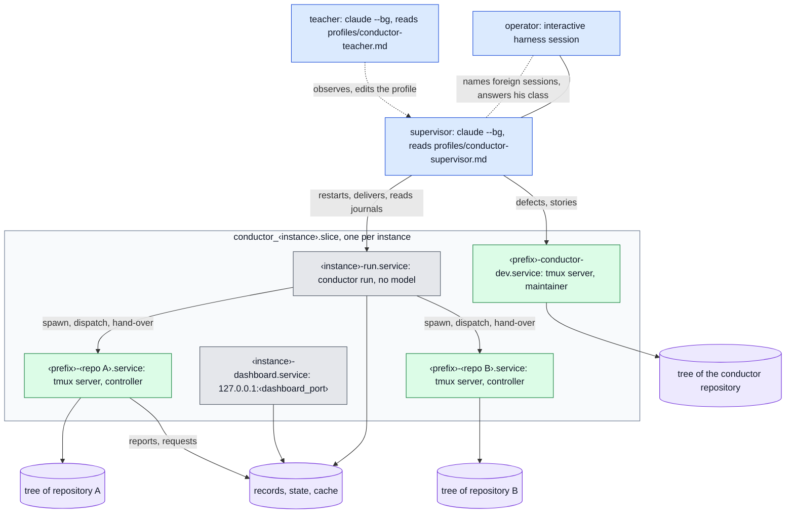
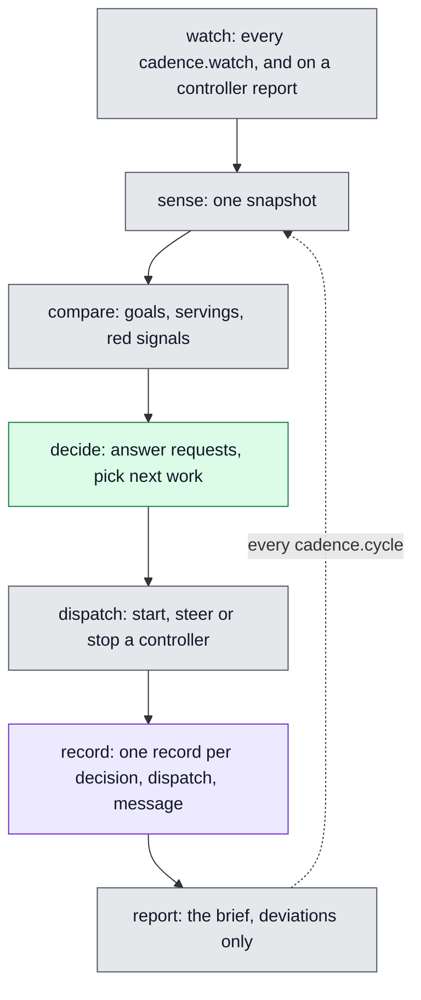
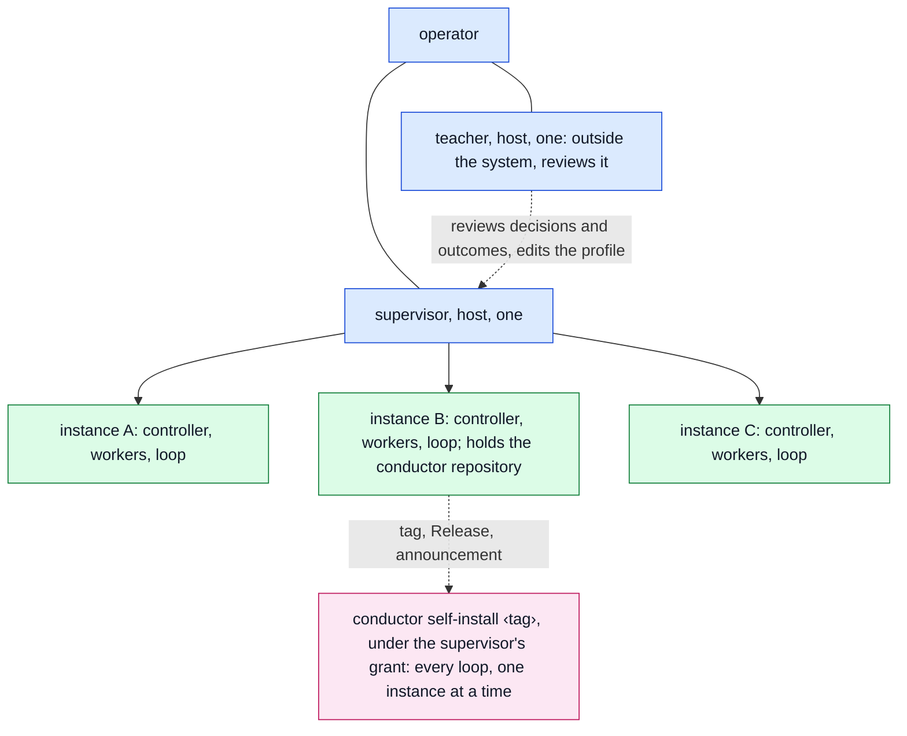
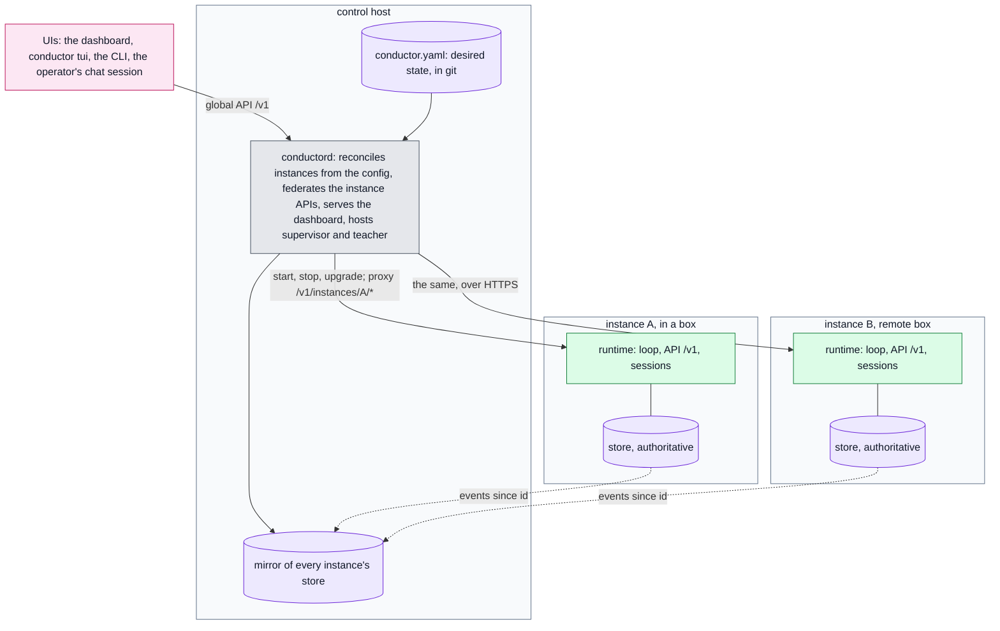
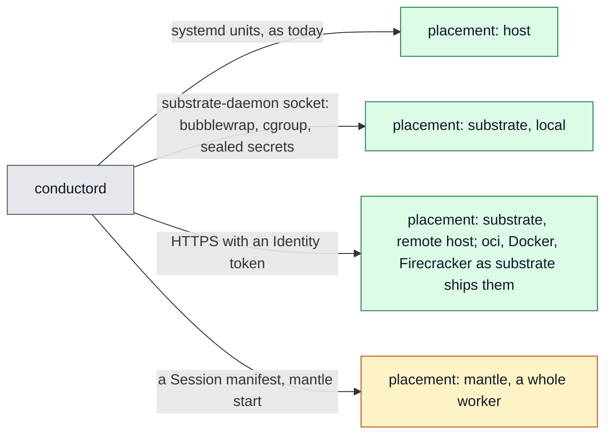
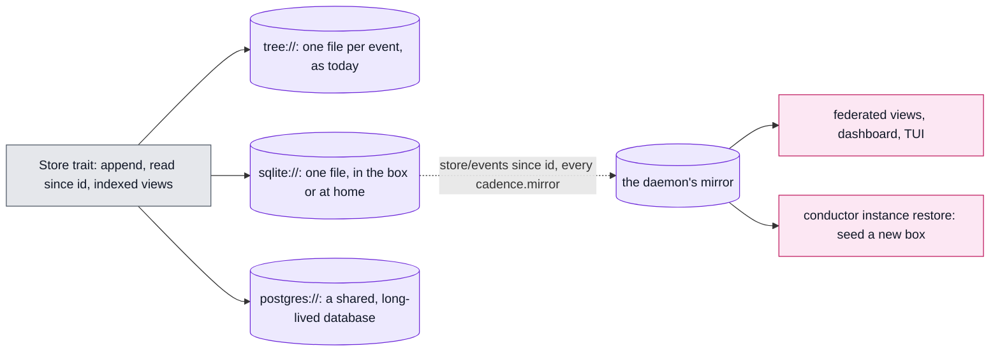
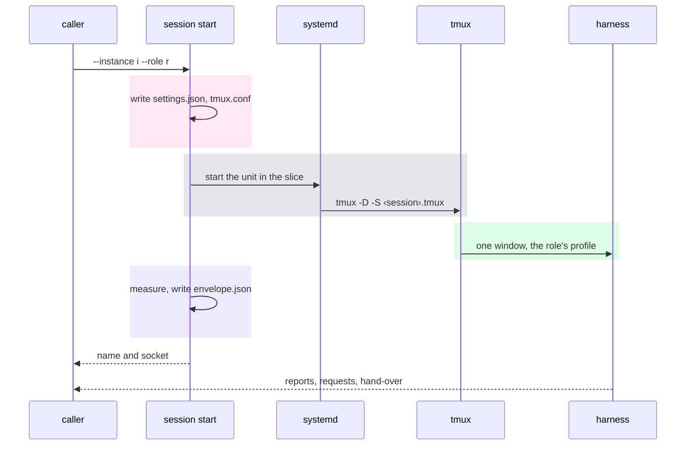
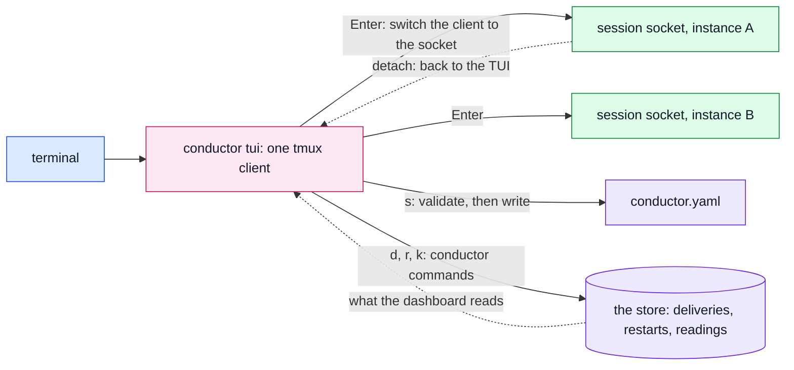
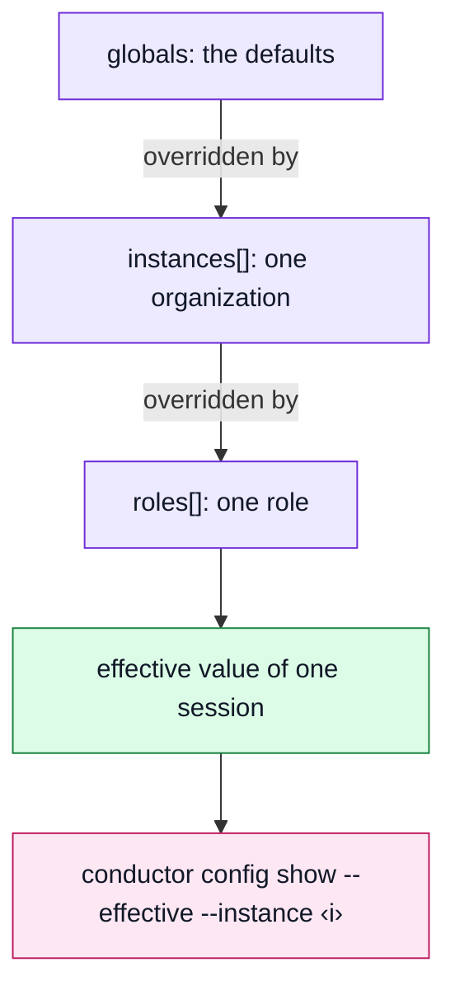
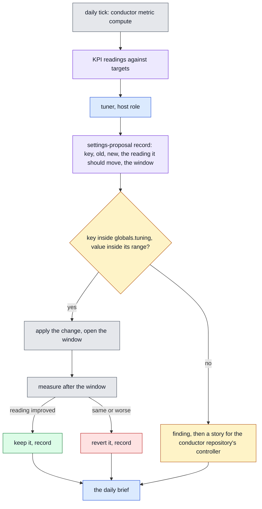

Colours in the diagrams: blue is a host role, green a session with a model, grey a process without
one, amber a custom role or a decision, violet a store or a tree, pink a command. Every diagram has
a plain-text version under it.

## Status quo

### The host



<details>
<summary>plain text</summary>

```text
operator (chat session) ──── supervisor (claude --bg) ◄···· teacher (claude --bg)
                                  │ restarts, delivers, reads journals; defects to conductor-dev
  ┌─ conductor_<instance>.slice, one per instance ───────────────────────────────────┐
  │ <instance>-run.service         conductor run, no model                           │
  │ <instance>-dashboard.service   127.0.0.1:<dashboard_port>                        │
  │ <prefix>-<repo A>.service      tmux server ── controller ── tree of repository A │
  │ <prefix>-<repo B>.service      tmux server ── controller ── tree of repository B │
  │ <prefix>-conductor-dev.service tmux server ── maintainer ── conductor tree       │
  │                                                                                  │
  │ run ──spawn, dispatch, hand-over──► controllers ──reports, requests──┐           │
  │ run, dashboard ◄──────────────────────────────────► records, state, cache ◄──────┘           │
  └──────────────────────────────────────────────────────────────────────────────────┘
```

</details>

### Levels

| level | one per | what runs there | started by |
|---|---|---|---|
| host | machine | the supervisor session, the teacher session, the maintainer session (`conductor-dev`), the operator's own chat session | `task supervisor:start`, `task teacher:start`, `task maintainer:start`; the chat session by the operator |
| instance | organization | the loop (`conductor run`), the dashboard, the instance's controllers | `conductor run --install`, `task dashboard`, the loop |
| repository | repository of an instance | one controller session, in its own tree | the loop, through `conductor spawn` |
| unit of work | a story or task | the controller's sub-agents (planner, implementer, reviewer) | the controller, inside its own harness session |

The loop runs no model: it takes snapshots, picks work, sends dispatches, spawns controllers and asks
for hand-overs at the context threshold. Every judgement runs in a session with a model.



<details>
<summary>plain text</summary>

```text
sense     conductor snapshot start-snapshot   one snapshot: repositories, pull requests, main CI,
                                              releases, planning blockers, specifications, sessions
compare   goals and servings                  which goal each repository's work serves; idle goals;
                                              work serving no goal; red signals
decide    decision requests                   answer controller requests; pick next work per repository
dispatch  conductor dispatch send-dispatch    start, steer or stop a controller; one charter each
record    the store                           one record per decision, dispatch and message
report    operator brief                      once a day and on escalation, deviations only
          ◄── every cadence.cycle, and on a controller report, back to sense
```

</details>

### Processes and units

Each instance is one systemd user slice, `conductor_<instance>.slice`, and every long-running
process of the instance is one user unit inside it:

| unit | runs | model |
|---|---|---|
| `conductor_<instance>-run.service` | `conductor run`: the loop | no |
| `conductor_<instance>-dashboard.service` | the dashboard on `127.0.0.1:<dashboard_port>` | no |
| `conductor_<session>.service` | one tmux server, `tmux -D -S <state>/sessions/<session>.tmux`, whose only window runs the harness of a controller or the maintainer | yes |

#### One session, one tmux server


<details>
<summary>plain text</summary>

```text
conductor session attach --name S  ──opens the socket──┐
conductor session deliver --name S ──types a text──────┤
                                                       ▼
conductor_S.service:  tmux -D -S <state>/sessions/S.tmux -f S.tmux.conf
                        └─ one window: the harness, started from the role's profile
files beside the socket:  S.settings.json   S.envelope.json   S.typescript ◄── attach --watch
systemctl --user stop conductor_S.service   ends this session and nothing else
```

</details>

Why one server per session:

- A session is one unit: `systemctl --user stop conductor_<session>.service` ends that session and
  nothing else; its cgroup, cpu weight and tasks limit are measured and written to
  `<state>/sessions/<session>.envelope.json` (the box the instance's confinement asked for).
- The socket is the address: `conductor session attach --name <session>` and
  `conductor session deliver --name <session>` open that socket; nothing is shared between two
  sessions and a crashed server takes no other session down.
- The tmux config is per session too (`<session>.tmux.conf`: `exit-empty on`, prefix `C-]`, status
  off, `-x 160 -y 50`), so a session's terminal size and keys cannot be changed from another one.
- Everything typed and printed is kept: `<session>.typescript` is the terminal log (the recording the `script` command writes; the name is `script`'s, not the language) a watcher reads, and a
  session started before the tmux launcher can still be followed through it (`--watch`).
- A session's settings file (`<session>.settings.json`) is written at start from the role's
  `settings` and its `read_only_tools`, so the harness reads a file conductor owns, not a shared one.

### Three ways to see the sessions

| view | command | shows |
|---|---|---|
| harness | `claude agents` (`--json` for a script) | every background session of the harness on this host, any directory, any owner: the controllers, the maintainer, the supervisor, the teacher, and sessions nothing of conductor started |
| conductor | `conductor session list` | one line per live session of every instance whose state holds a launcher's files for it: instance, name, repository, attach or watch, state, seconds since the last line |
| dashboard | `http://127.0.0.1:<dashboard_port>` | the instance's repositories, dispatches, decisions, metrics and the plan board |

The harness view is the superset: a session the loop lost (a controller whose unit died, a session
started by hand with `claude --bg`) is in it and not in `conductor session list`. The supervisor
reconciles the two every pass.

### Starting things: the Taskfile

| task | does |
|---|---|
| `task install` | builds and installs the binary; `task profiles` installs `.agents/*.md` into `profiles/` next to the config file |
| `task maintainer:start` | `conductor session start --role maintainer`: the maintainer in its own tmux server and unit |
| `task supervisor:start` | `claude --bg --agent conductor-supervisor -n conductor-supervisor …` in the config directory |
| `task teacher:start` | the same for the teacher |
| `task dashboard`, `task dashboard:stop` | the dashboard unit |
| `task sessions`, `task conductor:attach`, `task maintainer:attach` | list sessions; attach to one |
| `task agents:link REPO=<path>` | links the role adapters into a repository's `.claude/agents/` |

The supervisor and the teacher are not units: they are the harness's own background sessions, read
their 10-line adapter from `~/.claude/agents/<name>.md` and their whole definition from
`profiles/<name>.md`. They have no tmux server, no envelope, no terminal log, and `conductor session
list` does not show them.

### The operator's chat session

The operator works in an ordinary interactive harness session. It is not a role: it talks to the
supervisor (and, when he names one, to the teacher), and it is the place where decisions of his class
are given. A foreign session the operator names (a session he runs by hand in a repository of an
instance) is treated by the supervisor as that repository's owner: the loop starts no controller for
it, and the supervisor reads its MRs and pipelines instead.

### Attaching

```text
conductor session attach                  picker of every instance's sessions: Enter attaches, w watches, q quits
conductor session attach --name <session> one session, read-write
conductor session attach --role maintainer
conductor session attach --watch --name … read-only; also for a session started before the tmux launcher
ctrl-] then d                             detach; the session runs on
```

`claude agents` has no attach: a harness-only session (the supervisor, the teacher) is reached by
message or by `claude logs <id>`.

### What the status quo costs

| friction | measured on 2026-11-07 |
|---|---|
| three start mechanisms (unit, `claude --bg`, hand) | two sessions of one name (`<name>-2`) and a stale resumed id in one day; the rename needs `claude stop` and `claude --bg --resume` |
| the maintainer is a special role in config (`conductor-dev`) and in the host section | its hand-over left 52 local-only commits on 7 branches; no loop rule covered it until wave 45 |
| the supervisor is outside the config | its rules lived in a file under `~/.claude/agents/` until they became a shipped profile; four host scripts were written beside it |
| settings are per instance only | the same thresholds are copied into three instances; a host-wide change is three edits |
| one controller per repository | an instance with 6 active repositories runs 6 model sessions and 6 trees whether or not they have work |
| no custom role | a recurring job (a UI pass every day) has no place but a controller's charter |
| a dashboard per instance | three dashboard units on three ports, one Vue build each, no view across instances but the registry list |
| the store is files in the instance's state directory | an instance can only run where its files are; a remote or boxed instance has no way to keep its records at home |
| instances are installed by hand | `conductor init` and `conductor run --install` per instance; nothing compares the config with what runs |

## Next architecture

The design the operator asked for on 2026-11-07; the reasoning and the planning-store epic are in
`docs/design/architecture-next.md` (`epic:architecture-next`). Each change is a story; the migration at
the end orders them so that every step is reversible.

### One picture

The host and its instances:



Inside one instance:


<details>
<summary>plain text</summary>

```text
operator ── chat session ── supervisor (host, one)
                 │             │
              teacher (host, one; outside the system, reviews the supervisor and the outcomes)
                               │
            ┌──────────────────┼──────────────────┐
         instance A         instance B         instance C
            │                  │                  │
         controller         controller         controller        one per instance
         ├ worker            ├ worker            ├ worker         per repository or unit
         ├ worker            ├ worker            └ custom role    on a schedule
         └ custom role       └ worker (releaser) ──► conductor self-install <tag>
            │
         loop (no model), dashboard, records, state
```

</details>

| level | one per | role | what it does |
|---|---|---|---|
| host | machine | **teacher** | outside the system, above the supervisor: reviews what the supervisor decided and what the instances delivered, the way an adversarial reviewer reads a finished change; changes the supervisor's profile and files findings; never runs the supervisor's routine itself (operator, 2026-11-07) |
| host | machine | **supervisor** | keeps every instance's loop, controller and workers running; carries findings across instances; decides within its grant; reports to the operator |
| instance | organization | **controller** | the instance's judgement: picks work across the instance's repositories, starts and steers workers, answers requests, merges what passes, escalates |
| instance | organization | **loop** | `conductor run`: snapshots, timers, spawns, hand-overs, KPIs; no model |
| repository or unit | work | **worker** | one job in one tree: plan, implement, review, release; built-in roles |
| any | schedule | **custom role** | a role the config adds: a profile, a scope and a schedule; conductor starts it like any other |

The star stays: a worker talks to its controller, a controller to the supervisor, the supervisor to
the operator. A controller of one instance never messages another instance's sessions.

### The daemon and the APIs

Not every instance comes with a web UI. Each instance has an HTTP API; one daemon on the control
host reconciles the instances from the config, federates their APIs into one global API, and every
UI reads that.



<details>
<summary>plain text</summary>

```text
dashboard ─┐                                         ┌─ instance A, in a box ──────────────┐
tui       ─┤                                         │ runtime: loop, API /v1, sessions     │
cli       ─┼─► conductord (control host) ───────────►│ store (authoritative) ─┐             │
chat      ─┘    reconciles instances from config     └────────────────────────┼─────────────┘
                global API /v1, serves the dashboard  ┌─ instance B, remote ──┼─────────────┐
                conductor.yaml (desired state)  ◄─────│ store/events since id ◄┘ (mirror)    │
                mirror of every instance's store      └─────────────────────────────────────┘
```

</details>

| component | one per | does |
|---|---|---|
| `conductord` | control host | reads the config; starts, stops and restarts instance runtimes so that what runs equals what the config says (every `cadence.reconcile`, on a config change, on a lost runtime); serves `/v1/` on `127.0.0.1:<daemon_port>`; proxies `instances/{name}/*`; federates `sessions`, `decisions`, `unanswered`, `kpis`, `events`, `ask`; serves the dashboard app once; starts the supervisor and teacher; mirrors every instance's store |
| instance runtime | instance | `conductor instance serve`: the loop, the instance API on a socket in the box (today's dashboard routes under `/v1/`, plus `sessions/{name}/attach`, `deliver`, `restart`, `store/events`), the launcher of the controller, workers and custom roles |
| UIs | any number | the dashboard (served by the daemon, or deployed elsewhere against a daemon URL), the TUI, the CLI as an API client, the operator's chat session through the supervisor |

An instance that does not answer is a row with `state: unreachable` and its mirror time in every
federated view, never an error. `conductor ask` becomes `POST /v1/ask`, delivered to the supervisor,
whose first line names the route.

### Placements: confined, local or remote

conductor implements no sandbox. An instance's `placement` says what runs its runtime and sessions
and what confines them; the daemon and the config stay on the control host.



<details>
<summary>plain text</summary>

```text
conductord ──systemd units, as today────────────────────────► placement: host
           ──substrate-daemon socket (bubblewrap, cgroup)─────► placement: substrate, local
           ──HTTPS + Identity token──────────────────────────► placement: substrate, remote (oci, Docker, Firecracker as shipped)
           ──Session manifest, mantle start──────────────────► placement: mantle (a whole worker)
```

</details>

| placement | confinement | transport |
|---|---|---|
| `host` | today's systemd slice and units: cpu weight, memory, tasks; no write fence | Unix socket |
| `substrate`, local | substrate's `linux`/`systemd` adapter: bubblewrap plus a delegated cgroup; read-only roots; one writable workspace; cpu, memory, pids, storage; default-deny egress with the forge and model hosts; credentials as sealed memory slots, never in argv or env | the substrate daemon's socket |
| `substrate`, remote | the same on another host; `oci` where it ships; Docker and Firecracker drivers when substrate ships them | HTTPS/WSS with an Identity token |
| `mantle` | a whole worker (EC2, KubeVirt) from a `Session` manifest: repositories, agent kind, resources, network capabilities | mantle's forwarded socket |

A placement that cannot give the box the profile asks for refuses with a name; `strict` starts
nothing and records why, `report` falls back to `host` and records that. Inside every box the
sessions keep tmux, so attach, deliver and the terminal log work unchanged.

### State: four kinds, four homes

Config is desired state and is not in the store; the store keeps what happened, including every
config change.

| kind | examples | lives | authoritative copy | survives the box |
|---|---|---|---|---|
| config | `conductor.yaml`: instances, placements, roles, settings, secret names | with the daemon, in a git repository | the file | yes |
| records (the store) | decisions, dispatches, readings, findings, charters, hand-offs, config changes, reconciliations | with the instance that wrote them, through the `Store` trait | the instance's store; the daemon keeps a read-only mirror | the mirror does |
| runtime state | sessions, sockets, envelopes, leases, terminal logs | inside the box | the box | no; rebuilt from records |
| cache | exports of `origin/main`, build caches | inside the box | none | no |



<details>
<summary>plain text</summary>

```text
Store trait (append, read since id, views) ─┬─ tree://      one file per event, as today
                                            ├─ sqlite://    one file, in the box or at home ──► the daemon's mirror ──► views, restore
                                            └─ postgres://  a shared database, no mirror needed
```

</details>

A remote instance keeps its authoritative store in its box (`sqlite://`) and the daemon mirrors it
at home; the mirror is what the UIs read and what seeds a new box when the old one is gone. An
organization with a database sets `store: postgres://` on the instance and the daemon, and no mirror
is needed. Secrets never enter the config: it names them (`secret:<name>`), the daemon resolves them
from its secrets source (an age-encrypted file by default) and passes them to the placement as
sealed slots.

### No separate maintainer

conductor's own repository is a repository in one instance's `sources`. Its controller plans and
delivers conductor changes like any other repository's. What was special about `conductor-dev` becomes
two things:

- a built-in worker role `releaser` (version, changelog, tag, forge Release, announcement) that any
  repository can use;
- one daemon route, `POST /v1/instances/{name}/upgrade` under the supervisor's grant: install the
  released binary at the instance's placement, restart the runtime, run `conductor doctor` inside,
  and roll back when the runtime does not answer. The supervisor runs it one instance at a time
  after a release; the operator sees it in the daily brief.

The findings a session files about conductor (`conductor finding file-finding`) go to that
repository's planning store, as today.

### Every session is started by conductor

One start form for every role: `conductor session start --instance <i> --role <role>`, answered by
the instance's runtime at its placement (the host roles by the daemon in `conductor_host.slice`). It
writes the settings file, starts one tmux server in the box, measures it and writes the envelope. `claude --bg`, `task supervisor:start` and the adapters
under `~/.claude/agents/` go away; the harness view (`claude agents`) stays a diagnostic.



<details>
<summary>plain text</summary>

```text
loop, TUI or schedule ──► conductor session start --instance i --role r
                            1  write <session>.settings.json and <session>.tmux.conf
                            2  systemd: start conductor_<session>.service in conductor_<i>.slice
                            3  tmux -D -S <state>/sessions/<session>.tmux
                            4  one window: the harness with the role's profile
                            5  measure the box, write <session>.envelope.json
                      ◄──── session name and socket
harness ──► reports, requests, hand-over at the threshold
```

</details>

Rules carried over unchanged: one session per name, a successor only after its predecessor stopped;
hand-over at the context threshold with pushed branches; the terminal log as the record.

### The TUI

`conductor` with no arguments at a terminal (and `conductor tui`) opens a full-screen view built on
tmux: the TUI itself is one tmux client, and entering a session switches that client to the session's
socket, so the session keeps running untouched when the operator leaves.

```text
┌ instances ─────────┬ sessions of <instance> ──────────────┬ settings ───────────────────┐
│ > A   2 dec  K1 ok │ controller   busy  412k  wave/46     │ cadence.cycle        2h     │
│   B   0 dec  K3 !  │ worker repo1 idle   38k  story:x     │ thresholds.disk_low  200G   │
│   C   1 dec  K1 ok │ worker repo2 busy  120k  story:y     │ controllers.max_working 8   │
│   host             │ ui-pass      sched 06:00 daily       │ roles[3].schedule    daily  │
├────────────────────┴──────────────────────────────────────┴─────────────────────────────┤
│ Enter attach  w watch  d deliver  s settings  r restart  l log  k kpis  ? keys  q quit    │
└───────────────────────────────────────────────────────────────────────────────────────────┘
```



<details>
<summary>plain text</summary>

```text
terminal ── conductor tui (one tmux client)
              ├─ Enter ──► session socket, instance A ── ctrl-] then d ──► back to the TUI
              ├─ Enter ──► session socket, instance B
              ├─ s     ──► validate, then write conductor.yaml
              └─ d r k ──► conductor commands ──► the store ◄── read by the TUI and the dashboard
```

</details>

| key | does |
|---|---|
| `Enter` | attach the selected session (`ctrl-]` then `d` returns to the TUI) |
| `w` | watch it read-only |
| `d` | deliver a text to it (recorded like `conductor session deliver`) |
| `s` | edit the selected instance's or role's settings; the TUI validates and writes the config file, and shows the effective value with the level it comes from |
| `r` | restart the session (hand-over first, then stop, then start) |
| `l` | follow its terminal log (`<session>.typescript`, the recording `script` writes; nothing to do with the TypeScript language) |
| `k` | the instance's KPI readings of the last 7 days |

The TUI reads what the dashboard reads (the store and `<state>/sessions/`) and writes only through
conductor commands, so a thing done in the TUI is a record.

### Settings: global, instance, role



<details>
<summary>plain text</summary>

```text
globals ──overridden by──► instances[] ──overridden by──► roles[] ──► effective value of one session
conductor config show --effective --instance <i>   every key with the level it came from
```

</details>

| level | file section | holds |
|---|---|---|
| daemon | `daemon` | port and TLS listener, `cadence.reconcile`, `cadence.mirror`, the secrets source, the dashboard's served path |
| global | `globals` | the defaults every instance starts from: harness, models per role, cadence, thresholds, store backend, confinement limits, retention, the announcement hook |
| instance | `instances[].*` | overrides of any global key; `placement`, `store`, sources, checkouts, records, session prefix, the instance's roles |
| role | `roles[].*` (under `globals` or an instance) | profile, model, settings, tools, writable set, network, limits, schedule |

Precedence is role over instance over global. `conductor config show --effective --instance <i>`
prints every key with the level it came from. Today's `instances[].thresholds` keeps working: a key
set on an instance is an override. `PUT /v1/config` validates, writes, commits to the config
repository with caller and reason, records `config-changed` and reconciles.

### Built-in and custom roles

Built-in roles ship with a profile each: `supervisor`, `controller`, `planner`, `implementer`,
`reviewer`, `releaser`. A custom role is one entry in `roles[]`:

```yaml
roles:
  - role: ui-pass
    profile: ~/.b10x/conductor/profiles/ui-pass.md
    model: sonnet
    scope: repository
    repositories: [manager]
    schedule: daily 06:00
    handover: 150k
```

The loop starts it on its schedule (`daily HH:MM`, `every 6h`, `on: release`, `on: red-ci`), one
session at a time, in a tree of its scope, and ends it when its report arrives. A custom role reports
to the controller and can file findings and dispatch requests; it cannot merge. Its profile lives in
the instance's `profiles/`, outside the conductor repository, so a company-specific role never
enters the product.

### Self-improvement over settings



<details>
<summary>plain text</summary>

```text
daily tick ─► KPI readings vs targets ─► tuner ─► settings-proposal (key, old, new, reading, window)
   key inside globals.tuning?
     yes ─► apply, open the window ─► measure ─┬─ improved ──► keep, record ───┐
                                               └─ same/worse ► revert, record ─┼─► the daily brief
     no  ─► finding ─► story for the conductor repository's controller ────────┘
```

</details>

The daily tick computes the KPIs per instance. A built-in host role, `tuner`, runs after it:

1. reads the readings against the targets and the open findings;
2. proposes one settings change at a time as a record (`settings-proposal`: key, old value, new
   value, the reading it should move, the window to measure);
3. applies it when the key is inside the grant in `globals.tuning` (a list of keys with a bounded
   range, for example `cadence.watch: 60s..600s`, `controllers.max_working: 2..8`,
   `thresholds.context_handover: 120k..250k`);
4. measures after the window; keeps it when the reading improved, reverts it otherwise, and records
   both.

A key outside the grant, and anything that touches a profile, becomes a finding and a story for the
conductor repository's controller. The operator widens or narrows the grant in config; he never
sees a proposal inside it except in the brief.

### Migration, each step reversible

| step | change | reversible by | story |
|---|---|---|---|
| 1 | `conductor daemon serve`: reconcile instances from the config, `GET /v1/instances`; the registry file becomes derived | stop the daemon, run the units by hand | daemon-reconcile |
| 2 | the instance API on the runtime's socket; the daemon proxies and serves the dashboard once; `-dashboard.service` retired | start the old dashboard unit | instance-api |
| 3 | federated views and `conductor tui` read-only | nothing to undo | federated-views, tui-readonly |
| 4 | `globals` with precedence, `config show --effective`, `PUT /v1/config` | keys stay valid at the instance level | config-globals |
| 5 | `Store` trait with `tree` and `sqlite`; the daemon's mirror; `instance restore` | `store: tree://` | store-trait, store-mirror |
| 6 | `placement: substrate` local with sealed secrets from the daemon's secrets source | `placement: host` | placement-substrate-local, secrets-source |
| 7 | `placement: substrate` remote over HTTPS; attach as a stream | local placement | placement-substrate-remote |
| 8 | `postgres` backend | sqlite | store-postgres |
| 9 | host roles started by the daemon; the maintainer retired into an instance; `instances/{name}/upgrade` with rollback | the old task lines | host-roles-by-daemon, instance-upgrade |
| 10 | `placement: mantle` | substrate placement | placement-mantle |
| 11 | the tuner with an empty grant; TUI settings editor | an empty grant; read-only TUI | tuner |

Steps 1 to 5 move no session: the host keeps working as today throughout.

### Decided

| question | answer |
|---|---|
| teacher: own role or part of the supervisor? | its own role, above the supervisor, outside the system like an adversarial review (operator, 2026-11-07: "the teacher should clearly be its own role, and it should just be above the supervisor. It's just like the concept of adversarial review. So we're stepping out of the system and then reviewing it from there") |

### Open questions for the operator

| question | default without an answer |
|---|---|
| For a remote instance, is the authoritative store in the box with a mirror at home, or a shared database? | in the box with a mirror; a database when `store: postgres://` is set |
| Is the dashboard served by the daemon or deployed separately? | by the daemon at `/`, and deployable elsewhere against a daemon URL |
| The secrets source: an age file, the OS keyring, or the environment? | an age file named in `daemon.secrets` |
| Does one controller per instance keep a tree per repository, or does it work in the workers' trees only? | workers' trees only; the controller has no repository tools |
| Which keys go into the first tuning grant? | none; the tuner proposes and the brief shows the proposals |
