Colours in the diagrams: blue is a host role, green a session with a model, grey a process without
one, amber a custom role or a decision, violet a store or a tree, pink a command. Every diagram has
a plain-text version under it.

## Status quo

### The host

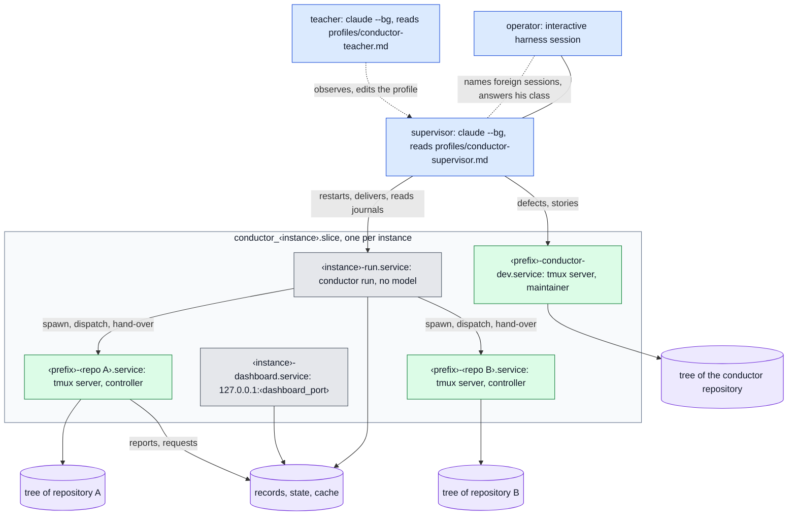

<details>
<summary>plain text</summary>

```text
operator (chat session) ──── supervisor (claude --bg) ◄···· teacher (claude --bg)
                                  │ restarts, delivers, reads journals; defects to conductor-dev
  ┌─ conductor_<instance>.slice, one per instance ───────────────────────────────────┐
  │ <instance>-run.service         conductor run, no model                           │
  │ <instance>-dashboard.service   127.0.0.1:<dashboard_port>                        │
  │ <prefix>-<repo A>.service      tmux server ── controller ── tree of repository A │
  │ <prefix>-<repo B>.service      tmux server ── controller ── tree of repository B │
  │ <prefix>-conductor-dev.service tmux server ── maintainer ── conductor tree       │
  │                                                                                  │
  │ run ──spawn, dispatch, hand-over──► controllers ──reports, requests──┐           │
  │ run, dashboard ◄──────────────────────────────────► records, state, cache ◄──────┘           │
  └──────────────────────────────────────────────────────────────────────────────────┘
```

</details>

### Levels

| level | one per | what runs there | started by |
|---|---|---|---|
| host | machine | the supervisor session, the teacher session, the maintainer session (`conductor-dev`), the operator's own chat session | `task supervisor:start`, `task teacher:start`, `task maintainer:start`; the chat session by the operator |
| instance | organization | the loop (`conductor run`), the dashboard, the instance's controllers | `conductor run --install`, `task dashboard`, the loop |
| repository | repository of an instance | one controller session, in its own tree | the loop, through `conductor spawn` |
| unit of work | a story or task | the controller's sub-agents (planner, implementer, reviewer) | the controller, inside its own harness session |

The loop runs no model: it takes snapshots, picks work, sends dispatches, spawns controllers and asks
for hand-overs at the context threshold. Every judgement runs in a session with a model.

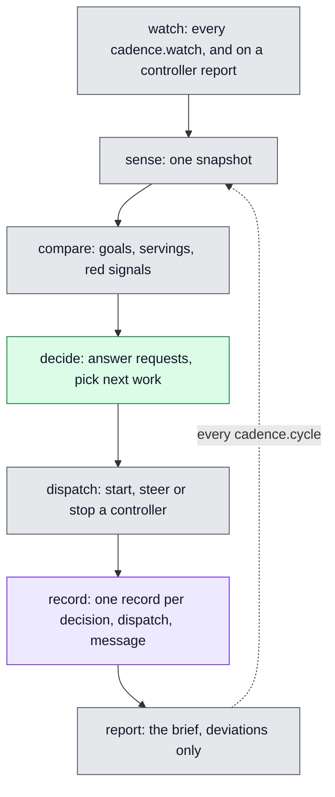

<details>
<summary>plain text</summary>

```text
sense     conductor snapshot start-snapshot   one snapshot: repositories, pull requests, main CI,
                                              releases, planning blockers, specifications, sessions
compare   goals and servings                  which goal each repository's work serves; idle goals;
                                              work serving no goal; red signals
decide    decision requests                   answer controller requests; pick next work per repository
dispatch  conductor dispatch send-dispatch    start, steer or stop a controller; one charter each
record    the store                           one record per decision, dispatch and message
report    operator brief                      once a day and on escalation, deviations only
          ◄── every cadence.cycle, and on a controller report, back to sense
```

</details>

### Processes and units

Each instance is one systemd user slice, `conductor_<instance>.slice`, and every long-running
process of the instance is one user unit inside it:

| unit | runs | model |
|---|---|---|
| `conductor_<instance>-run.service` | `conductor run`: the loop | no |
| `conductor_<instance>-dashboard.service` | the dashboard on `127.0.0.1:<dashboard_port>` | no |
| `conductor_<session>.service` | one tmux server, `tmux -D -S <state>/sessions/<session>.tmux`, whose only window runs the harness of a controller or the maintainer | yes |

#### One session, one tmux server

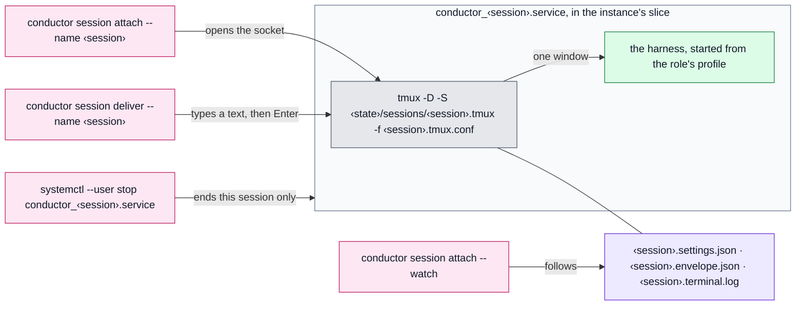

<details>
<summary>plain text</summary>

```text
conductor session attach --name S  ──opens the socket──┐
conductor session deliver --name S ──types a text──────┤
                                                       ▼
conductor_S.service:  tmux -D -S <state>/sessions/S.tmux -f S.tmux.conf
                        └─ one window: the harness, started from the role's profile
files beside the socket:  S.settings.json   S.envelope.json   S.terminal.log ◄── attach --watch
systemctl --user stop conductor_S.service   ends this session and nothing else
```

</details>

Why one server per session:

- A session is one unit: `systemctl --user stop conductor_<session>.service` ends that session and
  nothing else; its cgroup, cpu weight and tasks limit are measured and written to
  `<state>/sessions/<session>.envelope.json` (the box the instance's confinement asked for).
- The socket is the address: `conductor session attach --name <session>` and
  `conductor session deliver --name <session>` open that socket; nothing is shared between two
  sessions and a crashed server takes no other session down.
- The tmux config is per session too (`<session>.tmux.conf`: `exit-empty on`, prefix `C-]`, status
  off, `-x 160 -y 50`), so a session's terminal size and keys cannot be changed from another one.
- Everything typed and printed is kept: `<session>.terminal.log` is the terminal log a watcher reads (today the file is still `<session>.typescript`, the `script` command's default name; the story terminal-log-name renames it), and a
  session started before the tmux launcher can still be followed through it (`--watch`).
- A session's settings file (`<session>.settings.json`) is written at start from the role's
  `settings` and its `read_only_tools`, so the harness reads a file conductor owns, not a shared one.

### Three ways to see the sessions

| view | command | shows |
|---|---|---|
| harness | `claude agents` (`--json` for a script) | every background session of the harness on this host, any directory, any owner: the controllers, the maintainer, the supervisor, the teacher, and sessions nothing of conductor started |
| conductor | `conductor session list` | one line per live session of every instance whose state holds a launcher's files for it: instance, name, repository, attach or watch, state, seconds since the last line |
| dashboard | `http://127.0.0.1:<dashboard_port>` | the instance's repositories, dispatches, decisions, metrics and the plan board |

The harness view is the superset: a session the loop lost (a controller whose unit died, a session
started by hand with `claude --bg`) is in it and not in `conductor session list`. The supervisor
reconciles the two every pass.

### Starting things: the Taskfile

| task | does |
|---|---|
| `task install` | builds and installs the binary; `task profiles` installs `.agents/*.md` into `profiles/` next to the config file |
| `task maintainer:start` | `conductor session start --role maintainer`: the maintainer in its own tmux server and unit |
| `task supervisor:start` | `claude --bg --agent conductor-supervisor -n conductor-supervisor …` in the config directory |
| `task teacher:start` | the same for the teacher |
| `task dashboard`, `task dashboard:stop` | the dashboard unit |
| `task sessions`, `task conductor:attach`, `task maintainer:attach` | list sessions; attach to one |
| `task agents:link REPO=<path>` | links the role adapters into a repository's `.claude/agents/` |

The supervisor and the teacher are not units: they are the harness's own background sessions, read
their 10-line adapter from `~/.claude/agents/<name>.md` and their whole definition from
`profiles/<name>.md`. They have no tmux server, no envelope, no terminal log, and `conductor session
list` does not show them.

### The operator's chat session

The operator works in an ordinary interactive harness session. It is not a role: it talks to the
supervisor (and, when he names one, to the teacher), and it is the place where decisions of his class
are given. A foreign session the operator names (a session he runs by hand in a repository of an
instance) is treated by the supervisor as that repository's owner: the loop starts no controller for
it, and the supervisor reads its MRs and pipelines instead.

### Attaching

```text
conductor session attach                  picker of every instance's sessions: Enter attaches, w watches, q quits
conductor session attach --name <session> one session, read-write
conductor session attach --role maintainer
conductor session attach --watch --name … read-only; also for a session started before the tmux launcher
ctrl-] then d                             detach; the session runs on
```

`claude agents` has no attach: a harness-only session (the supervisor, the teacher) is reached by
message or by `claude logs <id>`.

### What the status quo costs

| friction | measured on 2026-11-07 |
|---|---|
| three start mechanisms (unit, `claude --bg`, hand) | two sessions of one name (`<name>-2`) and a stale resumed id in one day; the rename needs `claude stop` and `claude --bg --resume` |
| the maintainer is a special role in config (`conductor-dev`) and in the host section | its hand-over left 52 local-only commits on 7 branches; no loop rule covered it until wave 45 |
| the supervisor is outside the config | its rules lived in a file under `~/.claude/agents/` until they became a shipped profile; four host scripts were written beside it |
| settings are per instance only | the same thresholds are copied into three instances; a host-wide change is three edits |
| one controller per repository | an instance with 6 active repositories runs 6 model sessions and 6 trees whether or not they have work |
| no custom role | a recurring job (a UI pass every day) has no place but a controller's charter |
| a dashboard per instance | three dashboard units on three ports, one Vue build each, no view across instances but the registry list |
| the store is files in the instance's state directory | an instance can only run where its files are; a remote or boxed instance has no way to keep its records at home |
| instances are installed by hand | `conductor init` and `conductor run --install` per instance; nothing compares the config with what runs |

## Next architecture

The design the operator asked for on 2026-11-07; the reasoning and the planning-store epic are in
`docs/design/architecture-next.md` (`epic:architecture-next`). Each change is a story; all of them land
on the integration branch `v1`, in the order at the end, while v0 keeps shipping from `main`. The whole
system below is modelled in the ESS specification first (`spec/`), and the code is written against what
the specification generates.

### One picture

The host and its instances:

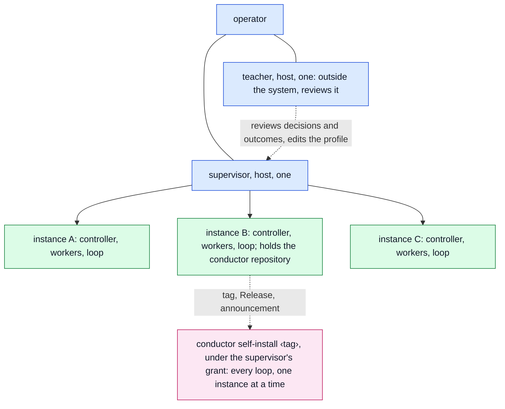

Inside one instance:

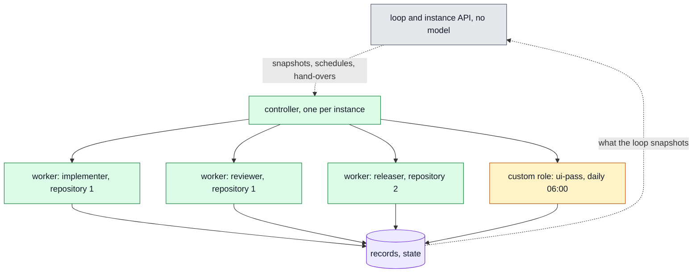

<details>
<summary>plain text</summary>

```text
operator ── chat session ── supervisor (host, one)
                 │             │
              teacher (host, one; outside the system, reviews the supervisor and the outcomes)
                               │
            ┌──────────────────┼──────────────────┐
         instance A         instance B         instance C
            │                  │                  │
         controller         controller         controller        one per instance
         ├ worker            ├ worker            ├ worker         per repository or unit
         ├ worker            ├ worker            └ custom role    on a schedule
         └ custom role       └ worker (releaser) ──► conductor self-install <tag>
            │
         loop (no model), instance API, records, state
```

</details>

| level | one per | role | what it does |
|---|---|---|---|
| host | machine | **teacher** | outside the system, above the supervisor: reviews what the supervisor decided and what the instances delivered, the way an adversarial reviewer reads a finished change; changes the supervisor's profile and files findings; never runs the supervisor's routine itself (operator, 2026-11-07) |
| host | machine | **supervisor** | keeps every instance's loop, controller and workers running; carries findings across instances; decides within its grant; reports to the operator |
| instance | organization | **controller** | the instance's judgement: picks work across the instance's repositories, starts and steers workers, answers requests, merges what passes, escalates |
| instance | organization | **loop** | `conductor instance serve`: snapshots, timers, agent starts, hand-overs, KPIs, the instance API; no model |
| repository or unit | work | **worker** | one job in one tree: plan, implement, review, release; built-in roles |
| any | schedule | **custom role** | a role the config adds: a profile, a scope and a schedule; conductor starts it like any other |

The star stays: a worker talks to its controller, a controller to the supervisor, the supervisor to
the operator. A controller of one instance never messages another instance's sessions.

### The daemon and the APIs

Not every instance comes with a web UI. Each instance has an HTTP API; one daemon on the control
host reconciles the instances from the config, federates their APIs into one global API, and every
UI reads that.

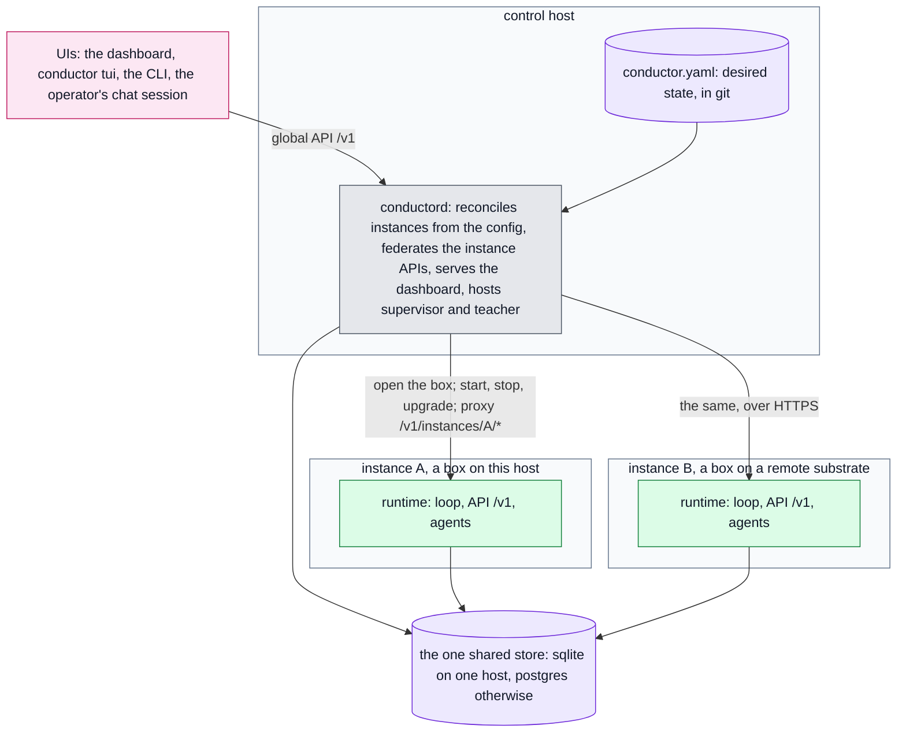

<details>
<summary>plain text</summary>

```text
dashboard ─┐                                         ┌─ instance A, a box on this host ────┐
tui       ─┤                                         │ runtime: loop, API /v1, agents ──┐   │
cli       ─┼─► conductord (control host) ───────────►└──────────────────────────────────┼───┘
chat      ─┘    reconciles instances from config     ┌─ instance B, remote ─────────────┼───┐
                global API /v1, serves the dashboard │ runtime: loop, API /v1, agents ──┤   │
                conductor.yaml (desired state)       └──────────────────────────────────┼───┘
                        │                                                               │
                        └──────────► the one shared store (sqlite or postgres) ◄────────┘
```

</details>

| component | one per | does |
|---|---|---|
| `conductord` | control host | reads the config; opens a box and starts, stops and restarts instance runtimes so that what runs equals what the config says (every `cadence.reconcile`, on a config change, on a lost runtime); serves `/v1/` on `127.0.0.1:<daemon_port>` and on a TLS listener for a dashboard deployed elsewhere; proxies `instances/{name}/*`; federates `sessions`, `decisions`, `unanswered`, `kpis`, `events`, `ask`; serves the dashboard app; starts the supervisor and teacher; opens the one shared store and hands its URL to every runtime |
| instance runtime | instance | `conductor instance serve`: the loop, the instance API on a socket in the box (today's dashboard routes under `/v1/`, plus `agents/{name}/attach`, `deliver`, `restart`), the starter of the controller, workers and custom roles |
| UIs | any number | the dashboard, served by the daemon where the operator controls conductord and, at the same time, deployed in a cluster for colleagues against the daemon's TLS listener (read-only unless the bearer grants more); the TUI; the CLI as an API client; the operator's chat session through the supervisor; the Claude app, for a controller started for Remote Control on its owner's token |

An instance that does not answer is a row with `state: unreachable` and the time it last answered in
every federated view, never an error. `conductor ask` becomes `POST /v1/ask`, delivered to the supervisor,
whose first line names the route.

The instance cluster has several operators, not one (operator, 2026-11-08). Every write on the global
API carries an operator's Identity bearer; an operator has grants (answer decisions, change settings,
start, stop and upgrade instances, purge); every record of an answer, a config change or a
reconciliation names the operator who caused it. The supervisor's "the operator" is whichever operator
the request is routed to, by grant; a class H decision is answered by any operator the grant names.

**Who issued a command: a person or a program.** Every command, event and record carries an actor,
and its type says which it is: a human actor is an operator; an agent actor is an agent conductor
started (its instance, role, name and kind). A grant belongs to a human actor only; a command that
needs one refuses an agent actor by name. The records write `human:<name>` or
`agent:<instance>/<role>/<name>` (operator, 2026-11-08: "we kind of need to distinguish between who is
an agent actor and who is a human actor").

**The daemon on a remote box.** conductord itself can run on a remote machine, a cloud instance the
team shares, with the config repository cloned there (operator, 2026-11-08: "the daemon itself, is
running also on the remote host ... we can connect via API. So this must of course be secured
somehow"). Its only API there is the TLS listener; every client presents an Identity bearer that
`conductor login <daemon url>` obtained and keeps in the client's keychain; `--daemon <url>` names the
daemon a command talks to. The dashboard against it is where the team approves stories and follows
progress: a story approval is a request the controller raises and an operator with the grant answers,
after which the controller moves the story in its repository's planning store.

**Joining an instance, and the token pool.** An engineer joins an instance with `conductor join
<daemon url> --instance <name>`: they log in, the daemon records them as an operator of that instance
with their role's grants, and they contribute their Claude token to the instance's token pool
(operator, 2026-11-08: "some engineer of us is basically joining ... an instance ... and by doing so,
they would basically hand out their token to the pool of Claude tokens. And the agents of kind Claude
Code, they would make use of these tokens"). The pool is a set of secrets with an owner, a seat and a
state each (`ok`, or `limited until <time>`); values stay in the secrets source and reach an agent
only as a sealed slot. A `claude-code` agent leases one token when it starts, runs on it, and after a
usage-limit stop is resumed on another; every agent record names the token's owner. `conductor leave`
withdraws the token and the agents on it move to others; the API lists owners, seats and states,
never values. A controller can be started for Remote Control on a named owner's token, so it appears
in that owner's Claude app (decided 2026-11-08).

### Placements: Substrate, local or remote

conductor implements no sandbox and keeps no confinement code of its own. An instance's `placement`,
overridable per role, names a Substrate daemon (the one on this host, or a remote one by URL), an
adapter and a profile; the daemon and the config stay on the control host. Confinement is one
Substrate contract (ADR 0109); conductor's own systemd units go.

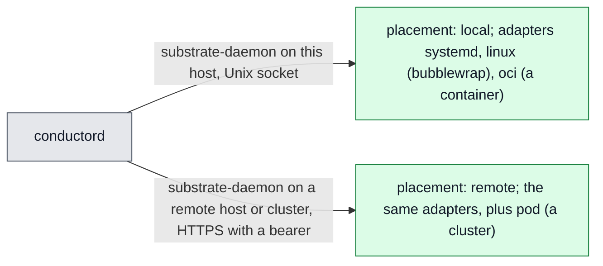

<details>
<summary>plain text</summary>

```text
conductord ──substrate-daemon on this host (Unix socket)──────────► placement: local   (systemd | linux/bubblewrap | oci)
           ──substrate-daemon remote (HTTPS + bearer)─────────────► placement: remote  (the same, plus pod)
```

</details>

| adapter | box | for |
|---|---|---|
| `systemd` | a unit in a slice: cpu weight, memory, tasks; no write fence | today's box, written on purpose |
| `linux` | bubblewrap plus a delegated cgroup: read-only roots, one writable workspace, cpu, memory, pids, storage, default-deny egress with the forge and model hosts | the default |
| `oci` | a container; Docker and Firecracker drivers when substrate ships them | an image per instance |
| `pod` | one pod per box in a cluster | a remote substrate in a cluster |

Every credential an agent needs enters its box as a sealed memory slot, never in argv or env. A
placement that cannot give the box the profile asks for refuses with substrate's name for it; the
instance does not start and the daemon records why; nothing falls back. tmux, attach, deliver and the
terminal log work unchanged inside the box.

### State: four kinds, four homes

Config is desired state and is not in the store; the store keeps what happened, including every
config change.

| kind | examples | lives | authoritative copy | survives the box |
|---|---|---|---|---|
| config | `conductor.yaml`: instances, placements, roles, settings, secret names | with the daemon, in a git repository | the file | yes |
| records (the store) | decisions, dispatches, readings, findings, charters, hand-offs, config changes, reconciliations | in the one shared database of the deployment, through Eventlog's persistence port (ADRs 0041, 0053, 0063) | the database | yes |
| runtime state | agents, sockets, envelopes, leases, terminal logs | inside the box | the box | no; rebuilt from records |
| cache | exports of `origin/main`, build caches | inside the box | none | no |

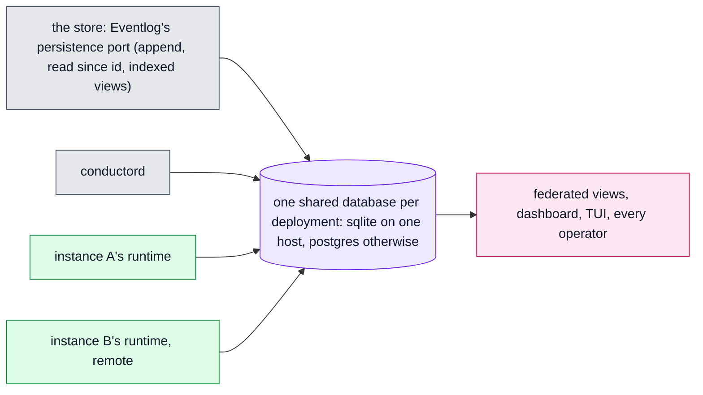

<details>
<summary>plain text</summary>

```text
Eventlog's port (append, read since id, views) ── one shared database (sqlite or postgres) ◄── conductord, every instance runtime ──► views, every operator
```

</details>

One shared database per deployment (operator, 2026-11-08: "with this multi-user, multi-operator
thing, we of course need some shared state database ... it's just one database and it will be
shared"): `daemon.store` names one URL, the daemon opens it and hands it to every instance runtime it
starts, every event names its instance, and every UI and every operator reads the same records. On
one host that is a SQLite file under the daemon's state directory; anywhere else a Postgres server
every box reaches, through Eventlog's own adapters. No copy per instance, no sync, no restore: a lost
box has written nothing the database does not hold. Today's eventlog tree is read once by
`conductor store migrate` and not opened again. Secrets never enter the config: it names them (`secret:<name>`), the
daemon resolves them through the `secrets` crates (the OS keychain on the control host; the Secrets
service where conductord is deployed) and passes them to the placement as sealed slots; an agent's box
holds one slot, a model token leased from the instance's token pool, and forge writes keep going
through the gates route.

### No separate maintainer

conductor's own repository is a repository in one instance's `sources`. Its controller plans and
delivers conductor changes like any other repository's. What was special about `conductor-dev` becomes
two things:

- a built-in worker role `releaser` (version, changelog, tag, forge Release, announcement) that any
  repository can use;
- one daemon route, `POST /v1/instances/{name}/upgrade` under the supervisor's grant: install the
  released binary at the instance's placement, restart the runtime, run `conductor doctor` inside,
  and roll back when the runtime does not answer. The supervisor runs it one instance at a time
  after a release; the operator sees it in the daily brief.

The findings a session files about conductor (`conductor finding file-finding`) go to that
repository's planning store, as today.

### Agent kinds: any program in any role, at any placement

Today every role is a Claude Code session. v1 abstracts that: an agent kind is the program that fills
a role slot and the way conductor starts, feeds, reads and stops it. A role slot is a role, a kind, a
placement, a profile and limits; any combination is allowed when the kind's capabilities cover what
the role needs (operator, 2026-11-08: "any combination possible - so abstract it - but keep exact
behaviour now (claudecode-based)").

| capability | means | needed by |
|---|---|---|
| interactive | a PTY to attach to, a mailbox the runtime delivers into, a hand-over at a context threshold, a terminal log | controller, supervisor, teacher, planner, releaser, custom roles as written today |
| run-to-exit | one unit of work in; an exit code and an events file out; a message to it is a new generation | implementer, reviewer, any worker whose unit is one story |

| kind | capabilities | in v1 |
|---|---|---|
| `claude-code` | interactive | the only kind, with today's behaviour kept exactly: the same files, the same tmux server, the same profile, envelope, terminal log, hand-over and guard; today's session scenarios and tests pass unchanged against it; its token is leased from the instance's token pool, and with a pool of one that is today's one token |
| `takt` | run-to-exit | after v1: `takt run --work aep:<story>`, exits 0 to 9, an events file; as a controller, a takt protocol |
| others (`codex`, a Loom agent turn) | either | named so the abstraction is not shaped for one program; no story |

### Every agent is started by conductor

One start form for every role: `conductor agent start --instance <i> --role <role>`, answered by
the instance's runtime at its placement (the host roles by the daemon, in their own box). For the
`claude-code` kind it writes the settings file, starts one tmux server in the box, measures it and
writes the envelope. `claude --bg`, `task supervisor:start` and the adapters under
`~/.claude/agents/` go away; the harness view (`claude agents`) stays a diagnostic.

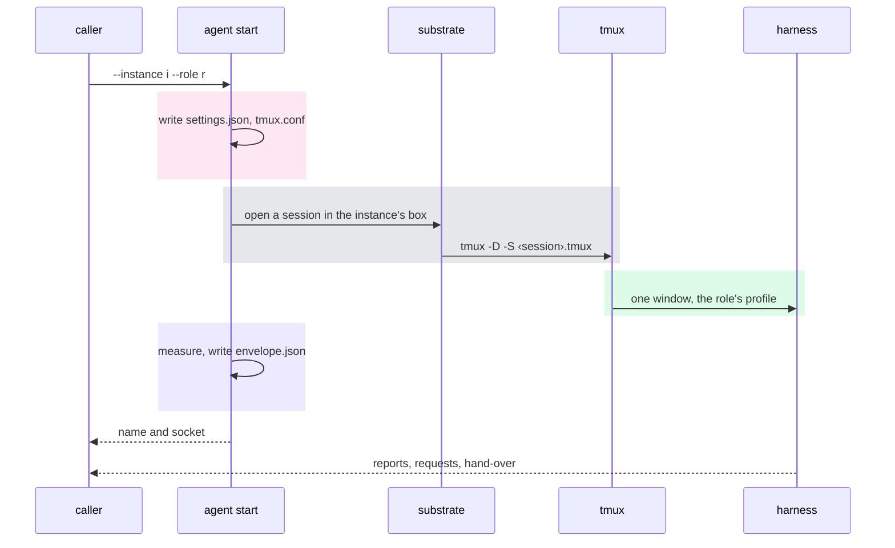

<details>
<summary>plain text</summary>

```text
loop, TUI or schedule ──► conductor agent start --instance i --role r
                            1  write <session>.settings.json and <session>.tmux.conf
                            2  substrate: open a session in the instance's box
                            3  tmux -D -S <state>/sessions/<session>.tmux
                            4  one window: the harness with the role's profile
                            5  measure the box, write <session>.envelope.json
                      ◄──── session name and socket
harness ──► reports, requests, hand-over at the threshold
```

</details>

Rules carried over unchanged: one session per name, a successor only after its predecessor stopped;
hand-over at the context threshold with pushed branches; the terminal log as the record.

### The TUI

`conductor` with no arguments at a terminal (and `conductor tui`) opens a full-screen view built on
tmux: the TUI itself is one tmux client, and entering a session switches that client to the session's
socket, so the session keeps running untouched when the operator leaves.

```text
┌ instances ─────────┬ sessions of <instance> ──────────────┬ settings ───────────────────┐
│ > A   2 dec  K1 ok │ controller   busy  412k  wave/46     │ cadence.cycle        2h     │
│   B   0 dec  K3 !  │ worker repo1 idle   38k  story:x     │ thresholds.disk_low  200G   │
│   C   1 dec  K1 ok │ worker repo2 busy  120k  story:y     │ controllers.max_working 8   │
│   host             │ ui-pass      sched 06:00 daily       │ roles[3].schedule    daily  │
├────────────────────┴──────────────────────────────────────┴─────────────────────────────┤
│ Enter attach  w watch  d deliver  s settings  r restart  l log  k kpis  ? keys  q quit    │
└───────────────────────────────────────────────────────────────────────────────────────────┘
```

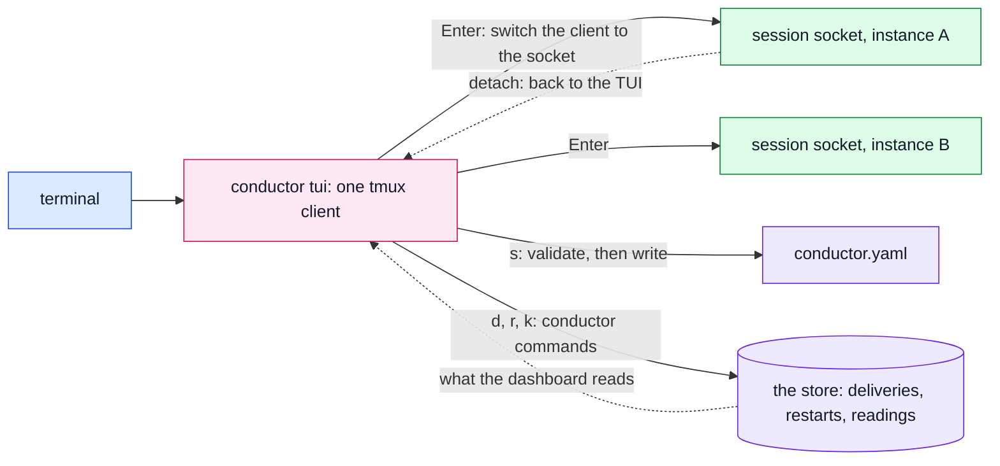

<details>
<summary>plain text</summary>

```text
terminal ── conductor tui (one tmux client)
              ├─ Enter ──► session socket, instance A ── ctrl-] then d ──► back to the TUI
              ├─ Enter ──► session socket, instance B
              ├─ s     ──► validate, then write conductor.yaml
              └─ d r k ──► conductor commands ──► the store ◄── read by the TUI and the dashboard
```

</details>

| key | does |
|---|---|
| `Enter` | attach the selected session (`ctrl-]` then `d` returns to the TUI) |
| `w` | watch it read-only |
| `d` | deliver a text to it (recorded like `conductor session deliver`) |
| `s` | edit the selected instance's or role's settings; the TUI validates and writes the config file, and shows the effective value with the level it comes from |
| `r` | restart the session (hand-over first, then stop, then start) |
| `l` | follow its terminal log (`<session>.terminal.log`) |
| `k` | the instance's KPI readings of the last 7 days |

The TUI reads what the dashboard reads (the store and `<state>/sessions/`) and writes only through
conductor commands, so a thing done in the TUI is a record.

### Settings: global, instance, role

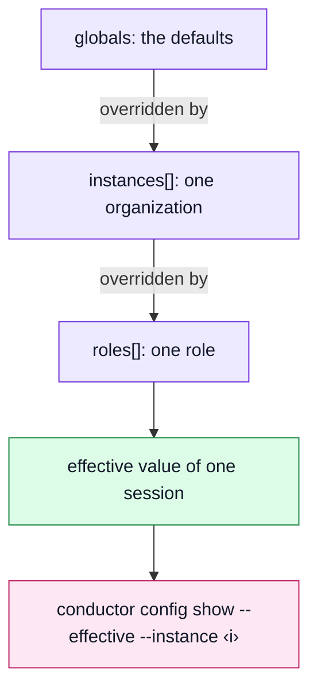

<details>
<summary>plain text</summary>

```text
globals ──overridden by──► instances[] ──overridden by──► roles[] ──► effective value of one session
conductor config show --effective --instance <i>   every key with the level it came from
```

</details>

| level | file section | holds |
|---|---|---|
| daemon | `daemon` | port and TLS listener, `cadence.reconcile`, `store`, the secrets source, the dashboard's served path, the operators and their grants |
| global | `globals` | the defaults every instance starts from: the kind and model per role, cadence, thresholds, limits, retention, the announcement hook |
| instance | `instances[].*` | overrides of any global key; `placement`, sources, checkouts, records, session prefix, the instance's roles |
| role | `roles[].*` (under `globals` or an instance) | kind, profile, model, settings, tools, writable set, network, limits, schedule, placement |

Precedence is role over instance over global. `conductor config show --effective --instance <i>`
prints every key with the level it came from. Today's `instances[].thresholds` keeps working: a key
set on an instance is an override. `PUT /v1/config` validates, writes, commits to the config
repository with caller and reason, records `config-changed` and reconciles.

### Built-in and custom roles

Built-in roles ship with a profile each: `supervisor`, `controller`, `planner`, `implementer`,
`reviewer`, `releaser`. A custom role is one entry in `roles[]`:

```yaml
roles:
  - role: ui-pass
    profile: ~/.b10x/conductor/profiles/ui-pass.md
    model: sonnet
    scope: repository
    repositories: [manager]
    schedule: daily 06:00
    handover: 150k
```

The loop starts it on its schedule (`daily HH:MM`, `every 6h`, `on: release`, `on: red-ci`), one
session at a time, in a tree of its scope, and ends it when its report arrives. A custom role reports
to the controller and can file findings and dispatch requests; it cannot merge. Its profile lives in
the instance's `profiles/`, outside the conductor repository, so a company-specific role never
enters the product.

### Self-improvement over settings

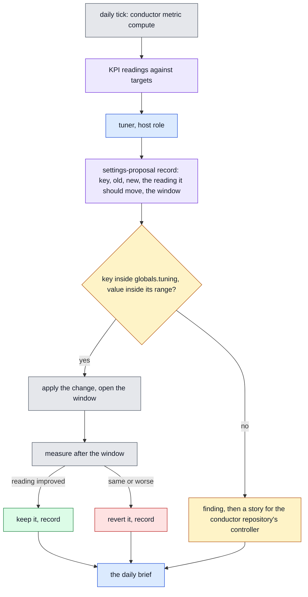

<details>
<summary>plain text</summary>

```text
daily tick ─► KPI readings vs targets ─► tuner ─► settings-proposal (key, old, new, reading, window)
   key inside globals.tuning?
     yes ─► apply, open the window ─► measure ─┬─ improved ──► keep, record ───┐
                                               └─ same/worse ► revert, record ─┼─► the daily brief
     no  ─► finding ─► story for the conductor repository's controller ────────┘
```

</details>

The daily tick computes the KPIs per instance. A built-in host role, `tuner`, runs after it:

1. reads the readings against the targets and the open findings;
2. proposes one settings change at a time as a record (`settings-proposal`: key, old value, new
   value, the reading it should move, the window to measure);
3. applies it when the key is inside the grant in `globals.tuning` (a list of keys with a bounded
   range, for example `cadence.watch: 60s..600s`, `controllers.max_working: 2..8`,
   `thresholds.context_handover: 120k..250k`);
4. measures after the window; keeps it when the reading improved, reverts it otherwise, and records
   both.

A key outside the grant, and anything that touches a profile, becomes a finding and a story for the
conductor repository's controller. The operator widens or narrows the grant in config; he never
sees a proposal inside it except in the brief.

### What v1 removes

The more goes, the better (operator, 2026-11-08). Removed, each replaced by something above:

| removed | replaced by |
|---|---|
| the per-instance dashboard server, its unit and `dashboard_port` | the instance API and the daemon's one dashboard |
| the host registry file and the prefix check against it | instances derived from the config |
| `conductor run --install`, the per-instance run and dashboard units, `task supervisor:start`, `task teacher:start`, `task maintainer:start`, the adapters under `~/.claude/agents/` | the daemon starts every runtime and host role |
| `confinement.provider`, `confinement.mode`, conductor's own systemd and no-op providers | Substrate placements |
| the hard-wired `claude --bg` launcher | the `claude-code` agent kind behind one trait |
| the eventlog tree as a backend, a store per instance | one shared database, SQLite on one host and Postgres otherwise |
| the maintainer role and its separate session | conductor's repository as a repository of one instance, with a releaser |
| the bridge session, per-instance harness config directories and binary pins of the earlier design | the federated API, the box and `instances/{name}/upgrade` |
| a secrets trait of conductor's own | the `secrets` crates |
| Agency, Loom and mantle as placements | nothing: Agency is dropped, Loom and mantle are not confinements; a Loom agent turn may become an agent kind later |

### Read and set aside

Surveyed on 2026-11-07 at each repository's newest commit, so nobody reads them twice; the design's
§12 has the citations.

| candidate | what it is | in v1 |
|---|---|---|
| Agency 0.1.0 | an ESS specification; no service runs; four of the eight gaps conductor filed are not specified | no: dropped; atlas was asked to deprecate its ADR |
| Loom 0.57.2 | a run-once Job in a cluster that reports its exit code; no attach, no message in, no Substrate in the pod | no: a cluster is substrate's `pod` adapter |
| mantle 0.3.1 | a whole session on a remote worker with attach | no: a remote substrate gives the same box as the local one |
| takt 0.34.0 | one case to a named exit (0 to 9) with an events file; no dispatcher; cross-repository work deferred to conductor | after v1: the first run-to-exit agent kind |
| substrate 0.16.1 | adapters `local`, `linux`, `macos`, `systemd`, `oci`, `pod`; a daemon over a socket or HTTPS; sealed secret slots; named refusals | yes: the only placement |
| secrets 0.6.0 | a storage port with the OS keychain and the Secrets service as backends, routed per namespace | yes: the secrets source |

### The integration branch and the order of work

Nothing merges into `main` until the cutover: v0 ships from `main` while v1 is built on the branch
`v1` (operator, 2026-11-08: "a new integration branch in which all of the stories can go active,
but not merge to default branch yet ... its basically v0 -> v1"). Every story lands on `v1` through
its own pull request with its own gate; the fork is tried on a scratch instance, never on the live
one.

| step | story | what lands on `v1` |
|---|---|---|
| 0 | spec-v1 | the whole system above modelled in `spec/`: new domains for instances, placements, agents, the store, secrets, operators and the token pool; the actor type (human or agent) on every command; the changed config and improvement domains; the components; one scenario per new command; the generated model |
| 1 | daemon-reconcile | `conductor daemon serve`: reconcile, instances, reconciliations; the registry file gone |
| 2 | instance-api | `conductor instance serve` with `/v1/` on its socket; the daemon proxies, serves the dashboard at `/` and on the TLS listener; the per-instance dashboard server gone |
| 3 | federated-views, tui-readonly | the federated routes; `conductor tui` read-only with attach |
| 3a | daemon-remote | the daemon as a system unit on a remote box; the TLS listener with Identity bearers as its only API; `conductor login`, `--daemon <url>`; the dashboard, the TUI and the CLI against it from a workstation |
| 4 | config-globals | `conductor.config/2`: levels, precedence, `config show --effective`, `PUT /v1/config`, `config migrate`, operators and grants |
| 5 | store-shared | the one shared database through Eventlog's SQLite and Postgres adapters; its URL handed to every runtime; `store migrate` from the tree |
| 6 | agent-kinds | the agent trait with `claude-code`; today's session scenarios and tests pass unchanged; the `agents/*` routes |
| 7 | placement-substrate-local, secrets-source | a local substrate box per instance and per agent; slots from the keychain |
| 7a | token-pool | `conductor join` and `leave`; the instance's token pool in the secrets source; a `claude-code` agent leases a token at start and is resumed on another after a limit stop; owners on every agent record; the controller for Remote Control on a named owner's token |
| 8 | placement-substrate-remote | a remote daemon over HTTPS with a bearer; attach as a stream |
| 9 | host-roles-by-daemon, instance-upgrade | the supervisor and teacher started by the daemon; the maintainer retired; `instances/{name}/upgrade` with rollback |
| 10 | tuner | the grant, empty, and the TUI's settings editor inside it |
| any | terminal-log-name | `<session>.terminal.log` |
| cutover | | the live instance moves to `v1` once, reversible by `main`'s binary and units; `v1` merges into `main` after the cutover has held for one day; the release is 1.0.0 |

### Decided

| question | answer |
|---|---|
| teacher: own role or part of the supervisor? | its own role, above the supervisor, outside the system like an adversarial review (operator, 2026-11-07: "the teacher should clearly be its own role, and it should just be above the supervisor. It's just like the concept of adversarial review. So we're stepping out of the system and then reviewing it from there") |
| merge step by step, or one fork? | one integration branch, `v1`, where every story goes active; no merge into `main` until the cutover; v0 keeps shipping (operator, 2026-11-07 and 2026-11-08) |
| Agency, Loom, takt? | Agency dropped ("forget entirely about agency, it was just a design"); Substrate for local and remote confinement (bubblewrap, Docker, Kubernetes); agents abstracted, any kind in any role at any placement, with today's Claude Code behaviour kept exactly (operator, 2026-11-08) |
| a remote instance's store? | first "remote -> sqlite, local too - with sync", then superseded the same day: one shared database per deployment, SQLite on one host and Postgres otherwise, no copy per instance and no sync ("with this multi-user, multi-operator thing, we of course need some shared state database ... it's just one database and it will be shared", 2026-11-08) |
| the dashboard: served by the daemon or deployed separately? | both at the same time: served by the daemon where the operator controls conductord, and deployed in a cluster for colleagues (2026-11-08) |
| the secrets source? | the `secrets` crates: the OS keychain locally, the Secrets service remotely (2026-11-08) |
| the first tuning grant? | empty; the operator writes keys into it (taken as the reversible default, 2026-11-08) |
| how many operators? | several: operators with Identity bearers and grants; every record names its operator (2026-11-08) |
| which stories go active? | all of the epic's, on `v1` (2026-11-08) |
| the daemon on a remote box; how engineers join? | conductord runs on the shared box too, behind its TLS listener with Identity bearers; an engineer joins an instance and contributes their Claude token to its pool, which `claude-code` agents lease from (2026-11-08) |
| the Claude app as a UI? | yes: a controller started for Remote Control on a named owner's token from the pool appears in that owner's Claude app (2026-11-08) |
| who issued a command: a person or a program? | told apart by type on every command, event and record; a grant belongs to a human actor only (2026-11-08) |

### Open question for the operator

Does the controller keep a tree per repository, or work through the workers' trees only? Example: an
instance with the repositories `loom` and `takt`; the controller (one Claude Code session in the
instance's box) must decide what takt works on next and whether a finished story holds.

| option | the controller has | it can | it costs |
|---|---|---|---|
| A | a full worktree per repository, as every repository controller has today | read code, list the planning store, run the tests itself to check a claim | one checkout plus one build directory per repository per instance |
| B (default) | read-only exports of each repository's `origin/main`, no build directory | read code and the planning store, plan, judge diffs; a check it wants is a worker's job | one export per repository, refreshed by the loop's fetch |
| C | nothing | read the forge and the shared store only; every look at code is a worker it starts | the cheapest box; a controller that asks a worker for every fact |
