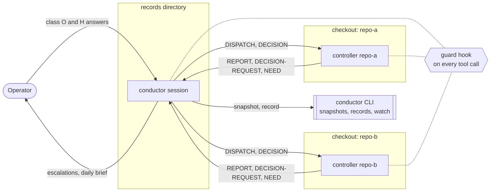

Conductor runs one AI coding session per repository and coordinates them from one place. A
conductor session reads the state of every repository, briefs each repository's controller and
decides the routine questions the controllers raise. Architecture, credentials, spending and
anything public go to a person, the operator. Every tool call of conductor and its controllers
passes a guard hook that keeps each controller's edits and messages inside its own repository and
records every refusal. The guard catches mistakes; it is not a sandbox.

Conductor has two parts: the background sessions, which run on Claude Code today, and the
`conductor` CLI, which reads the repositories into snapshots, keeps the records of what conductor
decides and dispatches, and is the guard hook.

## How it works

1. **Sense.** `conductor snapshot start-snapshot` reads every repository of the instance: git
   state, pull requests, `main` CI, releases, open planning blockers, specification status and
   live sessions. A snapshot completes only when every collector answered.
2. **Decide.** Conductor compares the snapshot with its goals and answers the decision requests
   controllers send. Routine ones (class C) it decides and records; the rest go to the operator.
3. **Dispatch.** Conductor sends each controller a brief. A controller works only in its own
   repository and talks only to conductor ([roles](./concepts/roles.md)).
4. **Guard.** Every tool call of conductor and the controllers passes
   `conductor guard record-guard-decision`, which allows it or denies it with a reason, and records
   each denial.
5. **Watch.** Between cycles, `conductor watch run --follow` wakes conductor when a session exits
   or fills its context, when `main` CI changes colour, or when disk runs low
   ([the loop](./concepts/the-loop.md)).

## What you keep control of

| | |
|---|---|
| **Decision classes** | Class C (routine: waves, merges, CI repair, upgrades) conductor decides and records. Class O (only what cannot be undone: data loss, a history rewrite) the operator decides; everything else conductor decides on the option that can be undone and reports as taken. Class H (setting a secret, a login, an account) needs the operator's hands. The store refuses a class-O or class-H decision recorded as conductor's ([decision classes](./concepts/decisions-and-messages.md)). |
| **The authority grant** | Conductor decides class C only within the instance's `authority.class_c` and the grant the operator writes down in the instance's `rules.md`. |
| **Reversal** | The operator answers escalations and may reverse any decision; conductor may reverse only its own. |
| **Pause and stop** | A repository can be marked Inactive, so conductor leaves its issues and pull requests alone ([add a repository rule](./guides/add-a-repository-rule.md)). `conductor controller pause-controller` and `stop-controller` record a pause or a stop; they do not end the session yet. The sessions are ordinary Claude Code background sessions, which `claude stop` ends. |

## Guarantees in short

- Every tool call of a guarded session reaches the guard. A missing `conductor` binary blocks the
  call; an unreadable payload denies it; a tool with no rule and not on a read-only list is denied.
- A controller's file edits stay in its checkout, its managed worktrees and its scratch; it never
  writes the records, the config or any settings file. Its messages go only to its own conductor.
- Every denial is recorded with the repository, session, tool, target and reason.
- The records are append-only: one immutable file per event, and a changed committed record is
  refused.

What is enforced in code, what is only instructed in the profiles, and what is not covered at all
is in the [security overview](/docs/security/overview).

## What it is not

- **Not a sandbox.** The Bash rules are a heuristic: they deny some forms but do not bound where a
  shell command writes, and the guard is no defence against a hostile prompt in an issue or pull
  request a controller reads. `git push` and `curl` to a forge API are not checked.
- **Not unattended-safe by default.** Every session runs Claude Code with
  `--permission-mode bypassPermissions`; the guard is its only check. Run it under an account whose
  reach you accept, with branch protection and scoped tokens on the forge.
- **Not a planner for a repository.** Each controller plans its own repository in its own planning
  store; conductor holds the cross-repository plan only.
- **Not a copy of the forge.** Code, issues, pull requests, CI and releases stay with the forge.
  Conductor's records hold decisions, dispatches, goals, controllers, messages, guard verdicts and
  snapshots.
- **Not an editor of other repositories.** Conductor never edits a repository; a controller does,
  in its own checkout.

## Status at a glance

Conductor is early, and nothing is released as stable. The snapshot, the decision and dispatch
records, the guard, the watch and the dashboard are shipped. Starting a controller session from
the CLI, a lease that stops two conductors running at once, and an operating-system sandbox are
planned. [Status](/docs/status) lists every capability with the test that holds it.

## Neighbours

| component | relation |
|---|---|
| [ESS](https://beyond10x.github.io/ess/) ([GitHub](https://github.com/beyond10x/ess)) | Conductor's nouns and commands are an ESS specification; the CLI's model crate is generated from it. The specifications collector runs `ess` against each repository's specification. |
| [AEP](https://beyond10x.github.io/ecosystem/aep/) ([GitHub](https://github.com/beyond10x/aep)) | Each repository's planning store. Controllers plan and deliver through it; the blockers collector reads open blockers with `aep plan workspace list`. |
| [Eventlog](https://beyond10x.github.io/ecosystem/eventlog/) ([GitHub](https://github.com/beyond10x/eventlog)) | Conductor's store is an eventlog tree store: one stream per record, one immutable file per event. |
| [Worktree](https://beyond10x.github.io/ecosystem/worktree/) ([GitHub](https://github.com/beyond10x/worktree)) | Managed worktrees beside each checkout. The guard treats a repository's managed worktrees as its own; the dashboard reads `worktree` cleanup dry-runs. |
| Gates ([GitHub](https://github.com/beyond10x/gates); no documentation site yet) | Common security and privacy checks. Conductor's own gate scans every tracked file with `b10x-gates` when a policy is configured. |

## Where to go next

- [Getting started](./getting-started.md): install the CLI, check its programs, write a config,
  take one snapshot.
- [Security overview](/docs/security/overview): read it before you start sessions on repositories
  you care about.
- [Roles](./concepts/roles.md) and [the loop](./concepts/the-loop.md): how the sessions divide
  the work.
- [Configure an instance](./guides/configure-an-instance.md),
  [initialise the records](./guides/initialise-the-records.md) and
  [start conductor](./guides/start-conductor.md): run it for real.
- [Troubleshoot](./guides/troubleshoot.md) when a start or a snapshot is refused.
- [The CLI reference](/docs/reference/cli) and [the config reference](/docs/reference/config).
