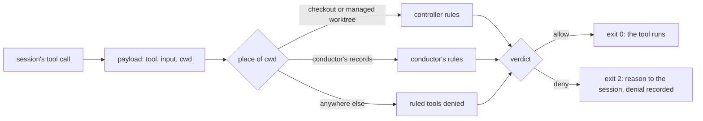

Conductor starts Claude Code sessions with `--permission-mode bypassPermissions`, so no tool call
waits for a person. **The guard is the only check on what a session's tools do.** Read this page
before you start sessions on repositories you care about.

## At a glance

A guarded session starts with a settings file that wires one PreToolUse hook on every tool,
`conductor guard record-guard-decision --from-pre-tool-use || exit 2`. The guard finds the place
the session runs in from the call's working directory, applies that place's rule, and answers
with an exit code. A denial is recorded in conductor's store. An allowed call is not.

Around the guard, code also decides how a session starts ([sessions](/docs/security/sessions)),
who may write through the daemon and as whom ([operators and credentials](/docs/security/operators-and-credentials)),
which decisions the store accepts, and what the config file may hold. Everything else is written
in the role profiles and asked of the model ([limits](/docs/security/limits#enforced-in-code-and-asked-of-the-model)).

## Threat model

### What is protected

| asset | what could go wrong |
|---|---|
| checkouts | a controller writes, deletes or commits in another repository's checkout, or a worker in the wrong worktree |
| the forge | a session merges, closes, comments, releases or changes settings on GitHub or GitLab without the decision behind it |
| credentials | a session sets, reads out or replaces a secret, a token, an SSH or GPG key, or a login |
| records | a session rewrites conductor's decisions, dispatches or charters, its config, or the files that wire the guard |
| the operator's authority | a session answers for the operator, or a write through the daemon is recorded as someone who did not make it |

### Who acts

- **A model making mistakes.** The main case. A controller that loses track of its working
  directory, edits the wrong file, merges on its own, or messages another repository's controller
  is stopped with a reason it can act on.
- **Hostile text in issues and pull requests.** A controller reads text other people wrote, which
  can tell the model to run a command. The guard narrows the file tools, `gh`, `glab` and
  messages. It does not confine where a shell command writes, so it is no defence against a
  hostile prompt. Limit what the session's user and forge token reach
  ([hardening](/docs/security/hardening)).
- **A compromised repository hook.** Every session loads the user, project and local settings, and
  `conductor trust` marks every checkout as a trusted workspace. A repository's own `.claude/`
  settings and hooks therefore run in its controller's session, with the user's rights. A hook is
  not a tool call, so the guard does not see it.

### Out of scope

- The operator, and anyone who can log in as the user the sessions run as.
- The host, the operating system and the user account. Agent sessions run unboxed. An instance's
  runtime runs in a substrate box only when its `placement` names an adapter
  ([sessions](/docs/security/sessions#boxes-slices-and-limits)).
- The harness (Claude Code), the model provider, the forge and the Identity service.
- Data leaving through the network: `WebFetch` is allowed, and so is any network call a shell
  command makes.

## The five guarantees

1. **Every tool call of a guarded session reaches the guard, and an unknown tool is denied.** The
   hook is wired on the matcher `*`. Six tools have rules, 24 read-only harness tools are
   allowed, a role may name more, and every other tool, MCP tools included, is denied. A missing
   binary, an unreadable payload or a crash denies the call.
2. **File tools stay in their place.** A controller's Edit, Write and NotebookEdit land only in
   its repository's checkout, its managed worktrees or its scratch. Conductor's land only in its
   records or its scratch. Paths are resolved, links included, before the comparison.
3. **No session writes what configures it.** No file tool writes a `.claude/` settings file, a
   role's settings or profile file, or, for a controller, conductor's config or records. A Bash
   command that names one of them and holds a write form is denied too.
4. **Forge writes and messages are narrowed.** `gh` and `glab` only read, but for the bot route
   and, under `forge.route: direct`, the session's own pull or merge requests. A credential write
   is class H under every route and handed to the operator. A controller messages only its own
   conductor and its own sub-agents.
5. **Conductor cannot take the operator's decisions as its own.** `decision
   record-conductor-decision` refuses a class O or H decision (`ReservedForOperator`). The
   operator's commands refuse an agent actor (`ActorNotHuman`), and a write through the daemon
   needs a person holding its grant. A `claude --bg` session's commands record as the Unix user
   today ([actors](/docs/security/operators-and-credentials#actors)).

**The guard does not confine where a shell command writes, and does not check `git push`.** A
controller's Bash can write, overwrite or delete any file its user can, through a command the
heuristic does not recognise, and push to any branch its credentials reach. Branch protection and
a scoped token are the controls for that ([limits](/docs/security/limits)).

## The pages of this section

| page | covers |
|---|---|
| [The guard](/docs/security/the-guard) | how it decides, tool by tool and role by role |
| [Sessions](/docs/security/sessions) | how a session starts, its settings and profile, and what runs in a box |
| [Operators and credentials](/docs/security/operators-and-credentials) | actors, grants, login, dashboard writes, the token pool, secrets |
| [Audit trail](/docs/security/audit-trail) | what is recorded and how to read it |
| [Known limits](/docs/security/limits) | what is not covered, and what to do about it |
| [Hardening](/docs/security/hardening) | a checklist for a deployment |
