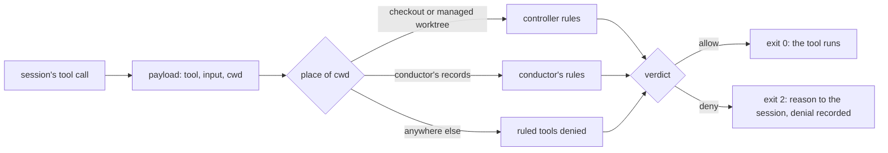

Conductor starts Claude Code sessions with `--permission-mode bypassPermissions`. No tool call
waits for a person. That is what lets conductor and its controllers work unattended, and it is
why this section exists: **the guard is the only check on what a session does.** Read this page
before you start sessions on repositories you care about.

## At a glance

Every session conductor starts loads a settings file that wires one PreToolUse hook on every
tool: `conductor guard record-guard-decision --from-pre-tool-use || exit 2`. The harness sends
the hook a description of the call, the payload. The guard finds the place the session runs in
from the payload's working directory: a repository's checkout or managed worktrees (the
controller rules), conductor's records (conductor's rules), or neither. It applies the rule for
that place and that tool, and answers with an exit code: 0 allows the call, 2 blocks it with one
line of reason that the session reads. A denial is recorded in conductor's store; an allowed call
is not.

Around the guard sit a few other checks in code: how a session is started
([confinement](/docs/security/confinement)), which decisions the store accepts from conductor,
and what the config file may hold. Everything else is written in the role profiles and asked of
the model.

## Threat model

### What is protected

| asset | what could go wrong |
|---|---|
| checkouts | a controller writes, deletes or commits in another repository's checkout, or a worker in the wrong worktree |
| the forge | a session merges, closes, comments, releases or changes settings on GitHub or GitLab without the decision behind it |
| credentials | a session sets, reads out or replaces a secret, a token, an SSH or GPG key, or a login |
| records | a session rewrites conductor's decisions, dispatches or charters, its config, or the files that wire the guard, and so changes what it is allowed to do |

### Who acts

- **A model making mistakes.** The main case the guard is built for. A controller that loses
  track of its working directory, edits the wrong file, runs `gh pr merge` on its own, or
  messages another repository's controller is stopped with a reason it can act on.
- **Hostile text in issues and pull requests.** A controller reads issues, pull requests and
  comments written by other people. That text can tell the model to run a command (prompt
  injection). The guard narrows what such a command can do through the file tools, `gh` and
  messages, but it does not confine where a shell command writes. It is no defence against a
  hostile prompt. Limit what the session's user and forge token can reach
  ([hardening](/docs/security/hardening)).
- **A compromised repository hook.** Sessions load project settings
  (`--setting-sources project,local`), and `task trust` marks every checkout as a trusted
  workspace. A repository's own `.claude/` settings and hooks therefore run in its controller's
  session, with the rights of the session's user. A hook is not a tool call, so the guard never
  sees what it does.

### Out of scope

- The operator, and anyone else who can log in as the user the sessions run as.
- The host, the operating system and the user account themselves. There is no operating-system
  sandbox and no resource limit yet.
- The harness (Claude Code), the model provider and the forge.
- Data leaving through the network: `WebFetch` is allowed, and so is any network call a shell
  command makes.

## The five guarantees

1. **Every tool call of a guarded session reaches the guard, and an unknown tool is denied.**
   The hook is wired on the matcher `*`. Six tools have rules, 24 read-only harness tools are
   allowed, a role may name a few more, and every other tool, an MCP server's tools included, is
   denied. A missing binary, an unreadable payload or a crash denies the call.
2. **File tools stay in their place.** A controller's Edit, Write and NotebookEdit land only in
   its repository's checkout, its managed worktrees or its scratch; conductor's only in its records
   or its scratch. Paths are resolved, links included, before the comparison.
3. **No session writes what configures it.** No file tool writes a `.claude/` settings file, a
   role's settings or profile file, or (for a controller) conductor's config or records. A Bash
   command that names one of them and holds a write form is denied too.
4. **Forge writes and messages are narrowed.** No guarded session runs a `gh` call that writes;
   a credential write (`gh secret`, `gh auth`, `gh ssh-key`, `gh gpg-key`) is class H and handed
   to the operator. A controller messages only its own conductor and its own sub-agents.
5. **Conductor cannot take the operator's decisions as its own.** The store refuses a class O or
   class H decision recorded as conductor's. An operator decision has its own command, which
   conductor's session may still run to record an answer the operator gave it; the record names
   the session that wrote it (`recorded_by`) and the operator's words. The Decisions page records
   his answers itself, as `recorded_by` `dashboard`
   ([below](#the-decisions-page-writes)).

**The guard does not confine where a shell command writes, and does not check `git push`.** A
controller's Bash can write, overwrite or delete any file its user can, through a command the
heuristic does not recognise, and can push to any branch its credentials reach. Branch
protection and a scoped token are the controls for that ([limits](/docs/security/limits)).

## The Decisions page writes

The dashboard (`conductor dashboard serve`) reads, with one exception: on its Decisions page the
operator answers open escalated requests and sends them as a batch, `POST /api/answers`. Each
answer is recorded as his decision (`decided_by` Operator, `recorded_by` `dashboard`, his words or
"chosen on the Decisions page") and its request moves to Answered, through the same path
`conductor decision answer-escalated-as-operator` takes when conductor relays an answer. The
server takes a batch only:

- on `127.0.0.1`, naming the server's own `Host`, from its own `Origin` (or none, with
  `Sec-Fetch-Site: same-origin`);
- with the token the page was served with: 32 random bytes minted when the server starts, put in
  the page's `<meta name="conductor-token">`, sent back in `X-Conductor-Token` and compared in
  constant time. It is never logged, echoed or set as a cookie;
- as `application/json`, with a `Content-Length` of at most 64 KiB and no chunked body, and at
  most 50 answers;
- for open escalated requests, each choice fitting its request's kind and lettered options. A
  request answered or withdrawn meanwhile is refused and records nothing.

The guard denies a Bash call of conductor or a controller that names `/api/answers` or posts to
the dashboard's port ([the guard](/docs/security/the-guard#bash-and-monitor)).

**Residual risk.** The boundary keeps a page from another site and a careless session out; it does
not keep out a local process. Anything running as the operator's user, or able to reach
`127.0.0.1` and read the page, can read the token from `/` and post answers, and **whoever holds
the token is recorded as the operator**. The guard's check is a substring test, a speed bump and
not a boundary: a script a session writes and then runs, a port or path held in a variable, or a
percent-encoded path gets past it. A session that writes and runs such a script is outside what
the guard confines (it does not confine where a shell command writes). Treat the dashboard's port
like the operator's terminal: do not forward it, and do not run the dashboard where another user
can reach `127.0.0.1`. The decision log names `recorded_by` `dashboard` on every answer sent this
way, so an answer the operator did not give can be found and reversed
(`conductor decision reverse-operator-decision`).

## Enforced in code, and asked of the model

| enforced in code | asked of the model (profiles only) |
|---|---|
| the guard decides every tool call of a session started with its settings file | starting each controller with the settings file and `--setting-sources project,local` (`conductor controller start-controller` records a controller; it does not start a session yet) |
| unknown tools and MCP tools are denied unless a role's `read_only_tools` names them | keeping a role's `read_only_tools` to tools that only read |
| file tools confined to the session's place; settings, profiles, config and records protected | Bash writes outside the session's own repository |
| `cd`, `pushd`, `git -C` into another repository or the records denied (a heuristic) | `git push` only through the repository's own route |
| `gh` writes denied; credential writes class H | commits and pushes through the bot route |
| a controller runs only `conductor`'s read commands | one controller session per repository (the store keeps one running controller record per repository; it does not stop a second session) |
| a controller messages only its conductor and its own sub-agents | message format and length |
| the store refuses class O and H decisions recorded by conductor | asking for a build slot when disk is low |
| the dashboard takes answers only with its page's token, from its own origin, as JSON; a Bash call that posts to it is denied (a heuristic) | relaying only the operator's own words with `answer-escalated-as-operator` |
| the config file refuses a value that looks like a token, and never prints it | handing a session over before its context runs out |
| `task conductor:start` refuses while a session of that name runs | not starting or resuming a conductor by hand |

The pages of this section:

- [The guard](/docs/security/the-guard): how it decides, tool by tool and role by role.
- [Confinement](/docs/security/confinement): how a session is started and what bounds it.
- [Audit trail](/docs/security/audit-trail): what is recorded and how to read it.
- [Known limits](/docs/security/limits): what is not covered, and what to do about it.
- [Hardening](/docs/security/hardening): a checklist for a deployment.
